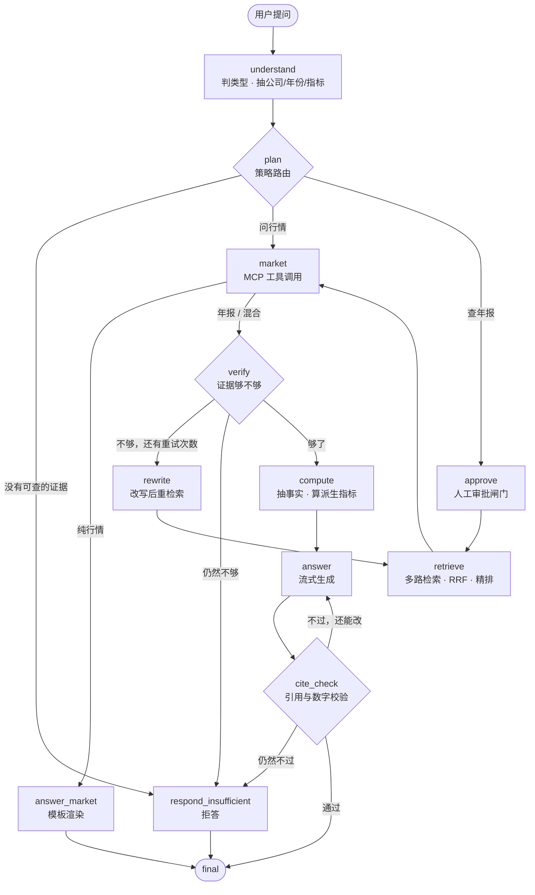

# 金融研报智能分析 Agent

把上市公司年报 PDF 变成**能追问、能核对、能拒答**的问答系统。

上传一份年报，它会按版面解析、按父子结构切块、建向量与中文全文索引；提问时走多路召回 + 融合 + 精排，答案里每个结论都带 `[E1]` 这样的引用编号，能点回原文页码；证据不够时它直接说不够，不编。

> 这不是又一个「切片 + 向量库 + 拼 prompt」的 RAG demo。项目的核心命题是：**答案里的数字必须能回到原文**。为此答案之后还有一层数字回查，对不上就重答或拒答。

| | |
| --- | --- |
| 语言 / 框架 | Java 21 · Spring Boot 4.0.8 · Spring AI 2.0.1 |
| 存储 | PostgreSQL 16.15 + pgvector 0.8.7 + zhparser 2.4 |
| 编排 | LangGraph4j 1.9.7（状态图 + PostgreSQL 检查点） |
| 前端 | Vue 3.5 · Vite · Element Plus · Pinia |
| 模型 | 阿里云百炼：qwen-plus · text-embedding-v4（1024 维）· qwen3-rerank |

## 目录

- [它能做什么](#它能做什么)
- [亮点](#亮点)
- [技术栈](#技术栈)
- [架构](#架构)
- [本地跑起来](#本地跑起来)
- [怎么用](#怎么用)
- [项目结构](#项目结构)
- [注意事项](#注意事项)
- [已知限制](#已知限制)
- [文档](#文档)

## 它能做什么

| 能力 | 说明 |
| --- | --- |
| **文档入库** | 上传 PDF → 版面解析 → 父子块切分 → 向量化 → 可检索。全程异步，进度可见，失败可重试；同一文件按 `content_hash` 幂等，重复上传 0 秒返回。 |
| **混合检索** | 向量（pgvector）、中文全文（zhparser + tsvector）、精确子串（pg_trgm）三路并行召回，RRF 融合后按配额分配给「车道」，再走精排。 |
| **Query Understanding** | 判断问题类型（事实查询 / 跨年对比 / 归因解释 / 拒答类），抽取公司、年份、指标；规则优先，规则不中才问模型。 |
| **检索改写** | 「那净利润呢」这类追问会结合对话上下文补全成完整检索语句，并且补全到的年份 / 公司会回填到执行状态里。 |
| **证据闸门** | 三道校验判断「够不够答」：命中条数、目标指标是否真的出现在证据里、归因类问题是否有归因证据。不够先回环重检索一次，仍不够就拒答。 |
| **事实层与计算** | 从表格单元格抽结构化事实（营业收入、净利润、毛利率…），派生出同比、占比、两年对比，全部是代码算的，不让模型「心算」。 |
| **引用与数字校验** | 正文里每个数字都要能在被引用的块里找到，或者是系统算出来的派生值；引用编号必须与证据一一对应。 |
| **拒答** | 没证据就说没证据，且是模板化文案，不花一次模型调用去「编一个礼貌的拒绝」。 |
| **人工审批** | 高风险问题在检索前停下来等人确认；确认后从检查点继续，不是从头跑。 |
| **实时行情** | 市值、股价、PE、PB、涨跌幅、历史 K 线，通过独立的 MCP Server 取；纯行情问题走模板渲染，混合问题单独标注「实时行情 + 时间」。 |
| **多轮与记忆** | 会话历史、上下文补全、长期偏好（例如「结论先给数字」），记忆只影响表达风格，不产生引用。 |
| **多租户与授权** | 租户隔离 + 文档级 ACL（`document_grant`）+ 管理后台；身份只从 Bearer token 推导。 |

## 亮点

**1. 答案里的数字都能回查。** 生成完不是直接返回：`ground()` 会扫正文里所有数字，逐个到被引块的原文里找，找不到就看它是不是派生值（同比、占比、求和）。全部对不上 → 重答一次 → 还不行 → 拒答。这一层在真实语料上抓到过「引用是真的、数字是编的」。

**2. 拒答是确定性的，不是模型的心情。** 三道闸门（条数 / 目标指标是否出现 / 归因证据）在代码里判，拒答文案是模板。同一个问题问十遍，答不出来就是答不出来。

**3. 事实层用代码算，不让模型心算。** 表格里的数字先抽成 `financial_fact`（带页码、块号、单位），同比和占比用 BigDecimal 算。模型只负责组织语言。

**4. 检索全过程可解释。** 每条车道都记 trace：Dense / Sparse 各召回几条、RRF 后名次、精排分数、各段耗时。前端「诊断」面板直接展开——这是整个项目里最难造假的部分。

**5. 图编排 + 检查点。** LangGraph4j 12 个节点，`plan` 之后可以在 `approve` 停下等人；恢复是从 PostgreSQL 检查点接着跑，审批超时也有兜底。

**6. 中文检索不引 Elasticsearch。** 一个 PostgreSQL 同时承担向量（pgvector）、中文全文（zhparser + GIN）、模糊子串（pg_trgm）。少一套中间件，也就少一致性问题：元数据和向量同表同事务，切换 chunk 版本才能做到原子。

**7. 成本可控。** 每轮问答通常只有 1~2 次大模型调用（Query Understanding 0~1 次 + 答案生成 1 次），其余全是确定性逻辑。最复杂的跨年对比问题实测 18 次模型 API（含 8 次向量化、8 次精排）。

**8. 行情不污染证据链。** 行情来自独立 MCP Server 子进程，单独两个节点，模板渲染，不参与 `[E]` 编号——价格和时间戳必须逐字准确，不能交给模型复述。

**9. 每个阶段都有实测数字。** 不是「写完了」，而是「跑通了、延迟多少、命中多少、踩了什么坑」。见 [`docs/阶段开发日志.md`](docs/阶段开发日志.md)。

## 技术栈

| 层 | 选型 | 为什么是它 |
| --- | --- | --- |
| 语言 / 框架 | Java 21 · Spring Boot 4.0.8 · Spring AI 2.0.1 | 项目目标之一是学 Spring AI 的 RAG 全家桶：`ChatClient`、`EmbeddingModel`、`VectorStore`、MCP |
| 数据库 | PostgreSQL 16.15 | 业务表、向量、全文索引、LangGraph 检查点都放一个库；向量与元数据同事务 |
| 向量检索 | pgvector 0.8.7 | 不额外引向量数据库；1024 维，HNSW 索引 |
| 中文分词 | zhparser 2.4（SCWS） | 本地可装、直接产出 `tsvector`，与 GIN 索引原生配合 |
| 图编排 | LangGraph4j 1.9.7 + postgres-saver | 状态图 + 检查点，人工审批（interrupt）与崩溃恢复都靠它 |
| 迁移 | Flyway（V1 ~ V20） | schema 只有一个来源，禁止手工改库 |
| 解析 | Python 3 + Docling 2.x | 版面与表格还原成 Markdown 明显好于纯文本抽取；独立进程，崩了不影响主服务 |
| 模型 | 百炼 qwen-plus / text-embedding-v4 / qwen3-rerank | 中文效果好、OpenAI 兼容协议，Spring AI 直接接 |
| 前端 | Vue 3.5 · Vite · Element Plus · Pinia | 与后端同构建（产物落 `src/main/resources/static`），单端口部署 |
| 消息 | Kafka | 解析流水线任务化，消费失败可重投 |
| 对象存储 | 腾讯云 COS | PDF 原件不入库，库里只存对象键 |
| 行情 | 独立 MCP Server（Java，stdio） | 外部数据源用 MCP 隔离，换数据源不动主服务 |

## 架构

### 一次提问经过的 12 个节点



12 个节点里只有 **3 个**会调模型：`understand`（规则不中时的意图路由）、`rewrite`（检索改写）、`answer`（生成）。其余都是确定性逻辑。

### 一次提问的数据流

1. **入口**：`POST /api/chat/stream` → 鉴权（token → 租户 + 用户）→ 首屏立即推一条 `stage` 事件（0.06 s 就能看到「理解中」）→ 异步进图。
2. **理解**：判问题类型、抽公司 / 年份 / 指标，必要时用对话历史补全追问。
3. **规划**：没有可查证据 → 直接拒答；纯行情 → 走 `market`；查年报 → 先过人工审批闸门。
4. **检索**：三路并行召回 → RRF 融合 → 按配额分车道 → 精排 → 证据闸门。每路都记 trace。
5. **生成与校验**：事实层算好数字 → 模型流式生成（带 `[E]` 编号）→ 数字回查 + 引用校验 → 通过则 `final`，不通过重答或拒答。

### 数据模型（核心表）

| 表 | 作用 |
| --- | --- |
| `company` / `document` | 公司、文档元数据；`document.parse_status` 四态 + `active_chunk_version` |
| `document_chunk` | 父子块（`parent_id` 自指）、`embedding` 1024 维、`content_tsv` 生成列、版本号 + `ACTIVE` / `SUPERSEDED` |
| `financial_fact` | 表格抽出的结构化数字（指标、期间、值、单位、来源块） |
| `conversation` / `message` / `memory` | 会话、消息、长期偏好 |
| `agent_run` / `agent_run_step` / 检查点表 | 图执行记录、每步状态、LangGraph 检查点 |
| `tenant` / `app_user` / `api_token` / `document_grant` | 多租户、账号、令牌、文档级授权 |

## 本地跑起来

### 0. 前置

- **JDK 21**、**Maven 3.9+**
- **Docker Desktop**（PostgreSQL 与 Kafka 都跑在容器里）
- 可选：**Node 20+**（想改前端）、**Python 3.12+**（想重新解析 PDF）
- 一个百炼 API Key（[阿里云百炼控制台](https://bailian.console.aliyun.com/)）

### 1. 起依赖（PostgreSQL + Kafka）

```bash
docker compose up -d          # 首次会构建带 pgvector + zhparser 的镜像，约 5 分钟
bash scripts/verify-db.sh     # 6 项断言：扩展、分词配置、表、索引
```

Windows 上用 Git Bash 跑脚本：

```powershell
& "D:\Program Files\Git\bin\bash.exe" scripts/verify-db.sh
```

看到 `ALL CHECKS PASSED` 再往下走。

### 2. 配置凭据

在仓库根目录放一份 `.env`（已 gitignore），然后用脚本加载进当前 shell：

| 变量 | 必填 | 说明 |
| --- | --- | --- |
| `SPRING_AI_OPENAI_API_KEY` | 是 | 百炼 Key，对话与向量共用 |
| `FINAGENT_RERANK_API_KEY` | 否 | 精排 Key；留空则自动装配「不精排」实现，功能照常跑 |
| `FINAGENT_COS_SECRET_ID` / `_SECRET_KEY` / `_REGION` / `_BUCKET` / `_KEY_PREFIX` | 否 | 腾讯云 COS，存 PDF 原件 |
| `FINAGENT_MCP_JAR` | 否 | 行情 MCP Server 的 jar 路径，不配则行情能力关闭 |
| `FINAGENT_MARKET_ENABLED` | 否 | 行情开关，默认 `true` |
| `KAFKA_BOOTSTRAP_SERVERS` | 否 | 默认 `localhost:9092` |

```powershell
. .\scripts\load-env.ps1
```

> 数据库连接默认就是 `jdbc:postgresql://localhost:5432/finagent`，用户 / 密码都是 `finagent`，与 `docker-compose.yml` 对齐，通常不用改。

### 3.（可选）起文档解析服务

只有上传新的 PDF 才需要它；已有语料可以直接查。

```powershell
cd document-parser-service
$env:HF_ENDPOINT = 'https://hf-mirror.com'   # 国内必须，否则模型下载超时
.\.venv\Scripts\python.exe -m uvicorn app.main:app --host 127.0.0.1 --port 8000
```

`GET http://127.0.0.1:8000/health` 返回 ok 即可。一份 181 页年报解析约 25 分钟。

### 4.（可选）打包行情 MCP Server

```powershell
cd ..\financial-mcp-server4j
mvn -DskipTests package
# 产出 target/financial-mcp-server4j-0.1.0.jar；主应用会按 FINAGENT_MCP_JAR 懒拉起这个子进程
```

> 仓库里的 [`mcp-market-server/`](mcp-market-server/) 是同一协议的 **Python 参考实现**，也可以直接跑，只需改 `args`。

### 5. 起后端

```powershell
. .\scripts\load-env.ps1
mvn spring-boot:run        # http://localhost:8080
```

首次启动时 Flyway 会跑 V1 ~ V20 建表并写入种子数据（演示账号、令牌）。

### 6. 起前端（二选一）

**A. 开发模式（改前端时用）**

```powershell
cd ..\financial-ai-web
npm install
npm run dev               # http://localhost:5173，Vite 已代理 /api → 8080
```

**B. 单端口（想直接体验完整形态）**

```powershell
.\scripts\build-ui.ps1     # npm ci + build，产物落到 src/main/resources/static
# 然后打开 http://localhost:8080
```

### 7. 登录

| 账号 | 密码 | 角色 |
| --- | --- | --- |
| `admin` | `demo123456` | ADMIN |
| `demo` | `demo123456` | ADMIN + ANALYST |

前端是 hash 路由，后台入口 `http://localhost:8080/#/admin`。

## 怎么用

### 前端走一遍（约 5 分钟）

1. **上传文档**：文档页选一份年报 PDF，填公司代码（如 `300059`）、名称、年份、类型（ANNUAL），提交。页面会实时显示解析 / 切块 / 向量化进度。
2. **提问**：回到对话页，问「东方财富 2025 年营业总收入是多少」。首屏立刻出现阶段提示，随后答案流式出现，每条结论后面跟着 `[E1]` 之类编号。
3. **追问**：「那净利润呢」。系统会结合上一轮把问题补全，界面会标注「问题已根据上下文补全」。
4. **看诊断**：展开「检索诊断」，能看到这条问题走了哪几条车道、各召回多少、融合与精排的分数、每段耗时。
5. **问行情**：「东方财富现在市值多少」。走行情支路，答案带「数据时间」标注，且不产生 `[E]` 引用。
6. **验拒答**：问一个年报里没有的问题（比如未收录公司的营收），它会明确说证据不足，而不是编一个数。

### 用 curl 调

```powershell
# 1) 登录拿 token
$login = curl.exe -s -X POST http://localhost:8080/api/auth/login `
  -H "Content-Type: application/json" `
  -d '{"username":"demo","password":"demo123456"}'
$token = ($login | ConvertFrom-Json).token

# 2) 上传一份年报（需要先起解析服务）
curl.exe -s -X POST http://localhost:8080/api/documents `
  -H "Authorization: Bearer $token" `
  -F "file=@D:\reports\东方财富2025年年度报告.pdf" `
  -F "companyCode=300059" -F "companyName=东方财富" -F "market=SZ" `
  -F "docType=ANNUAL" -F "docYear=2025" -F "title=东方财富2025年年度报告"

# 3) 提问（SSE 流式）
curl.exe -N -X POST http://localhost:8080/api/chat/stream `
  -H "Authorization: Bearer $token" -H "Content-Type: application/json" `
  -d '{"question":"东方财富2025年营业总收入是多少"}'
```

SSE 事件依次是 `stage`（阶段变化）、`meta`（问题类型、证据条数）、`delta`（正文增量）、`final`（引用、事实、耗时）。

### 几个好用的示例问题

| 问题 | 会走到哪 |
| --- | --- |
| 东方财富 2025 年营业总收入是多少 | 精准事实查询，跳过向量检索，最快 |
| 东方财富 2024 到 2025 年营业收入增长了多少 | 跨年对比，两个车道 + 派生计算 |
| 为什么东方财富 2025 年净利润增长 | 归因类，需要归因证据，否则拒答 |
| 东方财富现在市值多少 | 纯行情，MCP 工具 + 模板渲染 |
| 东方财富 2025 年净利润和现在市值对比 | 混合问题，年报证据 + 实时行情 |

## 项目结构

```
financial-ai-project/
├── docs/                              设计、契约、机制笔记、阶段报告
│   ├── 主流程导读.md                  ← 想读代码从这份开始
│   ├── 每轮问答的模型调用与流程图.md  ← 12 个节点逐个拆
│   ├── 关键契约.md                    ← C1~C41，跨模块不能违反的约定
│   ├── 技术资料/                      ← pgvector / tsvector+trgm / LangGraph4j / MCP 机制
│   └── 阶段开发日志.md                ← 按时间序的开发记录与实测数字
├── document-parser-service/           Python + Docling 解析服务
├── mcp-market-server/                 行情 MCP Server（Python 参考实现）
├── scripts/                           build-ui.ps1 / load-env.ps1 / verify-db.sh
├── src/main/java/com/finagent/
│   ├── agent/                         LangGraph4j 图、节点实现、状态、检查点
│   ├── understanding/                 Query Understanding（规则 + 模型）
│   ├── retrieval/                     多路检索、RRF、精排
│   ├── chunk/                         父子块切分、表格渲染、入库、版本切换
│   ├── context/                       Context Building 与证据打包
│   ├── answer/                        生成、数字回查、引用校验
│   ├── memory/  market/  security/    记忆 / 行情 / 多租户与授权
│   └── document/  storage/            文档流水线、COS
├── src/main/resources/db/migration/   Flyway V1 ~ V20（schema 唯一来源）
└── src/test/                          955 个用例
```

前端与行情 MCP Server 是**同级目录**下的两个独立仓库：`../financial-ai-web/`、`../financial-mcp-server4j/`。前端构建产物会落到 `src/main/resources/static/`（已 gitignore）。

## 注意事项

这些坑都真踩过：

1. **`init/` 里的 SQL 只执行一次。** `docker/postgres/init/` 下的脚本仅在数据卷为空时运行；改了配置要 `docker compose down -v` 再 `up`，否则新配置不生效（`down -v` 会清库，注意备份）。
2. **Docker Desktop 必须先起。** 容器停了，`mvn test` 会一片 `Connection refused`。
3. **百炼 `base-url` 必须带 `/v1`。** 少了 `/v1` 会返回 404，而且不会提示你缺的是 `/v1`。正确值：`https://dashscope.aliyuncs.com/compatible-mode/v1`。
4. **`embedding` 不会自动更新。** `content_tsv` 是生成列，改 `content` 会自动重算；但向量是应用侧调 API 写进去的，改了切块策略或换嵌入模型，必须重嵌入（`ReindexService`），否则新老向量混在一起。
5. **改前端后要重新构建。** 单端口模式下直接 `mvn package` 不会重跑前端，容易拿到旧 hash 的 chunk；改完前端执行 `scripts/build-ui.ps1`。
6. **Windows 上别用 PowerShell 5.1 读中文文件。** 默认按 GBK 解码会乱码，`Get-Content` 要加 `-Encoding UTF8`。
7. **`mvn test` 的过滤参数要加引号。** `-Dsurefire.excludedGroups=` 的空值必须写成 `"-Dsurefire.excludedGroups="`，否则被 PowerShell 吃掉。
8. **缺 Key 的用例会自动跳过。** 向量化、COS、精排、行情、解析的 live 测试在没有凭据时不跑，这是预期行为，不是失败。
9. **时区。** 库里的时间列是 `timestamptz`，行情时间戳来自交易所，展示统一按 `Asia/Shanghai`。

## 已知限制

- **单轮理解。** 指代消解只做到「结合上一轮补全查询」，真正的多轮指代（「它」「那家子公司」）还没做。
- **语料偏窄。** 只针对 A 股年报 / 半年报 / 季报的 PDF 版面调过，招股书、研报、扫描件（无文本层）效果会明显下降。
- **没有真正的 BM25。** PostgreSQL 自带 `ts_rank` 是近似值，真 BM25 需要自己算 tf/idf 或引扩展；当前用「精确子串 + 全文 + 向量」三路互补绕过去。
- **评测是小样本。** 10 个问题的冒烟评测 + 人工判定，不是标准 benchmark。
- **单机部署。** 没有分布式检索、没有多副本、没有限流网关，压测数据只能说明「单机跑得动」。
- **行情只覆盖 A 股。** 数据来自公开接口，交易时段外返回最近收盘快照（答案里会标明时间）。

## 文档

| 文件 | 内容 |
| --- | --- |
| [`docs/主流程导读.md`](docs/主流程导读.md) | 一次提问从 HTTP 到答案的完整调用链，最适合第一次读代码 |
| [`docs/每轮问答的模型调用与流程图.md`](docs/每轮问答的模型调用与流程图.md) | 12 个节点逐个拆：目的 / 输入 / 核心逻辑 / 输出 / 模型调用 / 降级 |
| [`docs/关键契约.md`](docs/关键契约.md) | C1~C41，跨模块不能违反的约定（如 `embedding_text` 的组成、只读 ACTIVE 版本） |
| [`docs/术语表.md`](docs/术语表.md) | 每个缩写的中文全称、为什么需要、在本项目里长什么样 |
| [`docs/技术资料/`](docs/技术资料/) | pgvector 工作机制、tsvector 与 trgm、LangGraph4j、MCP 调用链路、HNSW |
| [`docs/阶段开发日志.md`](docs/阶段开发日志.md) | 阶段 1 ~ 24 的时间序开发记录：做了什么、踩了什么坑、实测数字 |
| [`docs/跨文档评测报告.md`](docs/跨文档评测报告.md) | 两份年报的跨文档对比效果与失误分析 |
| [`docs/竞品对比与技术债.md`](docs/竞品对比与技术债.md) | 与同类产品的差异、已知技术债 |

## 免责声明

本项目仅用于学习与技术演示，不构成任何投资建议。行情数据来自公开接口，可能存在延迟或错误；年报数据请以交易所披露原文为准。
