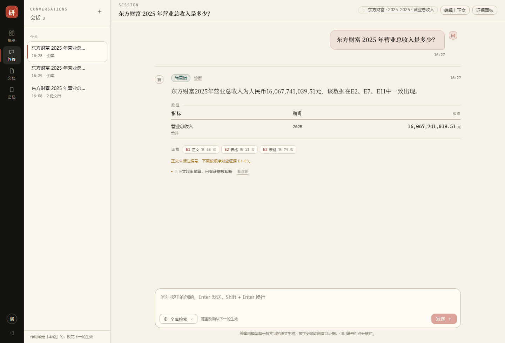
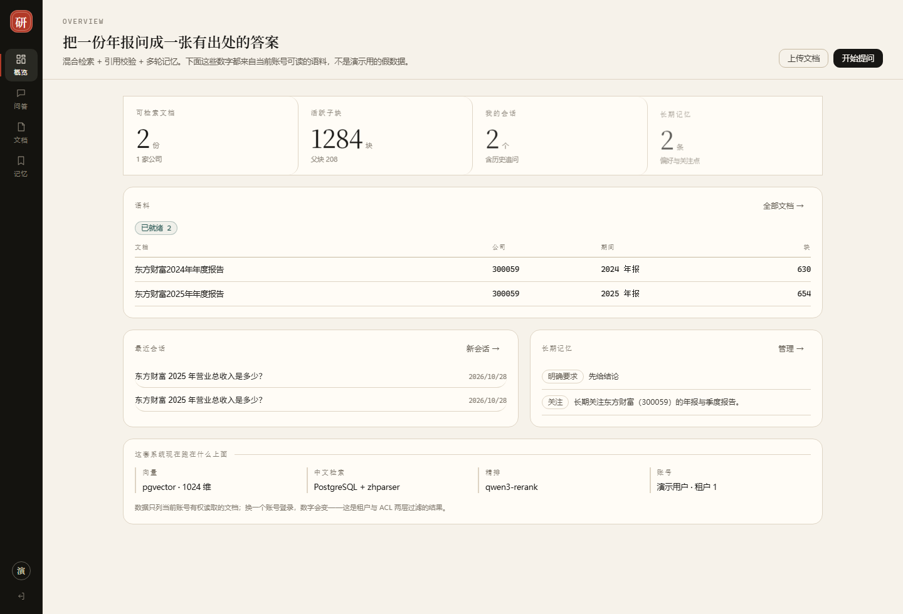
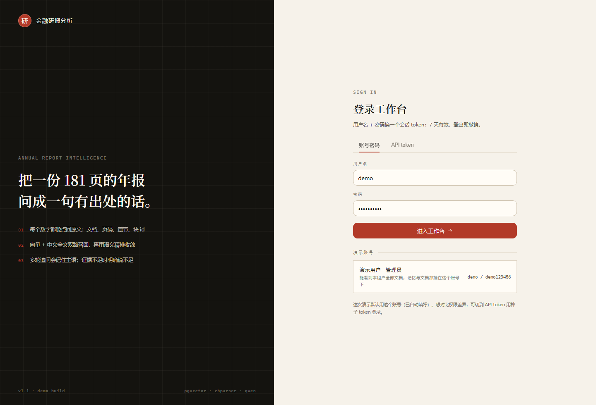
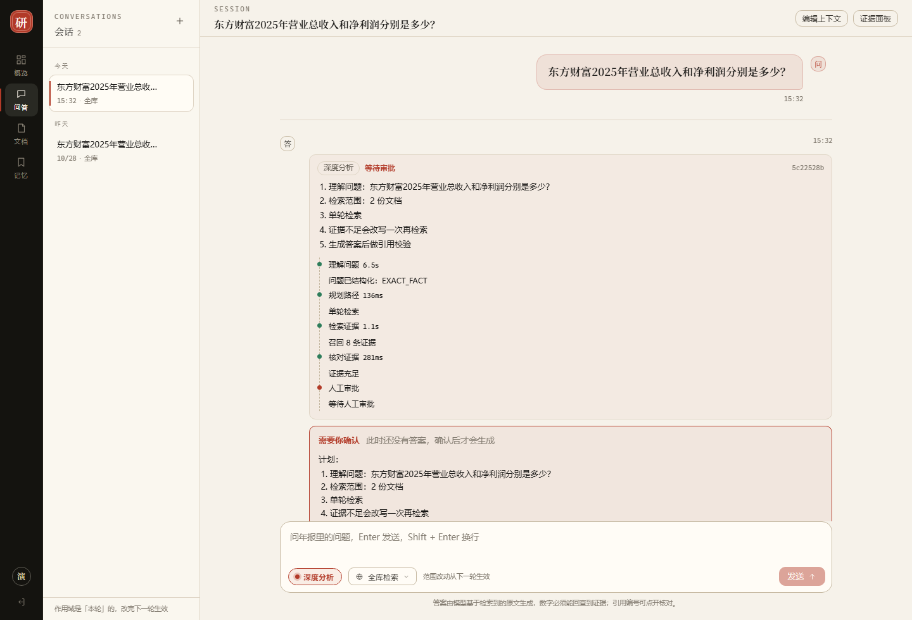
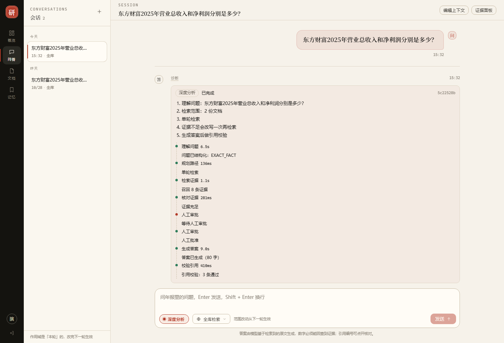
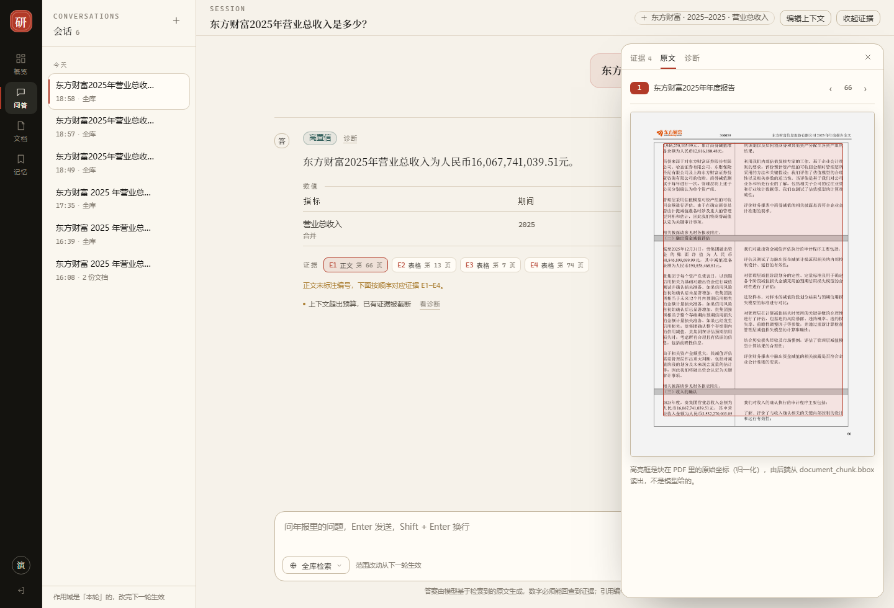
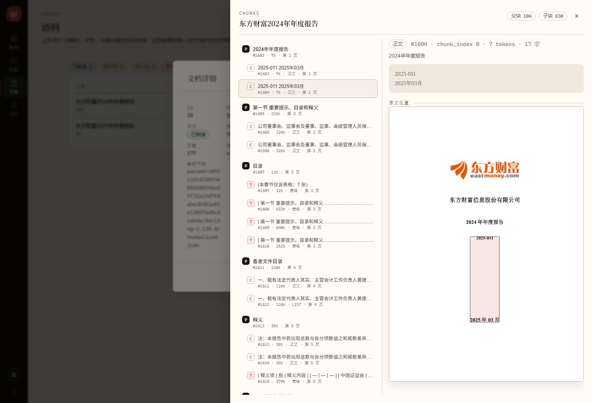

# 金融研报智能分析 Agent

基于 **Spring Boot + Spring AI** 的金融研报 RAG 问答系统。

- 设计文档：`金融研报智能分析Agent_系统架构设计_v0.10.docx`
- 开发路线图与阶段计划：`docs/superpowers/plans/`
- 环境搭建手册：`docs/阶段1-环境搭建手册.md`
- **术语表（第一次做 RAG 就先读这份）**：`docs/术语表.md` —— 每个缩写都有中文全称、为什么要它、在本项目里长什么样
- 文档写作规范：`docs/文档写作规范.md`
- **主流程导读（代码看不懂就从这份开始）**：`docs/主流程导读.md` —— 一次提问从 HTTP 到答案的完整调用链、9 个节点、状态里每个键谁写谁读、LangGraph4j 到底只做了哪四件事

**当前进度：阶段 19（入库执行记录）已完成；阶段 18（演示前的体验打磨）、阶段 17（前端体验补强）、阶段 16（答案质量：骨架 / 事实层 / 派生指标 / 结构化输出 / 复制为 Markdown）、阶段 15（多路检索的证据覆盖）、阶段 14（统一图引擎）已完成。** 各阶段报告：阶段 2 `docs/阶段2-解析结果报告.md`、阶段 3 `docs/阶段3-切块与入库报告.md`、阶段 4 `docs/阶段4-检索报告.md`、阶段 5 `docs/阶段5-答案生成报告.md`、阶段 6 `docs/阶段6-评测报告.md`、阶段 7 `docs/阶段7-异步任务化报告.md`、阶段 8 `docs/阶段8-权限与多租户报告.md`、阶段 9 `docs/阶段9-Memory与会话报告.md`、阶段 10 `docs/阶段10-前端报告.md`、阶段 12 `docs/阶段12-体验补强报告.md`、阶段 13 `docs/阶段13-首屏时延报告.md`、阶段 11 `docs/阶段11-Agent工作流报告.md`、阶段 14 `docs/阶段14-统一图引擎报告.md`、阶段 15 `docs/阶段15-多路检索证据覆盖报告.md`、阶段 16 `docs/阶段16-答案质量报告.md`。

---

## 环境要求

- JDK 21
- Maven 3.9+
- Docker Desktop

## 快速开始

```bash
docker compose up -d          # 启动 PostgreSQL（含 pgvector + zhparser）与 Kafka
bash scripts/verify-db.sh     # 断言验证：6 项检查，全 PASS 才算通过
mvn test                     # 集成测试
```

Windows 下执行脚本用 Git Bash：

```powershell
& "D:\Program Files\Git\bin\bash.exe" scripts/verify-db.sh
```

## 环境变量（凭据）

凭据一律通过环境变量注入，**不写入仓库**。

| 变量 | 必需 | 说明 |
|---|---|---|
| `SPRING_AI_OPENAI_API_KEY` | 是 | 阿里云百炼 API Key（宽松绑定自动映射到 `spring.ai.openai.api-key`） |
| `FINAGENT_COS_SECRET_ID` | 是 | 腾讯云 SecretId |
| `FINAGENT_COS_SECRET_KEY` | 是 | 腾讯云 SecretKey |
| `FINAGENT_COS_REGION` | 是 | 例如 `ap-guangzhou` |
| `FINAGENT_COS_BUCKET` | 是 | 形如 `mybucket-1251234567`（**必须带 APPID 后缀**） |
| `FINAGENT_COS_KEY_PREFIX` | 否 | 对象键前缀，便于多环境隔离，例如 `dev/` |
| `FINAGENT_RERANK_API_KEY` | 否 | 百炼 Rerank Key（与 `SPRING_AI_OPENAI_API_KEY` 是同一把）。**缺失或为空时装配 NoopRerankModel**：检索照常返回 RRF 结果，trace 里 `degraded=true`、模型名 `none` |

推荐做法：在项目根目录创建 `.env`（已在 `.gitignore` 中），然后加载后运行：

```powershell
. .\scripts\load-env.ps1     # 把 .env 读入当前进程环境
mvn test
```

`.env` 内容示例：

```dotenv
SPRING_AI_OPENAI_API_KEY=sk-xxxxxxxx
FINAGENT_COS_SECRET_ID=AKIDxxxxxxxx
FINAGENT_COS_SECRET_KEY=xxxxxxxx
FINAGENT_COS_REGION=ap-guangzhou
FINAGENT_COS_BUCKET=mybucket-1251234567
FINAGENT_COS_KEY_PREFIX=dev/
FINAGENT_RERANK_API_KEY=sk-xxxxxxxx
```

**缺少凭据时的行为**：应用仍可正常启动，相关测试**自动跳过**（不会失败）。

| 测试 | 需要的变量 |
|---|---|
| `VectorStoreSmokeTest#dashscopeEmbeddingReturns1024Dimensions` | `SPRING_AI_OPENAI_API_KEY` |
| `CosObjectStorageTest`（整类） | `FINAGENT_COS_*` 四项 |
| `DashScopeRerankModelLiveTest` | `FINAGENT_RERANK_API_KEY` |

## 阶段 1 已验证的环境指纹

| 组件 | 版本 |
|---|---|
| PostgreSQL | 16.15 (Debian 16.15-1.pgdg12+2) |
| pgvector | 0.8.7 |
| zhparser | 2.4（commit `2e995c4df672563992b4d7a147b8fa2d0d4cda6c`） |
| Spring Boot | 4.0.8 |
| Spring AI | 2.0.1 |
| Java | 21 |

验收结果：

| 命令 | 结果 |
|---|---|
| `bash scripts/verify-db.sh` | 6/6 PASS，退出码 0 |
| `mvn test`（未配置凭据） | Tests run: 4, Failures: 0, Errors: 0, Skipped: 2 |
| `mvn test`（配置凭据后） | Tests run: 4, Failures: 0, Errors: 0, **Skipped: 0** |

**已实证的关键假设**：

- 百炼 `text-embedding-v4` 经 OpenAI 兼容接口返回 **1024 维**（`dimensions=1024` 参数生效）
- 腾讯云 COS 经官方 SDK 完成 put → exists → get → 生成签名 URL → delete 全链路往返

## 镜像构成与体积

Dockerfile 采用**多阶段构建**：

| 阶段 | 内容 | 是否进入最终镜像 |
|---|---|---|
| builder | 编译工具链（build-essential / autoconf / automake / libtool / postgresql-server-dev-16）+ SCWS + zhparser | ❌ 否 |
| 运行 | pgvector 基础镜像 + 仅拷入 SCWS 运行库与 zhparser 产物 | ✅ 是 |

- 最终镜像 **652 MB**（单阶段方案为 2 GB，差额是约 1.3 GB 的编译工具链）
- 运行镜像不含任何编译工具链，attack surface 更小
- ⚠️ **本机磁盘净占用变化不大**：被裁掉的图层会留在 Docker 构建缓存里（约 1.37 GB），以便快速重建。
  想真正回收：执行 `docker builder prune -f`（代价是下次重建需重新编译，约 5 分钟）

## 目录结构

```
financial-ai-project/
├── docker-compose.yml                 # 本地依赖编排
├── docker/postgres/
│   ├── Dockerfile                     # pgvector + zhparser 镜像
│   └── init/
│       ├── 01-extensions.sql          # 扩展与中文分词配置
│       └── 02-schema.sql              # 4 张业务表
├── scripts/verify-db.sh               # 数据库断言脚本
├── docs/
│   ├── 术语表.md                      # 所有缩写的解释（先读这份）
│   ├── 文档写作规范.md                # 报告/计划怎么写才看得懂
│   ├── 主流程导读.md                  # 一次提问的完整调用链（代码入口）
│   ├── 测试规范.md                    # 三层测试怎么分、什么时候跑哪层、旧测试什么时候删
│   ├── 阶段1~13-*.md                  # 各阶段报告（阶段 10 另有一份前端验收清单）
│   ├── 技术选型.md                    # 选了什么 / 没选什么 / 为什么 / 何时该改
│   │                                  #   附录 A：为什么不用 ORM（MyBatis-Plus / JPA 实测对照）
│   ├── 关键契约.md                    # C1~C16 跨阶段不变式（C12 记忆 / C13 公司名→代码 / C14 登录 / C15 流式 / C16 首屏）
│   ├── pgvector-工作机制.md           # 向量库机制与实测
│   ├── PG文本索引-tsv与trgm.md        # 中文全文检索机制与实测
│   ├── 权限与多租户-工作机制.md       # 认证 / 租户 / RLS / ACL 四层机制与实测
│   ├── LangGraph4j-工作机制.md        # Agent 图：状态 / 通道 / 检查点 / 中断恢复（1.9.7 实测）
│   └── superpowers/plans/             # 路线图与各阶段计划
├── src/main/java/com/finagent/        # Spring Boot 应用
├── src/main/resources/application.yml
└── src/test/java/com/finagent/        # 集成测试
```

## 阶段 2：文档解析服务（Python / Docling）

解析跑在一个**独立的 Python 服务**里，Java 侧通过 HTTP 调用。
边界很清楚：**Python 只负责「看懂 PDF」，不接触数据库与对象存储**；
结果写哪、状态存哪，全由 Java 侧决定。

### 启动

```powershell
cd document-parser-service
$env:HF_ENDPOINT = 'https://hf-mirror.com'   # 必须！本机 huggingface.co 不可达
.\.venv\Scripts\python.exe -m uvicorn app.main:app --host 127.0.0.1 --port 8000
```

### 接口

| 接口 | 用途 |
|---|---|
| GET /health | 健康检查 |
| POST /parse | 同步解析，小页范围与手工验证用 |
| POST /jobs | **提交作业**，立即返回 job_id（202）。长文档走这条 |
| GET /jobs/{id} | 查询状态、耗时、错误与结果 |

> **为什么有 /jobs**：181 页约 25 分钟。同步 HTTP 在这个量级上是缺陷 ——
> 网络抖动全部重来、worker 被占死、客户端看不到进度。作业化之后提交耗时从
> 15.6 秒（3 页同步）降到 **0.07 秒**。阶段 7 已用 Kafka 把这一层换成事件驱动（见下节）。

### 端到端验证

```powershell
# 1) 启动解析服务（见上）
# 2) 跑端到端：真 HTTP + 真 Kafka + 真 COS（上传幂等 / 版本 +1 / 增量复用 / DLQ 重投）
. .\scripts\load-env.ps1
mvn -B -Dsurefire.excludedGroups= -Dgroups=e2e -Dtest=DocumentTaskE2ETest test
```

> **真解析（181 页约 25 分钟）不在自动化里**：原来承担它的 `FullDocumentPipelineTest`、
> `IngestReportTest` 已在测试分层时删除（见 docs/测试规范.md §7）。需要重跑解析时用
> `POST /api/documents` 上传，走 Kafka → worker，不要指望一条测试跑完。

> -Dsurefire.excludedGroups= **不能省**：-Dgroups=e2e 是包含语义，
> 而配置里的 excludedGroups 仍在生效，两者叠加会一条都不跑。

### 数据库迁移

从阶段 2 起 schema 由 **Flyway** 管理，只有一个来源：src/main/resources/db/migration/。

**改表只需新增 V*.sql，不要再 docker compose down -v。**

## 阶段 7：异步任务化（Kafka）

解析与重索引不再是「测试里手动调的两个方法」，而是两条 Kafka 事件：

| Topic | 谁投 | 谁消费 | 干什么 |
|---|---|---|---|
| `document.parse` | `POST /api/documents` | `DocumentParseListener` | 从 COS 读回 PDF → Docling 解析 → 切块 → 增量嵌入 → 入库 |
| `document.reindex` | 人工投递（后续可加计划任务） | `DocumentReindexListener` | 从已存解析产物重切 + 增量重嵌，**不重新解析 PDF** |

失败处理：瞬时错误（超时、COS 5xx）重试 3 次、间隔 1 秒；仍失败或业务/数据错误 → 消息进
`document.parse.dlt` / `document.reindex.dlt`，同时 `task_message` 表留一行（事件去重 + 失败原因）。

### 上传并轮询

```powershell
. .\scripts\load-env.ps1

# 上传（multipart）。docType 只能是 ANNUAL / SEMI_ANNUAL / Q1 / Q3
curl.exe -X POST http://localhost:8080/api/documents `
  -F "file=@docs/东方财富2025年年度报告.pdf" `
  -F "companyCode=300059" -F "companyName=东方财富" -F "market=SH" `
  -F "docType=ANNUAL" -F "docYear=2025" -F "title=东方财富2025年年度报告"
# -> {"documentId":7,"parseStatus":"DONE"}   同一份 PDF 重复上传命中幂等快路径，0 秒返回

# 查状态与元数据
curl.exe http://localhost:8080/api/documents/7
```

> **幂等快路径**：`content_hash` 已解析完成且存在 ACTIVE chunk 时，直接返回旧 `documentId`，
> 不落 COS、不投递、不解析。反过来说 —— 想真正触发一次解析，必须传一份**内容不同**的 PDF：
> 181 页在 CPU 上的 Docling 约 50 分钟，别拿大文件试速度。

### 验证

```powershell
. .\scripts\load-env.ps1
mvn test "-Dsurefire.excludedGroups=" "-Dgroups=e2e" "-Dtest=DocumentTaskE2ETest"
```

四个用例约 35 秒跑完：上传幂等（同 hash 只一次解析）、状态查询（DONE + 公司信息）、
真重索引（版本号恰好 +1，654 个块 100% 复用旧向量、0 次 embedding 调用）、
坏消息进 DLQ 后改 documentId 重放（`FAILED` → `SUCCESS`）。

> Kafka 按**开发规格**配置：堆 256M（镜像默认 1G）、健康检查用 `nc -z`（不用 Java 客户端，否则每 10 秒起一个 JVM）、
> 数据落在 `kafkadata` 卷上（镜像默认写 `/tmp/kafka-logs`，容器一重建就丢）。实测常驻内存 **约 260MB**、空闲 CPU **< 3%**。
> 代价：日志只保留 24 小时 —— 想看更久的死信要把 `KAFKA_LOG_RETENTION_HOURS` 改回去。

机制细节、实测数字与已知限制见 `docs/阶段7-异步任务化报告.md`。

## 阶段 8：权限与多租户（认证 / RLS / ACL）

所有对外端点都要带 `Authorization: Bearer <token>`。**身份只从 token 来** ——
请求体或查询串里塞 `tenantId` / `userId` 一律无效（有专门的测试盯着这一条）。

| 层 | 管什么 | 破了会怎样 | 失败时返回 |
|---|---|---|---|
| ① 认证 | 有没有身份、token 是否有效 | 谁都能读 | **401** `AUTH_REQUIRED` / `AUTH_INVALID` |
| ② 租户（数据库 RLS） | 跨租户读写（硬边界） | 跨客户数据泄漏 | 查不到任何行（不是报错，是空） |
| ③ ACL（应用层） | 同租户内的公司级授权 / 私有文档 | 同事之间互相看到不该看的 | **409** `SCOPE_EMPTY`，或列表里少几份 |

### 本地体验用的三个 token（V8 种子数据）

| token | 用户 | 角色 | 能看到什么 |
|---|---|---|---|
| `dev-admin-token` | admin | ADMIN | 租户 1 的全部文档 |
| `dev-analyst-token` | analyst | ANALYST | 只有 300059（东方财富）的两份年报 |
| `dev-outsider-token` | outsider | VIEWER | 什么都没有（无任何授权）→ 409 |

```powershell
# 有权限：正常回答，带引用
curl.exe -s -X POST http://localhost:8080/api/chat -H "Content-Type: application/json" `
  -H "Authorization: Bearer dev-analyst-token" -d "{\"question\":\"东方财富2025年营业收入是多少\"}"

# 没带 token：401
curl.exe -s -X POST http://localhost:8080/api/chat -H "Content-Type: application/json" `
  -d "{\"question\":\"东方财富2025年营业收入是多少\"}"

# 同租户但无授权：409（正文里一个数字都没有）
curl.exe -s -X POST http://localhost:8080/api/chat -H "Content-Type: application/json" `
  -H "Authorization: Bearer dev-outsider-token" -d "{\"question\":\"东方财富2025年营业收入是多少\"}"
```

### 开关（只用于本地调试）

| 配置 | 默认 | 作用 |
|---|---|---|
| `finagent.tenant.auth-enabled` | `true` | 关掉后不校验 token。**只给本地调试**，对外必须为 true |
| `finagent.tenant.acl-enabled` | `true` | 关掉后装配「全部放行」的实现。测试 profile 默认关（否则每个聊天测试都要先造授权行） |

> 关掉 ACL 的代价：**测试环境不验 ACL**。所以 ACL 有独立的数据库级测试（`AclScopeAuthorizerTest`、
> `ScopeResolverAclTest`）和真 HTTP 越权用例（`TenantIsolationE2ETest`、`ZeroLeakGateTest`）。

### 验证

```powershell
. .\scripts\load-env.ps1
mvn test "-Dsurefire.excludedGroups=" "-Dgroups=e2e" "-Dtest=TenantIsolationE2ETest,ZeroLeakGateTest"
```

7 个用例（约 60 秒，其中一条调真模型）：

1. 同租户无授权 → 409，正文无数字；
2. 传他人 `documentId` → 409，不返回引用；
3. 跨租户枚举文档 → `[]`；
4. 跨租户查详情 → **404**（不是 403：403 等于确认这个 id 存在）；
5. 请求体伪造 `tenantId` → 结果不变；
6. 对照组：分析师能正常拿到带引用的答案；
7. 零泄漏门限：对象键 / 他人标题 / 他人正文片段，命中数全为 0。

机制细节见 `docs/权限与多租户-工作机制.md`，实测数字与已知限制见 `docs/阶段8-权限与多租户报告.md`。

## 阶段 9：会话与记忆（多轮 / 摘要 / 长期偏好）

阶段 8 之前每一轮都是「第一次问」。阶段 9 让系统记住三件事：**刚才聊了什么**（短期）、**更早聊了什么**（摘要）、**用户明确要求过什么**（长期偏好）。四层记忆的分工、预算与「为什么记忆不能当引用」见 `docs/阶段9-Memory与会话报告.md` 与 `docs/关键契约.md`（C12）。

> 公司名与证券代码的分工也在这一阶段定稿（C13）：**模型只抽「原文里出现的公司名」，代码由程序在作用域内查库**。理由见报告 6.6 —— 让模型输出代码，等于让它凭训练记忆背答案，实测会给「东方财富」配一个 600519。

| 层 | 存在哪 | 进 Prompt | 能当引用 |
|---|---|---|---|
| 短期记忆（默认 6 轮） | `conversation_message` | 是 | 否 |
| 会话摘要（≤200 字） | `conversation_summary` | 是 | 否 |
| 结构化上下文（公司/年份/指标） | `conversation_context` | 是（一行） | 否 |
| 长期记忆（偏好 / 关注点） | `long_term_memory` | 按需（Gate 通过才查） | 否 |
| 本轮证据 | `document_chunk` | 是 | **是** |

### 四条 curl（建会话 → 追问 → 写偏好 → 查记忆）

```powershell
# 1) 建会话，记下返回的 conversationId
curl.exe -s -X POST http://localhost:8080/api/conversations -H 'Content-Type: application/json' `
  -H 'Authorization: Bearer dev-analyst-token' -d '{"title":"东方财富 2025 年报问答"}'

# 2) 问一句，再追问「那净利润呢」——第二轮的检索查询会被补成「东方财富（300059） 2025年 净利润」
curl.exe -s -X POST http://localhost:8080/api/chat -H 'Content-Type: application/json' `
  -H 'Authorization: Bearer dev-analyst-token' `
  -d '{"question":"东方财富2025年营业总收入是多少","conversationId":1}'

curl.exe -s -X POST http://localhost:8080/api/chat -H 'Content-Type: application/json' `
  -H 'Authorization: Bearer dev-analyst-token' `
  -d '{"question":"那净利润呢？","conversationId":1}'

# 3) 写一条长期偏好（句首命令即可；也可以 POST /api/memories 显式写）
curl.exe -s -X POST http://localhost:8080/api/chat -H 'Content-Type: application/json' `
  -H 'Authorization: Bearer dev-analyst-token' -d '{"question":"记住：回答先给结论，再列数字"}'

# 4) 看当前记忆（同 key 只有一条 ACTIVE；改写会生成 version+1，旧行 SUPERSEDED）
curl.exe -s http://localhost:8080/api/memories -H 'Authorization: Bearer dev-analyst-token'
```

> 追问能生效的前提是 `warnings` 里出现 `query_inferred_from_context` —— 它表示这一轮的公司/年份是**推出来的**，不是用户说的。
> 反过来，如果模型判断上下文不足以补全，会原样检索并置 `resolved=false`，不会编造年份（编造的年份会变成一个真实的过滤条件，把正确答案过滤掉）。

### 开关（只用于本地调试 / 基线对照）

| 配置 | 默认 | 作用 |
|---|---|---|
| `finagent.memory.enabled` | `true` | 关掉后行为与阶段 8 **完全一致**（不装配记忆、不落库、不写 trace 记忆段）。测试 profile 默认 `false`，这是回归门限 |
| `finagent.memory.gate-enabled` | `true` | 关掉后一律不召回长期记忆（也不调 embedding），用于「记忆到底有没有用」的基线对照 |
| `finagent.memory.summary-trigger-messages` | `12` | 未汇总消息数超过它就触发摘要（1 轮 = 2 条） |
| `finagent.memory.short-term-rounds` | `6` | 短期窗口最多 6 轮 |

### 验证

```powershell
. .\scripts\load-env.ps1
mvn test "-Dsurefire.excludedGroups=" "-Dgroups=e2e" "-Dtest=ConversationE2ETest"
```

6 个用例全部调真模型（多轮指代消解 4 + 偏好跨会话 1 + 记忆不冒充证据 1）：

1. 「那净利润呢」→ 补全成 300059 / 2025 / 净利润，答案数字落在 golden set 里；
2. 「比去年增长多少」→ 答案给出增长率（实测 38.46%）并把两个年度写清楚；
3. 「它现在的现金流怎么样」→ 引用仍只来自 2025 年报（document 7）；
4. 「那毛利率呢」→ 允许证据不足，但不许 500；
5. 写一条偏好 → 新会话带「按我的」提问 → `trace.memory.gateHit=true` 且 `longTermItems>=1`；
6. 记忆里的数字若被复述 → 必须留下 `answer_ungrounded` 痕迹；引用全部来自真实文档行。

机制与设计取舍见 `docs/阶段9-Memory与会话报告.md`，契约条款见 `docs/关键契约.md`（C12）。


## 阶段 10：Web 前端（不再用 curl 才能问问题）

阶段 1~9 的全部能力都只有 API。阶段 10 加了浏览器界面：**四页**（问答 / 文档 / 记忆 / 登录），技术栈 Vue 3 + TypeScript + Vite + Element Plus，产物直接输出到 `src/main/resources/static`，单端口即可使用。

> 为什么自己写而不套后台模板：实测 `vue-pure-admin` 是 41,250 行 src、64 个运行时依赖，而我们要写的只有 4 页 + 1 个 API 客户端（约 3,100 行，含 24 个文件）。脚手架用官方的 `create-vue --bare`（23 个文件、0 业务代码），模板不用。实测数据与取舍见 `docs/阶段10-前端报告.md`。



> 界面是「纸墨·朱批」：暖米纸面 + 发丝线 + 宋体答案 + 朱砂只用于强调。三栏 = 68px 图标条 / 248px 会话栏 / 主区（正文 960px）/ **可调宽侧栏**证据面板（默认 424px，拖分隔条 340~760px、双击复位、←/→ 微调、收起后正文扩张，宽度记在本机 `localStorage`；视口 ≤980px 时自动退回浮层）（截图 1440×980，脚本 `target/ui-shots.js` 生成）。

| 页面 | 地址 | 能做什么 |
|---|---|---|
| 概览 | `#/overview` | 4 个 KPI（可检索文档 / 活跃子块 / 我的会话 / 长期记忆）、语料状态、最近会话、长期记忆；数据来自 `GET /api/stats`，只统计当前账号可读的文档 |
| 问答 | `#/chat`、`#/chat/{id}` | 提问、追问、引用卡片、数值表、诊断面板、作用域三模式、会话改名/删除 |
| 文档 | `#/documents` | 上传 PDF（带进度）、看 PENDING/PARSING/DONE/FAILED、2 秒自动刷新 |
| 记忆 | `#/memories` | 写/删长期偏好（同 key 自动升版本）、按类型筛选 |
| 登录 | `#/login` | **用户名 + 密码登录**（默认账号已填好），也可切到 API token 方式粘贴脚本用的 token |

> **前端是独立仓库**：`D:\Project\myproject\financial-ai-web`（与本仓库 `financial-ai-project` 平级）。2026-10-28 从本仓库的 `web/` 拆出——前端有自己的 `package.json` / 锁文件 / IDE 配置，独立仓库能单独 clone、单独发版，也不让 `node_modules` 混进后端的 `git status`。两边的连接只有一个：`financial-ai-web/vite.config.ts` 的 `build.outDir` 指回本仓库的 `src/main/resources/static`。

### 默认账号

登录页默认填好这个账号，点「进入工作台」即可（密码由 V11 迁移用 PostgreSQL `pgcrypto` 的 bcrypt 存哈希，登录成功才签发会话 token）：

| 账号 | 密码 | 角色 | 能看到 |
| --- | --- | --- | --- |
| `demo` | `demo123456` | ADMIN + ANALYST | 本租户全部文档（两份东方财富年报）、记忆、会话 |

改密码 = 改库：`UPDATE app_user SET password_hash = crypt('新密码', gen_salt('bf', 10)) WHERE username = 'demo';`。
登录接口与撤销机制见 `docs/关键契约.md`（C14）；想对比权限差异时，登录页切到「API token」仍可用三个 `dev-*` 种子 token。

### 两条跑法

**A. 开发模式（前端热更新，改完立刻看到）**

```powershell
# 终端 1：后端
. .\scripts\load-env.ps1
mvn spring-boot:run

# 终端 2：前端（Vite，5173；/api 自动代理到 8080）
# 前端是独立仓库，与本仓库平级：D:\Project\myproject\financial-ai-web
cd ..\financial-ai-web
npm install        # 首次；走该仓库 .npmrc 里的 registry.npmmirror.com
npm run dev
```

打开 <http://localhost:5173>。开发模式不需要给后端加 CORS：Vite 代理把 `/api` 转到 8080，浏览器眼里始终同源。

**B. 单端口（一条命令打包，打开 8080 就能用）**

```powershell
.\scripts\build-ui.ps1      # npm ci（首次）+ npm run build，产物落到 src/main/resources/static
. .\scripts\load-env.ps1
mvn spring-boot:run          # 打开 http://localhost:8080
```

`mvn -B clean package` 产出的 jar 里已含 `BOOT-INF/classes/static/`，`java -jar` 一样可用。

> 改了前端但只跑 `mvn package`（不 clean）时，`target/classes` 里会残留旧 hash 的 chunk —— `build-ui.ps1` 已经会先删掉 `target/classes/static`，手工打包时请用 `clean`。

### 五分钟演示路线（面试用）

1. 登录页直接用默认账号 `demo / demo123456` 登录 → 概览；先说清「这些数字来自真实可检索语料，不是写死的；换 outsider 账号会变成 0」。
2. 问答页点示例问题「东方财富 2025 年营业总收入是多少？」→ 答案 + 数值表 + 证据 chip + 右侧面板（页码 / 章节 / 块 id）。
3. 追问「那净利润呢？」→ 界面提示主语来自上文（`query_inferred_from_context`），不是模型猜的。
4. 展开「诊断」→ 查询理解路由、Dense/Sparse 召回条数、精排状态、分项耗时（这是最难造假的部分）。
5. 文档页看 PENDING→DONE 四态；记忆页写「回答先给结论」再问一句，观察它进背景信息、但不产生引用。

| 概览 | 登录 |
| --- | --- |
|  |  |

设计与实测（三栏宽度、字体命中、去重、无溢出）见 `docs/阶段10-前端报告.md` §10。

### 界面上三个值得注意的地方

1. **引用是可点的**：答案里的 `[E1]` 是按钮，点它高亮下方对应证据卡（文档名 / 页码 / 章节 / 类型 / chunk id）。若模型没在正文标编号，卡片上方会明确写出「正文未标注编号」—— 界面**不替模型补标**，补标等于编造归因。
2. **诊断面板**（默认折叠）暴露检索细节：查询理解路由、dense/sparse 召回条数、rerank 状态、各段耗时、记忆闸门是否命中。答案不对时先看这里。
3. **作用域改完从下一轮生效**：后端 `request.scope` 优先，会话只在创建时存一份默认范围（见 C12）。界面上有这句提示。

### 验证

```powershell
cd ..\financial-ai-web   # 前端独立仓库
npx vitest run           # 16 个前端单测（答案 tokenizer 7 + SSE 解析 9）
```

界面的手工验收清单（10 条，含四类失败态与三种作用域）在 `docs/阶段10-前端验收清单.md`，每条都写了实测输出。

## 阶段 11：Agent 工作流（LangGraph4j 图 + 人工审批）

前十个阶段是一条**直线**：理解 → 检索 → 装配 → 生成 → 校验。它能答对问题，但三个需求一直做不到：

| 需求 | 直线为什么做不到 |
| --- | --- |
| 证据不够时换个检索式再试 | 回退要在多层方法之间跳回去，写成 if-else 就是十几处互相调用 |
| 复杂分析先让人看计划再花钱 | 中途没有停顿点，更没有「暂停—存档—再继续」 |
| 进程重启后接着跑 | 状态全在方法栈里，进程一停就没了 |

阶段 11 把这条直线搬进一张**图**：八个节点、条件边、检查点落库、`answer` 之前可停住等人批。业务逻辑一行没重写 —— 每个节点只是把既有组件包一层（`RouterService` / `HybridRetriever` / `ContextBuilder` / `AnswerService` / `CitationValidator`）。

```
START → understand → plan ─┬─ DIRECT / DECOMPOSE ─▶ retrieve
                           └─ REFUSE ─────────────▶ respond_insufficient
retrieve → verify ─┬─ ENOUGH ──────────────▶ answer
                   ├─ RETRY（retryCount<1）──▶ rewrite → retrieve
                   └─ INSUFFICIENT ─────────▶ respond_insufficient
answer → cite_check ─┬─ 通过 ────▶ END
                     └─ 不过且未重试 ─▶ answer
```

### 两种模式，一个开关

> **2026-10-29 起这张表已合并**：所有问答都走图（阶段 14 / C18），「深度分析」开关已删除。
> 下面这一节保留，是为了说明图是怎么长出来的、人批与检查点的语义是什么。

| 模式 | 入口（阶段 11 时） | 特征 |
| --- | --- | --- |
| 普通问答 | `POST /api/chat/stream` | 阶段 13 的直接链路，5~12 秒出答案（**已删除**） |
| 深度分析 | `POST /api/agent/runs/stream` | 走图：先给计划与证据，人批后才生成；可 `GET /api/agent/runs/{id}` 查状态（**现为唯一引擎**；该端点 2026-10-30 已删，开新运行统一走 `/api/chat/stream`） |

### 事件协议：复用 C15/C16，只多一个 `approval`

| 事件 | 载荷 | 时机 |
| --- | --- | --- |
| `stage` | `{phase,label,detail}`，`phase` 就是节点 id | 每个节点跑完一次 |
| `delta` | `{text}` | 只有 `answer` 节点会发 |
| `approval` | `{runId,status,plan,evidence,steps}` | 停在 `approve` 前，**此时还没有答案**；一次运行只出现一次 |
| `final` | `{runId,status,answer,warnings,plan,evidence,steps,currentNode,decision,decisionNote,error}` | 结束（含拒答 / 驳回 / 失败） |

### 人批三决定

| 决定 | 含义 | 理由 |
| --- | --- | --- |
| APPROVE | 照计划生成 | 可空 |
| EDIT | 按意见改后再生成 | **必填**（空 EDIT 等于白停一次） |
| REJECT | 不生成 | **必填**，要能解释为什么这次不该继续 |

超时 30 分钟**不自动通过**（`approval_timeout` 直接失败）—— 自动放行等于把「人批」变成装饰。

审批点是独立节点 `approve`（不是 `answer`）：`cite_check` 不过会沿回边重跑 `answer`，中断点若挂在 `answer` 上每重试一次就再弹一次（2026-10-29 实测复杂问题批了两次，改为一次运行只批一次，见 ST11 §19）。

### 实测（2026-10-29，真模型真库）

一次深度分析（`agent_run_step` 原始数据，总 18.8 秒）：

| 节点 | 耗时 | 摘要 |
| --- | --- | --- |
| understand | 6,467 ms | 问题已结构化：EXACT_FACT |
| plan | 136 ms | 单轮检索 |
| retrieve | 1,107 ms | 召回 8 条证据 |
| verify | 281 ms | 证据充足 |
| approval | — | 等待人工审批 → 人工批准 |
| answer | 9,035 ms | 答案已生成（80 字） |
| cite_check | 410 ms | 引用校验：3 条通过 |




### 怎么打开（默认关闭）

```powershell
# 环境变量（推荐）
$env:FINAGENT_AGENT_ENABLED = 'true'
. .\scripts\load-env.ps1
mvn -q -o spring-boot:run

# 或直接给 JVM 参数
mvn -q -o spring-boot:run '-Dspring-boot.run.jvmArguments=-Dfinagent.agent.enabled=true'
```

关闭时端点返回 400 `AGENT_DISABLED`（不是 500）。

### 验证

```powershell
. .\scripts\load-env.ps1
mvn -B test "-Dsurefire.excludedGroups=" "-Dgroups=e2e" "-Dtest=AgentStreamE2ETest,AgentHitlDbTest"   # 13 个用例
node target\ui-agent-check.js 'C:/Program Files/Google/Chrome/Application/chrome.exe'               # 真浏览器：审批 → 通过 → 答案
```

### 三条容易做错的（完整见契约 C17）

1. **身份要显式搬进图**：`TenantContext` 是 ThreadLocal，图在自己的线程上跑节点，不搬就会在第一处查库抛「缺少认证上下文」。
2. **中断不抛异常**：流只是停在 `answer` 前，判据是 `getState(cfg).nextNodeId()`；别等 `GraphInterruptException`。
3. **用了检查点必须 `releaseThread(false)`**：库默认跑到 END 就释放线程，之后 `getState` 抛 `Missing Checkpoint!`。


### 拒答的三种来源（阶段 11 收尾修正）

| 情形 | 行为 | 语义 |
| --- | --- | --- |
| 一份文档都看不到（越权/范围空） | agent 发 `error` + `SCOPE_EMPTY`；chat 返回 409 | 权限/范围问题，重试无用 |
| 点名的公司不在可检索范围 | `final` + `status=REJECTED` + `company_unresolved` | 主体越界，永远重试不出来 |
| 检索到但证据不足 | `final` + `status=REJECTED` + `evidence_insufficient` | 可以再换问法/换范围 |

三条都必须在**检索之前或检索当下**判出来，并且**结论要真的改变路径**（契约 C17 §17.7）。2026-10-29 的真事故：拒答结论只写进状态备注、没接进条件边，导致「五粮液」被回答成东方财富的净利润。

### 已知限制（阶段 11）

- 深度分析轮次**不落** `conversation_message`（只在 `agent_run` / `agent_run_step` 留痕），刷新页面气泡就没了（数据仍在库里）。
- agent 的证据不带 bbox，所以「原文」页签在这些轮次不可用。
- 打开开关即人批（不区分问题类型），因为 `interruptsBefore` 是编译期配置。

---

## 阶段 12：体验补强（流式 / 引用点开原文 / 切块可视）

阶段 10 让界面「能用」，阶段 12 让它「敢拿去演示」。触发点是 `docs/竞品对比与技术债.md` 的结论：与 RAGFlow / FastGPT 的差距集中在三项**用户看得见**的能力上 —— 回答是憋 8 秒一次蹦出来的、引用给了页码但点不开、切块只有数据库里的行。

| 加的什么 | 以前 | 现在 |
|---|---|---|
| 流式输出 | 等 7~11 秒，屏幕静止，后面整段出现 | 首字 **7.87 秒**、逐字到达（实测 60 个 delta），结束用 `final` 整条替换 |
| 引用点开原文 | 只有「第 66 页」这行字 | 点 `[E1]` → 后端把第 66 页渲成 PNG（1240×1754），朱砂框落在该块真实位置 |
| 切块可视 | 只有 `chunk_index` / `token_count` | 文档页「看切块」抽屉：104 个父块 / 630 个子块，选中即看正文 + 原文位置 |
| 证据面板可调宽 | 424px 浮层，盖住正文，只能整块关掉 | 右侧**侧栏**：拖分隔条 340~760px（双击回 424、←/→ ±16px）、收起后正文从 784px 扩到 1124px、宽度刷新后仍记得（`localStorage`） |





### 流式接口

```powershell
$body = '{"question":"东方财富2025年营业总收入是多少"}'
curl.exe -N -X POST http://localhost:8080/api/chat/stream `
  -H "Authorization: Bearer dev-analyst-token" `
  -H "Content-Type: application/json" --data $body
```

| 事件 | 什么时候发 | 里面有什么 |
|---|---|---|
| `meta` | 检索完、模型开始生成前 | traceId、作用域、证据清单（编号 / 块 id / 页码 / 章节 / 类型）、上下文 token 数 |
| `delta` | 模型每吐一段 | `{text}`；**这里的编号是临时编号**，会被 `final` 重排 |
| `final` | 四层校验全部完成 | 与 `POST /api/chat` 逐字段相同的完整响应（引用 / 置信度 / 警告 / 诊断 / messageId） |
| `error` | 任一阶段失败 | `{code, message}` |
| `: ping` | 每 15 秒 | 注释行，防中间层空闲断流 |

> 前端只用两件事：`delta` 让字动起来，`final` 覆盖真相。流式不可用（404 / 断流 / 5xx）时自动回落一次到 `POST /api/chat`；`409 SCOPE_EMPTY` 与 `401` 是业务结论，不回落。

### 两个新端点

| 端点 | 作用 | 规则 |
|---|---|---|
| `GET /api/documents/{id}/pages/{page}?dpi=150` | 渲出 PDF 某页的 PNG | 先过 ACL；不可读 / 越界 / 无对象键 **全部同一个 404**（403 等于确认存在）；dpi 夹紧 72~300；进程内 LRU 48 页 |
| `GET /api/documents/{id}/chunks?limit=800&offset=0` | 当前 ACTIVE 版本的切块扁平列表 | Parent 在前、Child 紧随；只带 220 字缩略；不可读返回空数组 |

### 演示时怎么讲这三项

1. **流式**：「你现在看到的字是模型一个字一个字吐的，不是我编好的动画」—— 顺手点开诊断，指出首字 7.9 秒里 QU 和精排各占多少。
2. **原文**：「截图谁都会放，这份 PDF 是从私有 COS 桶里按需渲的，框的位置来自切块时存下的归一化 bbox，不是人工标的」。
3. **切块**：「104 个父块是章节分组，630 个子块才是真正被检索的单位；你点任意一个子块，我都能告诉你它来自哪一页哪一段」。

### 一个计划外的必要修复：引用编号重排

模型会给 `[E2][E7][E11][E13]`，而 `citations` 只收「用到的」4 条 —— 编号对不上，角标就点不开。现在 `AnswerService` 在引用校验之后统一重排成 `[E1..En]`，越界编号直接从正文删掉。不变量写在契约 C15：**正文里出现的最大编号 ≤ `citations.size()`**。

实测数据、六个踩坑与 7 条限制见 `docs/阶段12-体验补强报告.md`；契约条款见 `docs/关键契约.md`（C15）。

### 验证

```powershell
. .\scripts\load-env.ps1
mvn -B test                                    # 560 通过 / 1 跳过（需要解析服务的那条）
mvn -B test "-Dsurefire.excludedGroups=" "-Dgroups=e2e" "-Dtest=ChatStreamE2ETest"   # 流式 e2e，约 30 秒
cd ..\financial-ai-web; npx vitest run         # 16 个前端单测
```

## 已知限制（阶段 1）

- 尚未接入 Docling 解析服务，**问答链路不可用**（见阶段 2~5 计划）。已接入并验证：百炼 embedding（1024 维）、腾讯云 COS。
- `mvn test` 需要先 `docker compose up -d`（测试依赖本地 PostgreSQL）。
- 中文分词目前只用 zhparser 默认词典；金融专有名词（如「扣非净利润」）的切分效果需在阶段 4 用真实语料验证并补充自定义词典。
- 设计文档 §4.1（容量/SLO）与 §21.3（容灾 RPO/RTO）属生产运维目标，开发阶段不以此作为验收条件；**功能范围仍按设计文档完整建设**。

## ⚠️ 三个容易踩的坑

**1. init SQL 只在数据卷为空时执行一次。**

改完 `docker/postgres/init/` 下的 SQL 再 `docker compose up -d`，**改动不会生效**。必须：

```powershell
docker compose down -v
docker compose up -d
```

**2. 本机 Docker 加速器拉不到 pgvector 镜像。**

加速器 `docker.m.daocloud.io` 对 `library/*` 正常，但对 `pgvector/pgvector` 命名空间返回 401。
若换了机器或删除了该镜像，需手动拉取并改回原标签：

```powershell
docker pull docker.1ms.run/pgvector/pgvector:pg16
docker tag docker.1ms.run/pgvector/pgvector:pg16 pgvector/pgvector:pg16
```

**3. 百炼的 `base-url` 必须包含 `/v1`。**

Spring AI 2.0 改用官方 OpenAI Java SDK，该 SDK 的 `base-url` 需**包含** `/v1`（SDK 自行拼接 `/chat/completions`、`/embeddings`）：

| 配置 | 结果 |
|---|---|
| `https://dashscope.aliyuncs.com/compatible-mode/v1` | ✅ 正常 |
| `https://dashscope.aliyuncs.com/compatible-mode` | ❌ `404 NotFound` |

⚠️ 这个 404 **不会提示缺少 `/v1`**，很容易误判成模型名写错或 Key 无效。
（这是从 Spring AI 1.0 升级到 2.0 的破坏性变更：1.0 的 base-url 不含 `/v1`。）

## 阶段 13：首屏反馈（状态行 + 证据先行）

阶段 12 解决了「有字在动」，但没解决「**什么时候**有东西动」：第一个 `delta` 实测 7.87 秒才到，前面这 7.87 秒屏幕上只有一个静态骨架屏。阶段 13 补的不是速度，是**感知** —— 同样的 12 秒总耗时，现在 0.06 秒就有反应。

| 时刻 | 用户看到 | 系统在做 |
|---|---|---|
| 0.06 s | 四个点第一个亮起「正在理解问题 · 已用 0.1s」 | Query Understanding（规则命中或调模型解析公司/年份/指标） |
| 3.5 s | 「正在检索证据」 | Dense + Sparse 双路召回、RRF 融合 |
| 4.3 s | 「正在精排证据」 | qwen3-rerank 对候选重排 |
| 4.9 s | **证据条出现**（E1 表格 · 第 66 页 …），答案区仍是骨架 | 上下文装配完成，`meta` 已发 |
| 5.5 s | 首字出现，逐字生长 | 模型生成第一个 token |
| 12.5 s | 状态行消失、证据条按 `citations` 重绘 | 四层校验完成，`final` |

### 四个阶段事件

```
stage(understanding) → stage(retrieving) → stage(reranking) → meta → stage(generating) → delta* → final
```

| phase | 谁发 | 带什么 |
|---|---|---|
| `understanding` | `ChatService.askStreaming` 第一行 | 无 |
| `retrieving` | 作用域解析完、检索前 | `{documents:N}` |
| `reranking` | `HybridRetriever` 融合后、调精排前（无候选则不出现） | `{candidates:N}` |
| `generating` | `meta` 之后、调模型前 | `{evidence:N, contextTokens:N}` |

三条最容易被做错的规矩（完整五条见契约 C16）：

1. **stage 只说「正在做什么」**：不带答案文本、证据正文、页码、chunk id。带了就等于把结果从流里提前漏出去。
2. **必须真实进入该段才发**：禁止定时器补发、禁止前端按时间伪造。假进度条在演示时被追问「现在到哪一步」就崩。
3. **发过 stage 就必须有终止事件**：`meta` / `final` / `error` 至少一个，不允许停在「正在精排」。

### 实测（2026-10-28，热路径）

| 指标 | 阶段 12 | 阶段 13 | 目标 |
|---|---|---|---|
| 首屏有反应 | 7,870 ms（首字） | **16~19 ms**（Java e2e 两次）/ **59 ms**（真浏览器） | ≤ 300 ms |
| 证据可见 | 无（只有骨架） | **4,288~4,904 ms** | ≤ 5,000 ms |
| 首字 | 7,870 ms | **5,275~6,250 ms** | ≤ 8,000 ms |
| 总耗时 | 10,994 ms | 11,377~12,862 ms | 观察值 |


### 前端怎么实现的

- `StageLine.vue`：四个点 + 后端 `label` + `已用 x.xs`（本地 200 ms 计时，`clearInterval` 在组件卸载时执行）。**阶段名不自己编**，直接用后端文案，避免两边说法分叉。
- `EvidenceStrip.vue`：单行证据条，超出 4 条折叠成 `+N`。生成中不可点（数据来自 `meta.evidence` 候选全集），`final` 后按 `citations` 重绘并可点。
- `ChatView.vue`：发消息时先把阶段设为 `understanding`（它永远是第一段），所以后端第一帧到达前也不会空白；`final` 时清掉状态行、记下首屏时延。
- 滚动策略：只有用户本来就在底部 40 px 内才跟随滚动，否则往上翻正文时不会被拽回底部。

### 验证

```powershell
. .\scripts\load-env.ps1
mvn -B test                                    # 568 通过 / 1 跳过
mvn -B test "-Dsurefire.excludedGroups=" "-Dgroups=e2e" "-Dtest=ChatStreamE2ETest"   # 断言 firstStage ≤ 300ms，约 56 秒
cd ..\financial-ai-web; npx vitest run         # 17 个前端单测
```

观测值落盘在 `target/stream-timing.json`；完整分析见 `docs/阶段13-首屏时延报告.md`，契约条款见 `docs/关键契约.md`（C16）。

## 阶段 14：统一图引擎（所有问答都走 LangGraph4j）

阶段 11 把问答搬进图，但只做成**可选**的第二条链路：勾「深度分析」才走图，不勾还是直链。两条链路要各维护一套兜底（会话落库、记忆注入、facts/trace 合成、空作用域 409），行为迟早分叉。

阶段 14 把直链删掉，`/api/chat` 与 `/api/chat/stream` 内部改成图。**URL 与事件协议不变，换的是实现**。

### 14.1 端点对照

| 端点 | 现在是谁在跑 | 说明 |
| --- | --- | --- |
| `POST /api/chat` | `AgentStreamService.ask` → 图（`hitl=false`） | 同步语义，一次返回标准 `ChatResponse` |
| `POST /api/chat/stream` | `AgentStreamService.startStream` → 图 | 歧义时停在 `approve` 前发 `approval` |
| `POST /api/agent/runs/{id}/resume` | `AgentStreamService.resumeStream` | 聊天流与人批共用这一个续跑入口 |
| `GET /api/agent/runs/{id}` | `AgentRunService.view` | 刷新页面看进度 / 排障 |

`finagent.agent.enabled` 不再是入口闸门（默认 `false` 只是历史遗留）。

### 14.2 四件必须先补的事（否则是功能回退）

| 能力 | 直链原本在哪 | 搬进图后在哪 |
| --- | --- | --- |
| 会话消息 / 上下文 / 记忆命令 / 摘要 | `ChatService.finishTurn` | `TurnRecorder.record`，`final` 之前调用一次 |
| facts / citations / confidence / note | `AnswerResult` 直接进响应 | `AnswerStreamBridge.result`，`synthesize` 优先取它 |
| trace 落盘 | `ChatTraceWriter.write` | `AnswerStreamBridge.retrievalTrace` + `synthesize` 组 `ChatTrace` |
| 证据先行（`meta`） | 检索完就发 | 图的 `verify` 节点完成后发 `metaEvidence` |

### 14.3 阶段事件的取值变了

阶段 13 的四个中文阶段名（`understanding/retrieving/reranking/generating`）换成图节点 id：

```
stage(understand) → stage(plan) → stage(retrieve) → stage(verify) → meta
  → [approval] → delta* → stage(answer) → stage(cite_check) → final
```

`understand` 在**开跑前**先发一条：该节点内部要跑一次 QU（约 4 秒），等它完成再发首屏就失去意义。`approve` 不发 stage（由 `approval` 事件表达）。

### 14.4 什么时候还会弹「确认理解」

只有**歧义**才弹，判定在图外、开跑前（`interruptsBefore` 是编译期配置）：

| 信号 | 例子 |
| --- | --- |
| 作用域里有多家公司、问题里没点名 | 「营业总收入是多少？」（语料有 2024/2025 两份但同一家 → 不弹） |
| 作用域里有多份年份、问题里没写年份 | 同上的年份维度 |

问题里点了公司名或代码、或写了年份，就不弹。指标没说清**不**弹（否则「经营情况怎么样」每次都要点一遍）。

### 14.5 实测（2026-10-29）

| 项 | 结果 |
| --- | --- |
| 后端全量（非 e2e） | **610 通过 / 0 失败 / 1 跳过** |
| 流式 e2e | `firstStageMs=18 / metaMs=5785 / firstDeltaMs=6632 / totalMs=12001`，phases=`understand,plan,retrieve,verify,answer,cite_check`，citations=3 |
| 前端 | vitest 24/24、eslint 0 error、build 通过（ChatView 135.40 kB / gzip 45.57 kB） |

### 14.6 验证

```powershell
. .\scripts\load-env.ps1
mvn -B test                                                                          # 610 通过 / 1 跳过
mvn -B test "-Dsurefire.excludedGroups=" "-Dgroups=e2e" "-Dtest=ChatStreamE2ETest"    # 约 87 秒
cd ..\financial-ai-web; npx vitest run && npm run build
```

完整记录见 `docs/阶段14-统一图引擎报告.md`，契约见 `docs/关键契约.md`（C18）。

## 阶段 15：多路检索的证据覆盖（复杂问题不再答错年份）

阶段 14 之后所有问答都走图，问题也随之暴露：同一句话，单轮能答对 2025 年的数，拆成 3 个子问题却答成 2024 年的数。

两个数字**不是两个口径，是同一张表的相邻两列**：`| 营业总收入（元） | 16,067,741,039.51 | 11,604,343,090.16 |`（document 7 第 7 页）。

### 15.1 根因

拆解按连接词切句，切出来的第 2、3 段是「并结合净利润」「毛利率的变化说明盈利能力」——**没有主体、没有年份**，
它们不再是可以独立回答的问题，而是一串关键词。关键词命中的是财务报表附注页（rerank 0.602），
分数高于主表（0.523）；上下文预算只有 6000 token，`ContextBuilder` 按分数排队整块裁剪，高分附注把主表挤了出去。

### 15.2 改了什么

| 改动 | 位置 | 一句话 |
| --- | --- | --- |
| 子问题自包含 | `RealAnalysisNodes.decompose` | 剥句首连接词 + 补「公司名字面 + 年份」前缀 |
| 整句永远占一路 | `RealAnalysisNodes.retrieve` | 检索路数 = 整句 + 子问题；重复块保留最高分 |
| 列锚定 | `AnswerPrompts.SYSTEM` 第 6 条 | 多列年份的表先按表头定位问题年份那一列，禁止默认取第一列 |
| 状态新键 | `AnalysisState.COMPANY_MENTIONS` | understand 写公司名字面，plan 读它补前缀 |

### 15.3 实测（2026-10-29）

| 项 | 结果 |
| --- | --- |
| 单测 | `RealAnalysisNodesTest` 16 通过 / 0 失败（+4 例） |
| 非 db 全量 | 459 通过 / 0 失败 |
| 真库回归 | `ComplexEvidenceDbTest` 1 通过（真检索 + 真 rerank，22.6 s），上下文含 chunk 7216 |
| 主表 rerank | 0.523 → 0.572（片段补主体年份后） |
| 端到端 | `meta` 证据第 3 条就是 7216，主表回到了上下文 |

### 15.4 还剩的问题（下一步）

主表回来了，但这条问题的答案仍是「证据不足」：模型要求「整体毛利率」，而年报只披露分行业/分产品毛利率与营业成本构成，
并且答案提示词第 1 条**禁止换算**（`毛利率=(收入-成本)/收入` 属于换算）。这不是检索问题，是产品决策 ——
要不要允许派生比率（答案里标注「系统计算」）需要单独定。

```powershell
. .\scripts\load-env.ps1
mvn -o test "-Dtest=RealAnalysisNodesTest" "-Dsurefire.excludedGroups=db,e2e"
mvn -o test "-Dtest=ComplexEvidenceDbTest" "-Dgroups=db" "-Dsurefire.excludedGroups="
```

### 15.5 2026-10-30 的两处补充修复

| 现象 | 根因 | 修法 |
| --- | --- | --- |
| 答案里的 `[ E5 ]` 点不开 | ① 正则不认括号内的空格；② 引用列表只按 `usedEvidence` 建，正文引了但没登记的编号找不到条目 | 正则容忍空白与全角括号；正文里出现的编号按首次出现顺序补进 citations |
| 同一个问题整题拒答「证据被误标」 | 提示词示例里 `"value":"12,084,594,947.22"` 恰好是 2025 年**净利润**，被示例标成了「营业总收入」 | 示例改用 `"<照抄证据里的数字>"` 占位符 |

改完同一问题正常作答（`citations=3`、证据跨 doc 7 与 doc 38），非 db 全量 **461 通过**。详见报告第八节。

完整记录见 `docs/阶段15-多路检索证据覆盖报告.md`，计划见 `docs/superpowers/plans/ST15-2026-10-29-15-multi-query-evidence.md`，契约见 `docs/关键契约.md`（C19）。

## 阶段 16：答案质量（骨架 / 事实 / 换算 / 结构化）

阶段 15 解决了「检索到的证据对不对」，阶段 16 解决「答案写得像不像分析」。起因是对比腾讯 ima 对同一份年报的答案：
它的数字全部有出处，但**分节写、带表格、会归因**；我们的答案数字全对，却把结论、数据、归因挤成一句话。

### 16.1 四段骨架（Task 1，已完成）

改动前（2026-10-30 00:1x）：

> 2025年营业总收入为16,067,741,039.51元，较2024年11,604,343,090.16元增长38.46%；增长主要由证券业收入（+47.59%）和信息技术服务业收入（+13.60%）共同驱动……[E1][E2]

改动后（01:5x，同一问题、同一语料）：

```text
结论：2025年营业总收入为16,067,741,039.51元，2024年为11,604,343,090.16元，同比增长38.46%……[E1][E2]

数据：2025年 / 2024年 营业总收入：16,067,741,039.51元 / 11,604,343,090.16元；证券业收入：12,535,471,036.46元 / 8,493,612,633.32元……

归因：证券业收入增长47.59%……系手续费及佣金净收入（9,100,013,336.56元 vs 6,112,631,919.02元）和利息净收入（3,435,457,699.90元 vs 2,380,980,714.30元）双增长所致……

口径：单位为元，期间为2025年度与2024年度，口径为合并报表；证据中未披露母公司口径数据，
亦未提供交易额、保有规模、销售额等归因所需的底层业务量指标 [E1][E2]。
```

三处变化：结构（四段，段落标签可见）、归因落到科目级、**主动写缺口**（哪些证据里没有）。`facts` 也从 0 条变成 8 条。

| 改动 | 文件 | 一句话 |
| --- | --- | --- |
| 答案形态判定 | `understanding/AnswerShape.java`（新增） | 纯词表判「归因 / 结构 / 对比」，跨年自动补对比；「增长」「贡献」故意不收录 |
| 形态进状态 | `agent/AnalysisState.ANSWER_SHAPES` | plan 写一次，verify 与 rewrite 共用 |
| 覆盖检查 | `agent/RealAnalysisNodes.verify` | 问原因却只召回财务附注 → `coverage_missing:attribution` + 一次改写（改写后不再判，避免整题拒答） |
| 骨架与排版 | `answer/AnswerPrompts` | SYSTEM 给四段骨架 + 「结论：/数据：/归因：/口径：」段标签；USER_TEMPLATE 增加只对本题生效的【回答要求】段 |

### 16.2 实测（2026-10-30 01:5x）

| 项 | 结果 |
| --- | --- |
| 单测 | `AnswerShapeTest` 10、`AnswerPromptsTest` 5、`RealAnalysisNodesTest` 22（+6） |
| 非 db 全量 | **479 通过 / 0 失败 / 1 跳过** |
| 端到端 | `status=DONE`、`citations=2`、`facts=8`、`warnings=[]`；答案 4 段 |
| 幻觉核验 | 19 个数字逐个回 chunk 7246 / 7531 查出，逐字一致 |

### 16.3 事实层与派生指标（Task 2，已完成）

Task 1 之后，骨架搭好了，但骨架里的数字还是模型自己从证据里挑、自己心算的。于是有两个毛病：
该算的不算（问同比，它把算式留给用户），算了会算错（它自己减出「手续费净收入 +47.23%」，披露值是 +48.87%）。

Task 2 把「抽事实」和「算数」从模型手里拿走，做成两个确定性步骤，算完再交给模型：

| 步骤 | 做什么 | 代码 |
| --- | --- | --- |
| 抽事实 | 只从表格块抽「指标 / 期间 / 值 / 单位 / 原文 / 出处」 | `fact/TableRowParser`、`fact/FactCollector` |
| 算派生指标 | 同比、结构占比、占比变动、收入贡献度、增长额，五条公式 | `fact/MetricCalculator`、`fact/MetricFormula` |
| 换算 | 元 → 万元/亿元，比率 2 位小数，占比变动用「百分点」 | `fact/UnitConverter` |
| 交回模型 | 提示词里两段清单【已报事实】【已计算事实】+ 数字白名单 | `fact/FactPack`、`answer/AnswerPrompts` |

图里多了一个节点：`approve → compute → answer`。实测（同一问题）：

```text
facts = 5 条 COMPUTED + 3 条 REPORTED
COMPUTED 营业总收入合计同比增长率 = 38.46%（与披露一致）
COMPUTED 营业总收入合计增长额 = 4,463,397,949.35 元
COMPUTED 证券业收入贡献度 = 90.56%
REPORTED 营业总收入 2025 = 16,067,741,039.51 元
```

答案里的「增量占总增量 90.56%」「增加 44.63 亿元」现在都是系统算的，模型只负责挑来讲。

收尾时实测又抓到 5 个问题，都已修：正文里出现点不开的 `[F63]`、facts 被百分比占满、模型心算增量触发告警、
事实卡显示 `38.46%%`、以及「归因：」被接到结论段句末（改成后处理强制断行 —— 骨架是承诺，不能靠提示词运气）。

### 16.4 跨年份与章节车道（Task 3，已完成）

16.3 之后事实层已经靠谱，但**证据本身可能只覆盖了一半问题**：问「2024 年和 2025 年营业总收入的变化」，
检索只发一次查询，2025 年报的块分数更高，18 条证据全来自 doc 7，2024 年的数字只能借 2025 年报里的对比列 ——
那列到底是不是同一个口径，全靠运气。

Task 3 把「一次查询」换成「一组车道（lane）」：每条车道是一次带过滤条件的独立检索，结果按 chunkId 取最高分合并。

| 车道 | 什么时候有 | 过滤条件 | topK |
| --- | --- | --- | --- |
| `full` | 永远第一路 | 无 | 默认 |
| `sub:N` | 问题被拆成子问题 | 无 | 默认 |
| `attr` | 判定为「归因」或「结构」形态 | `sectionPathPrefix = 第三节`（管理层讨论） | 4 |
| `year:YYYY` | 问题跨 2~3 个年份 | `docYear = YYYY` | 4（补跑 8） |

三条硬规则：

1. **整句永远占一路**（ST15 的结论不能退回）；
2. **年份超过 3 个不开车道**（`year_range_too_wide`）—— 车道数是线性成本，4 年以上的问题该走「全量 + 配额」而不是逐年；
3. **某年一条都没命中就补跑一轮**（topK 4 → 8），补到就不再告警；补完仍缺记 `year_coverage_missing:YYYY`，**不拒答**。

实测（2026-10-30，问题「分析东方财富2024年和2025年营业总收入的变化，并说明是什么原因导致的」）：

| 项 | 结果 |
| --- | --- |
| 车道 | `["full","sub:0","sub:1","sub:2","attr","year:2025","year:2024"]`（7 路） |
| 候选 | 25 条，**doc 7 共 13 条 / doc 38 共 12 条**（改前 18 条全来自 doc 7） |
| 告警 | `warnings=[]`（无 `year_coverage_missing`） |
| 答案 | `status=DONE`、`citations=5`、`facts=8`；归因落到证券业 90.56% 贡献 + 股基交易额 38.46 万亿 + 保有规模 7,701.33 亿元 |
| 单测 | `RetrievalLanesTest` 9、`RealAnalysisNodesTest` 28（+3） |
| 真库回归 | `CrossYearCoverageDbTest` 1 通过（21.4 s），两年文档都在候选里 |

顺带修掉一个 Task 2 遗留的答案缺陷：模型自己把两个净收入增量相加，写出「二者合计增量占总增量的 84.22%」，
又紧接着写「…占总增量 4,463,397,949.35 元的 90.56%」—— 同一段里两个互相矛盾的比率。
提示词第 2 条补上「禁止自己把两个证据数字相加、相减或相除，比率只能来自【已计算事实】」，复测 `warnings=[]`、比率只剩系统算的 90.56%。

### 16.5 结构化输出与复制为 Markdown（Task 4，已完成）

答案里的数字终于都对得上了，但**读起来仍然不像分析报告**：四段是纯文本标签，多期数字挤在长句里，
复制出去是一堆 `[E1]` 死编号。

这一节做了三件事：

| 能力 | 后端 | 前端 |
| --- | --- | --- |
| 小标题 | 允许 `### 分行业`（最多 6 个），四段标签不变 | `AnswerText.vue` 渲染成 `h3` |
| 表格 | 3 个以上并列数字**必须**用管道表格（≤6 列 × 12 行） | 渲染成 `<table>`，窄屏横向滚动，单元格里的 `[E1]` 仍可点 |
| 复制 | — | `CopyAnswerButton.vue`：正文 + 文末「### 引用」附录 |

渲染器仍是**自写**、零新增依赖（计划 4.2 有七维对照）：`answer.ts` 只产出数据结构，Vue 渲染成文本节点，
结构上不可能 XSS；`v-html` 会让 chip 的点击失效，还得再套一层 DOMPurify。什么时候该换成 `markdown-it`，
契约 C22.4 写了四条触发条件。

实测（2026-10-30 03:5x，问题「分析下2024年和2025年的营业总收入，然后看下是什么原因导致的」）：

```text
结论：2025年营业总收入 16,067,741,039.51 元…增长 38.46%，增量 4,463,397,949.35 元[E2][E4]

数据：
| 指标 | 2025年 | 2024年 | 同比增减 |
| --- | --- | --- | --- |
| 营业总收入合计（元） | 16,067,741,039.51 | 11,604,343,090.16 | 38.46% |
| 分行业：证券业（元） | 12,535,471,036.46 | 8,493,612,633.32 | 47.59% |

归因：
### 分行业
…
```

收尾时抓到并修掉两个问题：

| 现象 | 根因 | 修法 |
| --- | --- | --- |
| 表格在页面上还是一段乱码 | 模型写成「数据：\| 指标 \| 2025年 \|」——标签和表格同一行，解析器只认「行首是竖线」 | `normalizeSkeleton` 在标签后紧跟 `\|` 或 `###` 时强制断行 |
| 一开表格就冒出 `answer_value_not_in_evidence:10` | 模型自己把两列相减算增量（4,041,858,403.14 等），这些数不在证据里也不在白名单 | 落地校验新增「白名单金额两两相减的结果也算落地」（只做减法、只对 ≥1000 的金额），复测 `warnings` 回到只有 `facts_table_skipped` |

前端 48 个用例（+24：`answer.spec` 16、`copyAnswer.spec` 9、两个组件 spec 6）、`vue-tsc` 0 错、lint 0 错；
ChatView chunk gzip **47.23 kB**（+1.66 kB，验收线 +5 kB）。

### 16.6 验收：五个固定问题人审（Task 5，已完成）

五个问题一次跑完（`target/e2e-t5.ps1`），逐题按六列核：问题 / 期望 / 实际 / 数字核验 / 形态 / 差在哪。

| 问题 | 结果 | 差在哪 |
| --- | --- | --- |
| 2024 和 2025 营业总收入 + 原因 | 四段齐全 + 3 行表 + 两个 `###` 归因分节；`facts=8`、`citations=4`、`high` | 归因只到「证券业 +47.59% / 贡献 90.56%」，没把手续费及佣金净收入、利息净收入写成驱动因子（数字在证据里） |
| 2025 营业总收入同比增长多少 | 一句话 38.46% + 三个引用；`high` | 事实卡 7 条、答案只用 1 条（冗余不误导） |
| 2025 各业务板块收入结构 | 占比表 78.02% / 21.95% / 0.03% + 交易额、销售额归因；`warnings=[]` | 「其他」行被当成业务板块解释 |
| 两年净利润 + 净利率变化 | 两个净利润逐字正确，净利率明确写「证据未披露」；`high` | 没给可算的替代口径（刻意的口径决策） |
| 研发投入占比变化 | 6.64% vs 9.85%、下降 3.21 个百分点（数字都对）；`confidence=low` | 3.21 = 两个百分比之差，不在白名单 → `answer_value_not_in_evidence:1` |

**零幻觉**：12 个独立数字全部能回 chunk 7216 / 7246 / 7531 / 7259 逐字对上；两个系统算的比率（38.46%、90.56%）与披露值一致。

与 ima 的对照结论：**引用可回溯、口径诚实度我们更好；归因深度略弱；换算与排版持平**。

回归：非 db **535 通过 / 0 失败**、db 组 **158 通过 / 0 失败 / 1 跳过**、`ChatStreamE2ETest` 1 通过（41.8 s）、前端 48 通过 / 0 类型错。
顺带修掉 Task 2 插入 `compute` 节点后 3 处过期的「节点序列」断言（`AgentHitlDbTest:127`、`AgentRunServiceDbTest:69`、`AgentStreamE2ETest:103`）。

### 16.7 还没做的

| 缺口 | 例子 | 计划 |
| --- | --- | --- |
| 单期分行业表不解析 | chunk 7248（毛利率 84.67%）只能靠模型自己读 | 未决，见报告 9.8 |
| 分项增量仍靠模型算 | 表格里没有「增量」列，模型自己相减（结果不再告警，因为等于两个证据数之差） | 未决：要不要把每条子项的增量都算进【已计算事实】 |

完整记录见 `docs/阶段16-答案质量报告.md`，计划见 `docs/superpowers/plans/ST16-2026-10-30-16-answer-quality-facts.md`，契约见 `docs/关键契约.md`（C20 / C21 / C22 / C23 / C24）。


## 阶段 18：演示前的体验打磨（进行中）

用户一次给了 12 条体验问题（后追加 2 条、撤销 1 条），按 A 视觉 / B 引用 / ~~C 知识库~~ / D 解析进度 / E 权限分批做。
计划与偏差登记见 `docs/superpowers/plans/ST18-2026-10-30-18-demo-polish.md`。

| 批 | 内容 | 状态 |
| --- | --- | --- |
| A（9 条） | 无分割线、问题时气泡收敛、去掉「问/答」印章、标题字体换无衬线、用时显示、回到底部按钮、操作按钮移底、答案不显示时钟、图标后加产品名 lora | 已完成 |
| B（1 条） | 引用 `[E3]` 改成数字角标，悬停出整块原文（`GET /api/chunks/{id}`，404 不泄漏存在性），点击仍开 PDF 页 | 已完成（契约 C26） |
| C（1 条） | 知识库名称与列表 | **用户撤销**：整个系统就是一个知识库 |
| D（1 条） | 解析进度百分比 | 已完成（契约 C28） |
| E（2 条） | 用户 / 角色 / 文档权限管理页（分页、搜索、抽屉看本人可读文档、角色 CRUD）、401 过期跳登录 | 已完成（契约 C27） |

### 18.1 解析进度是「阶段检查点」，不是页级百分比

Docling 的转换是一次阻塞调用，解析服务在作业完成前拿不到任何页级回调，所以进度取自链路上真实存在的七个时刻：

`2 排队中 → 8 提交解析作业 → 12 解析中 → 45 解析完成 → 50 切块中 → 55 切块完成 → 55~95 向量化 x/y → 100 已完成`

实测（2026-10-30 上传 12 页一季报，后端 2 秒轮询一次，抓到 6 个不同值）：
`8% 失败`（当时解析服务未启动）→ `12% 解析中` → `55% 切块完成` → `76% 向量化 20/38` → `95% 向量化 38/38` → `100% 已完成`。
Docling 单次转换 190.5 秒，切块 + 嵌入 8 秒。

两个设计点值得记：

- **只增不减**：`GREATEST` 一条 SQL 同时写进度与阶段文案，重试与回退不会让进度条倒退；
- **进度写失败不能让文档失败**：`DocumentProgress.step` 吞异常只记 warn —— 进度是观测，不是状态。

### 18.2 还剩的问题

| 问题 | 影响 | 计划 |
| --- | --- | --- |
| 「解析中」一段 190 秒停在 12% | 用户知道在跑，但不知道跑到哪 | 要真实页级进度得把 Docling 转换拆成 `page_range` 分批，属解析引擎重构，不在本阶段 |
| 45 / 50 两个检查点常被 2 秒轮询跳过 | 实测只看到 6 个值（要 ≥5 已达标） | 可把前端轮询降到 1 秒，或在解析完成时多留一拍 |

完整记录见 `docs/superpowers/plans/ST18-2026-10-30-18-demo-polish.md` §5.1，契约见 `docs/关键契约.md`（C26 / C27 / C28）。

---

## 阶段 19：入库执行记录（已完成）

阶段 18 的进度条只回答「现在到哪一步」，看不到「这一趟到底发生了什么、失败卡在哪、重试过几次」。阶段 19 补的是一条**流水**：一次入库被拆成固定模板的若干步，每步记录状态、耗时、附注，失败时给出错误原文与重试按钮。

计划与偏差登记见 `docs/superpowers/plans/ST19-2026-10-31-19-ingest-timeline.md`，口径见 `docs/关键契约.md` **C29**。

### 19.1 三块内容

| 块 | 内容 |
| --- | --- |
| 表（V17） | `document_ingest_run`（一次尝试：attempt / flow / current_step / status / summary_json / error）+ `document_ingest_step`（一步一行：seq / step / status / detail / retry / duration_ms），均带 RLS 与租户策略 |
| 接口 | `GET /api/documents/{id}/ingest`（NONE / RUNNING 或 FAILED 补全 8 行 / DONE 只给摘要）、`POST /api/documents/{id}/retry`（只接受 FAILED，否则 409 `NOT_RETRYABLE`） |
| 前端 | 详情弹窗内嵌 `IngestTimeline.vue`：运行中 2 秒轮询 + 当前步三重动效（脉冲点、流光条、秒数自增）；DONE 只显示一行摘要；FAILED 显示错误原文与「重试」 |

步骤模板固定：PARSE / RESUME 8 步（已入队 → 提交解析作业 → 解析中 → 解析完成 → 切块中 → 切块完成 → 向量化 → 切换 ACTIVE），REINDEX 4 步。步数不随心跳、重试增加。

### 19.2 实测（2026-10-31，本机真链路）

| 场景 | 结果 |
| --- | --- |
| 12 页一季报，正常入库 | 3/8「解析中 · 已用 0m0s → 3m1s」每 30 秒变一次（心跳节流生效）→ 7/8「向量化 0/38」→ DONE；摘要 `parseMs=201078 chunkMs=326 embedMs=4093 pages=12 chunks=38` |
| 停掉解析服务再上传（1 页探针 PDF） | `attempt=1`、第 2 步 FAILED、错误原文为连接被拒；**同一步 `retry=3`**（Kafka 重投折进同一条 run） |
| 点「重试」 | 200，`attempt=2` → 74 秒后 DONE（`pages=1 chunks=1`） |
| 对 DONE 文档点重试 | 409 `NOT_RETRYABLE` |

### 19.3 三个容易做错的地方

1. **重试不该产生新「次」**：MQ 重投是同一次入库的内部重试，5 分钟宽限窗内失败会被 `reopen` 复用同一条 run，只把该步 `retry+1`；不加这条，一次失败上传会在界面上显示「第 4 次」。
2. **重试必须把进度归零**：C28 的进度是 `GREATEST(旧值, 新值)`，不归零则重试后的 8% 写不进去，界面停在 100% 假完成。
3. **DONE 不返回步骤**：`totalMs/parseMs/chunkMs/embedMs` 由各步耗时现算，算完把 `steps` 置空——省流量，也避免把「上次跑的过程」当成现状。

### 19.4 收尾时修掉的跨阶段回归（2026-10-31）

全量测试在阶段 19 收尾时打出 5 条红（3 条多轮 e2e + 1 条记忆闸门 + 1 条评测门禁），查下来全是阶段 14 统一图引擎时**丢了调用点**的旧账：指代消解（`TurnContext`）、长期记忆召回（`MemoryGate`）、期间标注（`PeriodLabeler`）三个类都只剩定义、没人调用。另外两处判定写窄了：指标命中按字面比对（「归母净利润」对不上表头「归属于上市公司股东的净利润」），答案形态把「应对行业**变化**的措施」判成「要对比」，模型于是拒答一个没人问的问题。

修完后的评测门禁（2026-10-31 20:09~20:15，32 题 live）：

| 指标 | 修前 | 修后 | 门槛 |
| --- | --- | --- | --- |
| 引用准确率 | 0.7260 | **1.0000** | ≥ 0.90 |
| 数值准确率 | 0.6296 → 0.8889 | **1.0000** | ≥ 0.90 |
| 拒答准确率 | 1.0000 | **1.0000** | = 1.00 |
| 期间标注率 | 0.0000 | **1.0000** | = 1.00 |

口径写进 `docs/关键契约.md` **C30**，过程与实测表见 ST19 §12.4。教训一句：**定义存在 ≠ 在用**，这类断链只有真链路或 e2e 能抓到。
