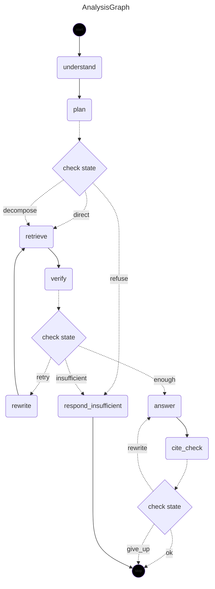

# 阶段 11 · Agent 工作流（LangGraph4j + HITL）

> 状态：**计划草案（待确认）**　|　依赖：阶段 9（会话/Memory）、阶段 10（前端）、阶段 13（stage 事件协议）
> 目标：把现在这条「写死的流水线」升级成**显式状态图**，支持中间决策、人工介入与断点续跑；同时保持阶段 13 的首屏体验。

---

## 0. 为什么做这一步

### 0.1 现在的链路是一条直线，而不是一张图

`ChatService.ask()` 现在是固定的四步：

```
prepare()  →  检索 + 装配上下文  →  AnswerService 生成  →  compose() 打包响应
```

四个环节之间没有任何**判断**。这带来三个具体问题：

| 问题 | 现在的表现 | 想要的能力 |
| --- | --- | --- |
| 复杂问题拆不开 | 「比较 2024 与 2025 的毛利率并解释原因」一次检索、一次生成，模型只能拿一段证据硬答 | 拆成两个子问题分别检索，再合并 |
| 证据不足时不会自救 | 检索不到就拒答（`evidence_insufficient`），不会改写查询重试 | 改写一次（换同义词/放宽年份），仍不行才拒答 |
| 高风险结论没人把关 | 模型直接出答案，用户只能事后判断 | 复杂分析先给「计划 + 草稿要点」，用户确认后再生成 |

这三件事的共同点：**它们都是「下一步做什么」的决策**，不是「怎么算」的实现。决策需要状态、需要跳转、需要暂停 —— 直线代码表达不了。

### 0.2 为什么用 LangGraph4j，而不是自己写个状态机

自己写并不难（一个 `Map<String,Object>` + `while` 循环），但有两件事很难白送：

1. **Checkpoint**：每步状态落库，进程崩了能从断点续跑；同一线程可以回看历史、可以改状态再继续。
2. **interrupt / resume**：`interruptsBefore("approve")` 一行配置就能让图停在某节点前，把控制权交回调用方；恢复时用 `GraphInput.resume(...)` 带回人工输入。HITL 的全部难点（状态冻结、恢复点定位、重复执行防护）都在库里。

这两条正好对应设计文档 §14 的「Agent 执行可追溯 + HITL」。

### 0.3 库的实测事实（2026-10-28，Maven Central + javap）

| 项 | 实测结果 |
| --- | --- |
| 最新版本 | **1.9.7**（`org.bsc.langgraph4j`，2026-10 仍活跃） |
| 与我们的版本对齐 | `langgraph4j-parent:1.9.7` 里 `spring-ai.version = **2.0.1**`，与本项目完全一致 |
| Java 基线 | `maven.compiler.source=17`，我们跑 21，兼容 |
| 要引的坐标 | `langgraph4j-core`（319 KB）、`langgraph4j-spring-ai`（71 KB）、`langgraph4j-postgres-saver`（36 KB） |
| 传递依赖 | `org.bsc.async:async-generator`、`jspecify`、`slf4j-api`；**Jackson 2 与 Gson 都是 `provided`**，不引也能跑 |
| 默认序列化 | `StateGraph(AgentStateFactory)` 构造器内部用的是 **`ObjectStreamStateSerializer`（JDK 序列化）** —— 所以状态里只能放 JDK 可序列化类型 |
| 图构建 API | `StateGraph.addNode(name, AsyncNodeAction)` / `addEdge` / `addConditionalEdges(name, AsyncEdgeAction, Map)` / `compile(CompileConfig)` |
| 运行 API | `CompiledGraph.stream(Map, RunnableConfig)` → `AsyncGenerator<NodeOutput>`；`invoke`；`getState` / `updateState` / `getStateHistory` |
| 中断 API | `CompileConfig.builder().interruptsBefore(Set<String>)` / `interruptsAfter`；中断时抛 `GraphInterruptException`，带 `InterruptionMetadata`（`nodeId()` / `state()` / `reason()`） |
| 恢复 API | **`GraphInput.resume()`** / `GraphInput.resume(Map)`：同一 `threadId` 再调一次 `stream(...)` 即从断点继续 |
| 持久化 | `PostgresSaver.builder().datasource(DataSource).createTables(true).build()`；自带 `LG4JThread` / `LG4JCheckpoint` 两张表与 v1.0→v2.1 迁移脚本 |
| Spring AI 集成 | `org.bsc.langgraph4j.spring.ai` 提供 `StreamingChatGenerator`、`SpringAIToolService`（工具调用）、`SpringAIStateSerializer`（消息序列化） |
| 不引的 | `langgraph4j-studio-*`（可视化调试台）本期不引，说明见 D9 |

> 一个必须记住的坑：`provided` 意味着 **Jackson 2 不在 classpath 上**。本项目 Boot 4 用的是 Jackson 3（`tools.jackson`），所以绝不能用 `JacksonStateSerializer` / `SpringAIJacksonStateSerializer`，否则运行时 `NoClassDefFoundError`。

---

## 1. 范围

### 1.1 本阶段要做

1. 引入 LangGraph4j 三件套，并跑通一个最小图（spike，先验证 Boot 4 下可用）。
2. 定义 `AnalysisState`（显式 state schema，只放 JDK 可序列化类型）。
3. 六个节点：`understand`（理解/补全）→ `plan`（决定走哪条路）→ `retrieve` → `verify`（证据够不够）→ `answer` → `cite_check`。
4. 条件边：`plan` 按问题类型分流；`verify` 不足时回到 `retrieve`（最多一次改写）；`cite_check` 不过回 `answer`（最多一次）。
5. HITL：复杂分析在 `answer` 前暂停，等人 `APPROVE` / `EDIT` / `REJECT`。
6. Checkpoint：每步落库（`PostgresSaver`），进程重启后能恢复；线程 = 一次 run。
7. 业务表 `agent_run` / `agent_run_step`（Flyway V11，带 `tenant_id` + RLS + 注释），记录归属、状态、每一步摘要。
8. REST：`POST /api/agent/runs`、`GET /api/agent/runs/{id}`、`POST /api/agent/runs/{id}/resume`、`GET /api/agent/runs/{id}/stream`（SSE，复用 C15/C16 协议）。
9. 前端：问答页新增「分析计划 + 步骤时间线 + 审批框」，审批后继续流式出答案。

### 1.2 本阶段不做（以及为什么）

| 不做 | 理由 |
| --- | --- |
| 自由 ReAct（让模型自己决定调哪个工具、无限循环） | 演示场景固定（财务问答 + 对比 + 趋势），固定图更可控、可测、可解释；自由 ReAct 的失败模式没法写进验收 |
| 多 Agent 协作（Planner/Writer/Critic 三个 Agent） | 单 Agent 六节点已经够讲；多 Agent 需要消息总线与投票机制，成本翻倍、收益在演示里看不出来 |
| 报告生成（Markdown/Word 研报） | 设计文档把它放在 V3，且依赖图表能力，见 `docs/竞品对比与技术债.md` 的 P2 |
| 工具调用白名单之外的能力（联网搜索、代码执行） | 安全边界：本机演示不引入任意代码执行 |
| LangGraph4j Studio 可视化 | 它是一个独立 web 应用（jetty/springboot 两种），本期用前端自己的步骤时间线展示即可 |
| Redis 做 checkpoint | 现有 Postgres 已够用，多一个容器多一份运维（沿用 ST9 D1 的判断） |
| 跨会话的 Agent 记忆 | 复用阶段 9 的四层 Memory，不为 Agent 另建一套 |
| 自动重试整个 run（超过改写一次） | 会放大模型成本；失败态落到 `agent_run.status=FAILED` 让人决定 |

---

## 2. 契约 C17（草案，落 `docs/关键契约.md`）

### 2.1 状态：`AnalysisState`

状态是整张图唯一的真相源，**必须可 JDK 序列化**（默认序列化器是 `ObjectStreamStateSerializer`）。

| 键 | 类型 | 写入者 | 说明 |
| --- | --- | --- | --- |
| `runId` | String | 入口 | UUID，也是 checkpoint 的 `threadId` |
| `question` | String | 入口 | 用户原话，**永不改写**（改写只写 `rewrittenQuery`） |
| `rewrittenQuery` | String | plan | 检索用的查询（可为空 = 用原问） |
| `queryType` | String | understand | `EXACT_FACT` / `COMPARISON` / `COMPLEX_ANALYSIS` …（沿用 `QueryType` 的枚举名，存字符串） |
| `companyCodes` / `yearFrom` / `yearTo` | List<String> / Integer | understand | 与 `QueryUnderstanding` 对齐 |
| `plan` | List<String> | plan | 人可读的步骤（每项一句话），给前端画计划卡片 |
| `subQuestions` | List<String> | plan | 复杂问题拆出来的子问题 |
| `hits` | List<Map<String,Object>> | retrieve | 每条形如 `{chunkId, documentId, page, sectionPath, type, score}` |
| `evidenceCount` / `insufficient` | Integer / Boolean | verify | 证据是否够（规则判定 + 可选模型判定） |
| `retryCount` | Integer | verify | 改写重试次数，上限 1 |
| `answer` | String | answer | 最终答案（含 `[E1]` 编号） |
| `citationIssues` | List<String> | cite_check | 引用校验问题列表 |
| `decision` | String | resume | `APPROVE` / `EDIT` / `REJECT` |
| `decisionNote` | String | resume | 人工备注（EDIT 时是要点补充） |
| `status` | String | 各节点 | `RUNNING` / `WAITING_APPROVAL` / `DONE` / `FAILED` / `REJECTED` |

三条硬规则：

1. **状态里只放 JDK 类型**（String / List / Map / Integer / Boolean）—— 不放 record、不放 `ChatMessage`、不放 `float[]`。要传结构化对象就转成 `Map`。
2. **节点只能写自己负责的键**（上表「写入者」列），别顺手改别人的字段。
3. **`question` 永不被改写**：改写只写 `rewrittenQuery`，这样「用户到底问了什么」在任何时候都能追溯。

### 2.2 图（本节给了两份视图：原计划形态 + 带改动标记的视图）

```
                ┌──────────────┐
   START ──────▶│ understand   │  规则/LLM 补全，确定性
                └──────┬───────┘
                       ▼
                ┌──────────────┐
                │ plan         │  决定：直答 / 拆子问题 / 改写
                └──┬────────┬──┘
         直答/对比  │        │ 复杂分析
                   ▼        ▼
            ┌───────────┐  ┌─────────────────┐
            │ retrieve  │◀─│ retrieve ×N     │（按 subQuestions 逐个检索）
            └─────┬─────┘  └────────┬────────┘
                  ▼                 ▼
            ┌───────────┐◀──────────┘
            │ verify    │  不足且 retryCount<1 → 改写后回 retrieve
            └─────┬─────┘  仍不足 → respond_insufficient
                  ▼
            ┌───────────┐   ← interruptsBefore("answer")，仅复杂分析
            │ answer    │◀─ 人工 APPROVE/EDIT 后继续；REJECT 直接结束
            └─────┬─────┘
                  ▼
            ┌───────────┐  校验不过且未重试 → 回 answer
            │ cite_check│
            └─────┬─────┘
                  ▼
                 END
```

#### 2.2.1 同一张图，标出「本版本动哪里」

> 库本身的概念（状态 / 通道 / 检查点 / 中断恢复 / 序列化坑）见 `docs/LangGraph4j-工作机制.md`，本节只讲「我们的图长什么样、这版改哪里」。

图例（三种标记，全文统一）：

| 标记 | 含义 | 判断标准 |
| --- | --- | --- |
| `[新]` | 本阶段从零写的代码 | 现在仓库里不存在这段逻辑 |
| `[改]` | 已有逻辑，本阶段只在外面包一层适配（逻辑本身一行不动） | 既有类能直接调，只是要读写 state |
| `[用]` | 直接调用，既不包也不改 | 纯依赖，失败只会影响该节点 |

```text
START
  │ [新] 初始化：校验请求、生成 runId、把 question/tenantId/scope 塞进 AnalysisState
  ▼
[改] understand ────────── 包 RouterService.understand(query, TurnContext)
  │                        出参 qu 拆成 queryType / companyCodes / yearFrom / yearTo / metrics 写进 state
  │ [新]
  ▼
[新] plan ──────────────── 读 qu.queryType 决定路线，不调模型（纯规则）
  │ [新] 条件边：route = DIRECT | DECOMPOSE | REFUSE
  ├── DIRECT（EXACT_FACT / SEMANTIC_EXPLANATION / COMPARISON）──▶ [改] retrieve
  └── DECOMPOSE（COMPLEX_ANALYSIS 且有 subQuestions）──────────▶ [新] retrieve ×N 循环
                                                                        │
                                                                        ▼
                                                                  [改] retrieve（每个子问题各调一次）
  ▼
[新] verify ───────────── 读 AnswerResult.confidence 与 blocks 数，判三条出口
  │ [新] 条件边：verdict = ENOUGH | RETRY | INSUFFICIENT
  ├── RETRY（不足 && retryCount < 1）──▶ [改] rewrite（只写 rewrittenQuery）──▶ 回 retrieve
  ├── INSUFFICIENT ────────────────────▶ [改] respond_insufficient（复用现有拒答文案 + C6 第 5 条）
  └── ENOUGH ──────────────────────────▶ [新] 条件边：只有 DECOMPOSE 路线进 answer 且带中断
  ▼
[新] answer（仅复杂路线）── 前置 interruptsBefore(Set.of("answer"))
  │                          节点内复用 AnswerService.answerStreaming(...) 的 delta 回调
  │ [新]
  ▼
[改] cite_check ────────── 复用 CitationValidator + AnswerService 的编号重排与 ground
  │ [新] 条件边：不过且未重试 → 回 answer
  ▼
END
```

逐项落点（每行都能对应到具体文件，写代码时按这张表检查）：

| # | 图上元素 | 标记 | 复用的既有代码 | 本版本要写的部分 |
| --- | --- | --- | --- | --- |
| 1 | START 初始化 | `[新]` | — | `AnalysisState` 初始 Map（question / tenantId / userId / runId / scopeKind） |
| 2 | `understand` | `[改]` | `RouterService.understand(String, TurnContext)`、`CompanyResolver.resolve(...)` | 节点壳 + 把 `qu` 拆进 state |
| 3 | `understand → plan` 边 | `[新]` | — | 一行 `addEdge` |
| 4 | `plan` | `[新]` | `QueryUnderstanding.queryType()` / `needDecompose()` | 三值分流规则（不调模型） |
| 5 | `plan` 条件边 | `[新]` | — | `addConditionalEdges` + 三个目标声明 |
| 6 | `retrieve` | `[改]` | `HybridRetriever.retrieve(req, qu, scope)`、`ContextBuilder.build(...)` | 节点壳 + 把 `ContextPackage` 累加进 state 的 `blocks` |
| 7 | `retrieve ×N` | `[新]` | 同上 | 顺序 for 循环（**不用 `ParallelNode`**，理由见下方 2.2.2） |
| 8 | `retrieve → verify` 边 | `[新]` | — | 一行 `addEdge` |
| 9 | `verify` | `[新]` | `AnswerResult.confidence`（阶段 5 已有）、`ContextPackage.blocks().size()` | 三条出口的判定阈值 |
| 10 | `rewrite` 回边 | `[改]` | `RouterService` 的降级改写 + `QueryUnderstanding.normalizedQuery()` | 节点只写 `rewrittenQuery`，`retryCount + 1` |
| 11 | `respond_insufficient` | `[改]` | 现有拒答文案 + 契约 C6 第 5 条（answer / note / `evidence_insufficient` 三者必齐） | 组一个 `REJECTED`/`insufficient` 的终态 state |
| 12 | `answer` | `[改]` | `AnswerService.answerStreaming(question, qu, pkg, memory, onDelta)` | 节点壳 + `onDelta` 转成 C15 的 `delta` 事件 |
| 13 | `interruptsBefore(answer)` | `[新]` | — | `CompileConfig` + 审批 REST + `GraphInput.resume(...)` |
| 14 | `cite_check` | `[改]` | `CitationValidator`、`AnswerService` 内的 `renumberCitations` 与 `ground` | 校验失败的回边（最多回一次） |
| 15 | SSE 阶段映射 | `[改]` | 契约 C16 的 `stage` 事件（`ChatStreamEvent.stage(phase,label,detail)`） | `phase` 取值从四个固定值扩成节点 id + 新增 `approval` 事件 |
| 16 | Checkpoint | `[新]` | — | `PostgresSaver` + `agent_run`/`agent_run_step` 两表（V11） |

#### 2.2.2 本版本明确不动的部分（防止范围蔓延）

| 不动的东西 | 为什么不动 | 如果非要动会怎样 |
| --- | --- | --- |
| `HybridRetriever` 内部（Dense/Sparse/RRF/Rerank 权重） | 阶段 4~13 已经调平，评测门槛 `Recall@10=1.000 / MRR=0.782` 是照着现状打的 | 一改就动门槛，需要重跑 27 题评测才能证明没退化 |
| `AnswerService` 的四层校验（格式 / 引用 / 数值落地 / 时间） | 阶段 5~6 修过三次真实事故（编 5,560、编号跳号、无引用） | 校验逻辑散进节点后，非 Agent 路径（`/api/chat`）就与 Agent 路径不一致 |
| C15 的事件 JSON 形状（`meta` / `delta` / `final` / `error`） | 前端 `web/src/utils/sse.ts` 已按它写好解析 | 改形状要同步改两个仓库，且旧客户端直接崩 |
| 前端三栏布局与侧栏 | 阶段 12 刚验证完（拖宽、持久化、窄屏回退） | 这期前端只加「时间线 + 审批框」两块，不改骨架 |
| 检索 Query 的构造（`normalizedQuery`） | `understand` 节点产出后由 `retrieve` 消费，职责已经清晰 | 若在 `retrieve` 里再改写，`verify` 的重试就与首次检索口径不一致 |

为什么 `retrieve ×N` 用顺序循环而不是 `ParallelNode`：

1. 合并顺序必须可复现 —— 并行分支的完成顺序不确定，`blocks` 的先后会抖动，引用编号 `[E1..En]` 跟着抖，评测无法重放。
2. 3 个子问题 × 约 1 s 的检索，顺序执行也只多 2 s，而模型生成要 7 s，收益不可见。
3. 并行的真正收益要等多文档、多公司大范围检索（阶段 14+ 再评估），现在引入只会增加租户上下文与连接池的复杂度。

### 2.3 Checkpoint 与线程

- `threadId` = `runId`（UUID，服务端生成，不可猜）。
- `CompileConfig.builder().checkpointSaver(postgresSaver).interruptsBefore(Set.of("answer")).recursionLimit(12)`。
- `PostgresSaver` 自建 `LG4JThread` / `LG4JCheckpoint` 两张表，**这是 Flyway 管 schema 规则的一个明确例外**：表结构归库自己的迁移脚本（`db/migration/v1.1__init.sql` → `v2.1`），我们不复制、不改写，只登记原因。
- `PostgresSaver` 用一个**专属的 owner 数据源**（不是 `TenantAwareDataSource`）：库给的 DDL 不会带 `tenant_id`，也不会给 `finagent_app` 授权；反过来，任何人通过 API 都拿不到这两张表（没有对应端点），租户边界由 `agent_run` 保证。
- 读到 checkpoint 之前必须先查 `agent_run` 并校验 `tenant_id` / `user_id`，否则等于绕过 RLS。

### 2.4 HITL 语义

| 决定 | 行为 | 状态迁移 |
| --- | --- | --- |
| `APPROVE` | 按当前 plan 与草稿继续生成 | `WAITING_APPROVAL` → `RUNNING` → `DONE` |
| `EDIT` | 把 `decisionNote` 追加到 answer 的提示词（如「补充毛利率口径」），再继续 | 同上 |
| `REJECT` | 不生成，直接落 `REJECTED` + 原因 | `WAITING_APPROVAL` → `REJECTED` |

四条硬规则：

1. **只有 `WAITING_APPROVAL` 能 resume**；其它状态 resume → 409 `RUN_NOT_WAITABLE`。
2. **resume 幂等**：同一 `(runId, decisionSeq)` 重复提交只生效一次（`agent_run_step` 里记 `decision` 行，重复则返回现有结果）。
3. **暂停期间状态冻结**：`WAITING_APPROVAL` 的 run 不允许新问题插入（同一会话再问会新建 run）。
4. **超时不自动通过**：等待超过 `finagent.agent.approval-timeout`（默认 30 分钟）→ `FAILED` + `approval_timeout`，绝不「默认同意」。

### 2.5 与 C15 / C16 的关系

- 流式**沿用同一个 SSE 协议**（`meta` / `delta` / `final` / `error`），只是 `stage` 事件的 `phase` 取值从四个固定值扩展成**节点 id**（`understand` / `plan` / `retrieve` / `verify` / `answer` / `cite_check`）。前端 `StageLine` 不需要改渲染逻辑，只多认几个 label。
- `POST /api/agent/runs/{id}/stream` 与 `POST /api/chat/stream` 共用 `ChatStreamEvent`；差异只有：多了 `plan` 事件（`stage` 的 `detail` 里带 `plan` 数组）与 `approval` 事件。
- HITL 暂停时**不发 `final`**，发 `approval` 事件后关闭流；resume 时重新开一条流（同一个 runId）。

### 2.6 租户与权限

- `agent_run` 带 `tenant_id` + `user_id`，RLS 策略与阶段 8 一致（`p_agent_run_tenant`）。
- 跨租户 / 他人的 run → **404**（不是 403），与 C11 一致。
- `agent_run_step.summary` 只存人可读摘要，**不存证据正文**（正文在 checkpoint 里，且只能经 runId 访问）。

---

## 3. 文件结构

### 3.1 新增

| 文件 | 作用 |
| --- | --- |
| `src/main/java/com/finagent/agent/AnalysisState.java` | 状态工厂 + 键常量 + `AgentState` 子类（只读 JDK 类型） |
| `src/main/java/com/finagent/agent/AnalysisGraph.java` | 组装图：六个节点 + 条件边 + `compile(CompileConfig)` |
| `src/main/java/com/finagent/agent/AgentNodes.java` | 六个节点实现（`AsyncNodeAction`），注入现有 `RouterService` / `HybridRetriever` / `AnswerService` |
| `src/main/java/com/finagent/agent/AgentProperties.java` | `finagent.agent.*`：enabled、approval-timeout、recursion-limit、max-rewrite |
| `src/main/java/com/finagent/agent/AgentCheckpointConfig.java` | `PostgresSaver`（专属 owner 数据源）+ `CompiledGraph` 的 Bean |
| `src/main/java/com/finagent/agent/AgentRun.java` / `AgentRunStep.java` | 两个 record |
| `src/main/java/com/finagent/agent/AgentRunRepository.java` | `JdbcTemplate`：建 run / 更新状态 / 追加 step / 按租户查 |
| `src/main/java/com/finagent/agent/AgentRunService.java` | 启动 run、resume、状态校验、幂等 |
| `src/main/java/com/finagent/agent/AgentController.java` | 四个端点 |
| `src/main/resources/db/migration/V11__agent_run.sql` | 两张业务表 + 索引 + RLS 策略 + 全套 COMMENT |
| `src/test/java/com/finagent/agent/*` | 图单测（`MemorySaver` + 假 ChatModel）、HITL 集成、恢复测试 |

前端（仓库 `financial-ai-web`）：

| 文件 | 作用 |
| --- | --- |
| `src/components/PlanCard.vue` | 计划卡片（`plan` 数组） |
| `src/components/StepTimeline.vue` | 步骤时间线（节点 id + 状态 + 耗时） |
| `src/components/ApprovalCard.vue` | 审批框（通过 / 修改要点 / 拒绝） |
| `src/api/agent.ts` | 四个端点封装 |
| `src/views/ChatView.vue` | 复杂问题走 agent 路径；流式渲染复用现有逻辑 |

### 3.2 修改

| 文件 | 改动 |
| --- | --- |
| `pom.xml` | 加 `langgraph4j-core` / `-spring-ai` / `-postgres-saver` 1.9.7 |
| `src/main/java/com/finagent/chat/ChatService.java` | 复杂问题（`COMPLEX_ANALYSIS` 或需要拆子问题）转 `AgentRunService.start()`；其余仍走原链路 |
| `src/main/java/com/finagent/chat/ChatStreamEvent.java` | 新增 `APPROVAL` 事件类型与 `plan` 载荷 |
| `src/main/resources/application.yml` | 新增 `finagent.agent` 配置块 |

---

## 4. 任务（Task 1~9）

### Task 1　依赖与 spike（先证伪再动工）

**做**：pom 加三个依赖 → 写一个 `AgentSpikeTest`：`StateGraph` 两节点（`a → b`）+ `MemorySaver` + `invoke`，断言状态合并正确；再写一个 `interruptsBefore` 用例，断言第一次 `stream` 抛 `GraphInterruptException`、`GraphInput.resume(Map)` 后能继续。

**验收**：`mvn -B test -Dtest=AgentSpikeTest` 绿；确认**没有** `NoClassDefFoundError: com/fasterxml/jackson/databind/*`。

**如果失败**（Java 序列化与 Spring 代理冲突 / Boot 4 类加载冲突）：改 `langgraph4j-core` + `GsonStateSerializer`（加 gson 依赖，1 MB 以内），并在 §7 偏差登记。**不要**退回 Jackson 2 —— 那会和 Boot 4 的 Jackson 3 抢注解。

### Task 2　V11 迁移

**做**：`agent_run`（`id UUID PK` / `tenant_id` / `user_id` / `conversation_id` / `question` / `status` / `current_node` / `plan_json` / `decision` / `decision_note` / `error` / `created_at` / `updated_at`）+ `agent_run_step`（`run_id` / `seq` / `node` / `status` / `summary` / `duration_ms` / `created_at`，`UK(run_id, seq)`）+ `p_agent_run_tenant` / `p_agent_run_step_tenant` 两条 RLS 策略 + 全套 COMMENT。

**验收**：Flyway 到 V11 success；手工三条探针（owner 看到 N 行 / `finagent_app` 无变量 0 行 / 设 tenant 后 N 行）。

### Task 3　状态与图骨架（不接真模型）

**做**：`AnalysisState` + `AnalysisGraph` 六节点全用**假实现**（节点只改状态、不调外部），`MemorySaver`，写 4 条单测：直答路径、复杂路径、`verify` 不足回 `retrieve`、`cite_check` 不过回 `answer`。

**验收**：4 条绿；`MermaidGenerator` 输出的图与 §2.2 一致（作为文档附件，不引 studio）。

### Task 4　节点实现（接真组件）

**做**：`understand` 复用 `RouterService.understand`；`plan` 用**规则 + 一次 LLM**（复杂问题才调）；`retrieve` 调 `HybridRetriever.retrieve(..., RetrievalProgress)`；`verify` 用规则（命中数 ≥ 阈值 + 命中是否含目标指标）；`answer` 调 `AnswerService.answerStreaming`；`cite_check` 复用 `CitationValidator`。

**验收**：单测覆盖「检索为空 → 不足 → 改写一次 → 仍空 → 拒答」；trace 里能看到节点耗时。

### Task 5　HITL

**做**：`interruptsBefore("answer")` 仅复杂问题启用（`CompileConfig` 是编译期配置，所以**编两张图**：`fastGraph` 与 `hitlGraph`，按问题类型选）；`AgentRunService.resume(runId, decision, note)`；三种决定 + 幂等 + 超时。

**验收**：集成测试跑三遍：APPROVE 出答案、EDIT 的 note 出现在答案里、REJECT 不生成且 `status=REJECTED`；重复 resume 只生效一次。

### Task 6　Checkpoint 持久化（PostgresSaver）

**做**：`AgentCheckpointConfig` 用专属 `HikariDataSource`（owner，不复用 `TenantAwareDataSource`）建 `PostgresSaver`；`createTables(true)` 首次建表；跑通「进程内建图 → 暂停 → 重启应用 → 用同 runId resume」。

**验收**：`LG4JThread` / `LG4JCheckpoint` 出现行；重启后 resume 成功；`docs/关键契约.md` C17 里登记「Flyway 例外」。

### Task 7　REST + SSE

**做**：`POST /api/agent/runs`（body：question/scope/conversationId）→ 202 + `{runId}`；`GET /api/agent/runs/{id}/stream`（SSE：`stage`(节点) → `meta`(计划 + 证据) → `delta`* → `approval` 或 `final`）；`POST /api/agent/runs/{id}/resume`；`GET /api/agent/runs/{id}`（状态 + 步骤）。

**验收**：`RestAuthContractTest` 口径补三条（无 token 401 / 他人 run 404 / 越权 resume 404）；SSE 事件顺序与 C16 表一致。

### Task 8　前端

**做**：复杂问题自动走 agent 路径（后端返回 `runId` 时前端切到「计划 + 时间线」模式）；`ApprovalCard` 三个按钮；resume 后接同一条流；失败态可读。

**验收**：headless 探针跑「复杂问题 → 计划出现 → 暂停 → 点通过 → 答案出现」四步，控制台 clean。

### Task 9　文档与报告

**做**：`docs/关键契约.md` C17 定稿；`docs/术语表.md` 加「Agent 状态图 / Checkpoint / HITL / interrupt-resume / 节点与边」；README 阶段 11 节；`docs/阶段11-Agent工作流报告.md`（骨架同阶段 12/13）；roadmap 标完成；ST11 §7 偏差登记。

---

## 5. 总验收

| # | 门槛 | 怎么验 |
| --- | --- | --- |
| 1 | 最小图在 Boot 4 下可跑 | `AgentSpikeTest` 绿，无 Jackson 2 相关异常 |
| 2 | 直答路径不回归 | 事实题走原链路或 fastGraph，`ChatStreamE2ETest` 仍绿 |
| 3 | 复杂路径能拆子问题 | 单测断言 `subQuestions.size() >= 2` 且检索被调用两次 |
| 4 | 证据不足会改写重试一次 | 单测断言 `retryCount==1` 且 `rewrittenQuery` 非空 |
| 5 | HITL 三种决定正确 | 集成测试三条 + 幂等一条 |
| 6 | 重启后可恢复 | 手工重启应用 + `GET /runs/{id}` 仍 `WAITING_APPROVAL`，resume 成功 |
| 7 | 跨租户 404 | e2e：outsider 访问 analyst 的 runId → 404 且正文无敏感字段 |
| 8 | 首屏不回归 | 首个 `stage` ≤ 300 ms，`meta` ≤ 5 s（沿用阶段 13 口径） |
| 9 | 后端全量绿 | `mvn -B test` 0 失败（基线 568 + 新增） |
| 10 | 前端构建 + 单测绿 | `npm run build` + `vitest` |

---

## 6. 测试计划

| 层 | 类 | 覆盖 |
| --- | --- | --- |
| L1 单测 | `AnalysisStateTest` | 状态合并、键白名单、非法类型拒绝 |
| L1 单测 | `AgentNodesTest` | 六个节点的纯逻辑（假依赖） |
| L2 集成 | `AgentGraphDbTest`（`@Tag("db")`） | `MemorySaver` 跑全图；`PostgresSaver` 落库 + 恢复 |
| L2 集成 | `AgentHitlTest`（`@Tag("db")`） | 三种决定 + 幂等 + 超时 |
| L2 集成 | `AgentControllerTest` | 四个端点的状态码与错误形状 |
| L3 e2e | `AgentE2ETest`（`@Tag("e2e")`） | 真模型：复杂问题 → 暂停 → 通过 → 答案；首屏时延 |

---

## 7. 偏差登记

| # | 计划原文 | 实际 | 原因 |
| --- | --- | --- | --- |
| （执行时填） | | | |

---

## 8. 决策（待确认）

| # | 决策 | 结论 |
| --- | --- | --- |
| D1 | LangGraph4j 版本与坐标 | **1.9.7**，只引 `core` / `spring-ai` / `postgres-saver` |
| D2 | 状态用什么 | 自定义 `AnalysisState`（不用 `MessagesState`），只放 JDK 类型 |
| D3 | 序列化 | 默认 `ObjectStreamStateSerializer`；失败才退 `GsonStateSerializer` |
| D4 | Checkpoint 表归属 | `LG4J*` 由库自建（登记为 Flyway 例外），业务表 `agent_run*` 走 V11 |
| D5 | Checkpoint 数据源 | 专属 owner `HikariDataSource`，不复用 `TenantAwareDataSource` |
| D6 | HITL 触发条件 | 仅 `COMPLEX_ANALYSIS`（或模型判 `needDecompose=true`） |
| D7 | 人工决定 | `APPROVE` / `EDIT`（追加要点）/ `REJECT`，不自动通过 |
| D8 | 流式协议 | 复用 C15/C16；`stage.phase` 扩展为节点 id，新增 `approval` 事件 |
| D9 | 可视化 | 用前端自己的时间线，不引 `langgraph4j-studio` |
| D10 | 工具集 | 只做「检索 / 拆解 / 改写」，不做联网与代码执行 |

---

## 9. 执行顺序

```
Task 1 依赖与 spike ──┬─▶ Task 2 V11 ──▶ Task 3 图骨架 ──▶ Task 4 节点实现
                      │                                        │
                      └─▶ Task 6 Checkpoint（可与 3/4 并行）    ▼
                                                        Task 5 HITL
                                                             │
                                                             ▼
                                              Task 7 REST+SSE ──▶ Task 8 前端 ──▶ Task 9 文档
```

Task 1 是硬门槛：**spike 不过就改方案，不往上堆代码**。

---

## 10. 风险与回滚

| 风险 | 影响 | 兜底 |
| --- | --- | --- |
| LangGraph4j 与 Boot 4 类加载冲突 | Task 1 直接卡住 | 退 `GsonStateSerializer`；再不行只引 `core`（不用 spring-ai 模块），工具调用自己写 |
| Java 序列化与 Spring 代理对象冲突 | 状态里混进不可序列化对象 | 状态只放 JDK 类型（C17 硬规则 1）；`AnalysisStateTest` 里加「反射检查所有值为 Serializable」 |
| `PostgresSaver` 建表与 Flyway 抢 schema | 迁移顺序错乱 | 首次启动前手工 `createTables(true)` 一次，之后 `createTables(false)` |
| HITL 暂停把 SSE 连接挂死 | 前端转圈 | 暂停即关流（发 `approval` 后 complete），resume 另开一条 |
| 复杂路径慢（多一次 LLM 规划 + 多次检索） | 首屏变差 | 规划与检索并行；`plan` 用规则优先、模型兜底 |
---

## 12. 执行前修订（2026-10-29，Task 1 开工）

### 12.1 D4 定案：`LG4J*` 两张表由 Flyway 建，运行时 `createTables(false)`

| 方案 | 做法 | 代价 | 结论 |
| --- | --- | --- | --- |
| A（原 D4） | `createTables(true)`，库自己建表 | 违反「schema 只由 Flyway 管」；`flyway_schema_history` 里看不到这两张表，后续没人知道它们存在 | 否 |
| B（手写 DDL） | 自己写 `CREATE TABLE LG4JThread ...` | 库升级时表结构变了，我们的 DDL 不知道要跟 | 否 |
| **C（定案）** | **把 jar 自带的 `db/migration/v1.0__init.sql` ~ `v2.1__init.sql` 原文抄成 `V12__langgraph_checkpoint.sql`（V11 已被阶段 10 的登录迁移占用；`agent_run` 顺延到 V13，见 §12.5）；运行时 `createTables(false)`** | 升级 LangGraph4j 时要 diff 一次新 jar 的 sql | **采用** |

理由：既守「schema 只由 Flyway 管」，又不发明 DDL —— 抄的是库自己发布在 jar 里的文件（`langgraph4j-postgres-saver-1.9.7.jar!db/migration/*.sql`），升级时 `jar xf` 出来对比一遍即可。

### 12.2 Task 1 spike 的五个断言（不碰数据库，用 `MemorySaver`）

| # | 断言 | 为什么是它 |
| --- | --- | --- |
| 1 | 三个包能在 Boot 4 + Spring AI 2.0.1 下解析、编译 | 版本冲突只有真解析才知道 |
| 2 | 默认序列化器能序列化「只含 JDK 类型」的状态 | 决定 Task 6 的检查点能不能落库 |
| 3 | `stream(...)` 每走完一个节点推一次，顺序与图一致 | 决定 C16 的 `stage` 事件能否直接由 `NodeOutput` 驱动 |
| 4 | 追加通道累加、覆盖通道替换、自定义 reducer 求和 | 决定 `steps` 与 `blocks` 怎么写 |
| 5 | `interruptsBefore` 抛 `GraphInterruptException`，`GraphInput.resume(Map)` 能继续跑到 END | HITL 的地基；失败则 Task 5 要换方案 |

### 12.3 文件清单（本步骤只动两个文件）

| 文件 | 动作 |
| --- | --- |
| `pom.xml` | 加 `langgraph4j-core` 与 `langgraph4j-postgres-saver`（**`-spring-ai` 推迟到 Task 4 再评估**，见 12.4） |
| `src/test/java/com/finagent/agent/GraphSpikeTest.java` | 新增，纯单测（不启 Spring、不打 `db` 标签） |

### 12.4 与 §8 决策的两处偏差

| 决策 | 原文 | 调整 | 理由 |
| --- | --- | --- | --- |
| D1 | 一次引入 core / spring-ai / postgres-saver | Task 1 只引 core + postgres-saver | `-spring-ai` 只在用 `StreamingChatGenerator` / `SpringAIToolService` 时才需要；先用最小面跑通，Task 4 要用再加 |
| D4 | 库自建表 | 改由 Flyway 建（见 12.1） | 守「schema 只由 Flyway 管」 |
### 12.5 Task 1 spike 结果（2026-10-29，7 个断言全部通过，其中一条被实测推翻）

跑法：`mvn -B test "-Dtest=GraphSpikeTest"` → **6 个用例全绿，0.36 秒**（纯单测，不启 Spring、不连库）。

| # | 断言 | 结果 | 证据 |
| --- | --- | --- | --- |
| 1 | 三个包能在 Boot 4 下解析 | ✅ | `mvn dependency:build-classpath` 解析出 `langgraph4j-core-1.9.7` / `langgraph4j-postgres-saver-1.9.7` / `async-generator-5.1.0`（注意传递依赖是 **5.1.0**，不是文档里常写的 1.2.x） |
| 2 | 默认序列化器不是 Jackson | ✅ | `graph.getStateSerializer().getClass().getName()` 含 `StateSerializer` 且不含 `Jackson` |
| 3 | `stream` 每个节点推一次 | ✅ **但有哨兵** | 2 个节点推了 **4 条**：`__START__`、`first`、`second`、`__END__`；`isSTART()` / `isEND()` 可判别 → **映射 stage 事件时必须过滤这两个哨兵** |
| 4 | 通道合并符合声明 | ✅ | `steps` 追加成 `[one, two]`、`score` 累加成 3、`question` 被覆盖 |
| 5 | 条件边分流 | ✅ | 同一个 `CompiledGraph` 按 `question` 内容走 `deep` / `direct` |
| 6 | `recursionLimit` 挡死循环 | ✅ | `a↔b` 环 + `recursionLimit(6)` → 抛 `RuntimeException` |
| 7 | 中断 + resume | ⚠️ **机制与计划写的不一样** | 见下 |

#### 被推翻的那条：中断不抛异常

计划（以及我上一版说明文档）写的是「跑到中断节点前抛 `GraphInterruptException`」。实测 1.9.7 的 `stream(...)` 路径：

```text
PROBE-OUT node=__START__
PROBE-OUT node=draft
PROBE-NO-THROW                       ← 没有异常
PROBE-SNAP node=draft next=answer     ← 静静停在 answer 之前
```

正确的判断方式是 **看状态快照的 `nextNodeId()`**：等于 `answer` 就说明「卡在 answer 之前等人」。`GraphInterruptException` 仍然存在（`GraphInterruptException.of(Throwable)`），但它服务的是节点内部主动中断（`InterruptibleAction`）那条路径，不是 `interruptsBefore`。

#### 另外两条实测结论（都会写进 C17）

1. **`GraphInput.resume(Map)` 的 Map 会被合并进状态**：resume 时传 `{decision: APPROVE}`，`answer` 节点里 `state.value("decision", "none")` 读到了 `APPROVE`，最终 `data()` 里也有这个键 —— HITL 传人工决定就靠它，不需要额外表。
2. **`releaseThread` 默认 `true`，跑完 END 就释放线程**：之后 `getState(cfg)` 直接抛 `IllegalStateException: Missing Checkpoint!`。要「跑完还能查状态 / 还能基于它再 resume」必须 `releaseThread(false)`；中断（没到 END）时不影响，resume 照常。

#### 三处连带修正

| 修正 | 原计划 | 现在 |
| --- | --- | --- |
| HITL 判定 | catch `GraphInterruptException` | 读 `app.getState(cfg).nextNodeId()`，等于中断点即「等待审批」 |
| stage 事件映射 | 每个 `NodeOutput` 一条 | 先过滤 `isSTART()` / `isEND()` 两个哨兵，再映射（否则前端会多出两段空状态） |
| 迁移编号 | V11 = `agent_run`、V12 = `LG4J*` | **V12 = `LG4J*`（已写）、V13 = `agent_run`** —— 计划写的时候漏了：`V11` 已被阶段 10 的 `V11__login_and_session.sql` 占用，直接加 V11 会让 Flyway 报 `Found more than one migration with version 11`（实测 127 个 Spring 上下文全挂），见 §12.6 |

#### 还有一个待验项（Task 6 之前必须回答）

`PostgresSaver` 默认读的是 **v1.1** 这套 SQL（`sqlInitResourcePath() = db/migration/v1.1__init.sql`，`javap -c` 可见），而 `PostgresSaverV2` 读 v2.1。我们 V11 抄的是 v1.1（`thread_id UUID` + `state_data TEXT` + 部分唯一索引）。**Task 6 接 PostgresSaver 时要验证「同一个 thread_name 在中断后 resume 不会被唯一索引挡住」**：v1.1 的 upsert 是 `ON CONFLICT (thread_name) WHERE is_released = FALSE DO NOTHING`，中断时该行 `is_released = FALSE`，所以 resume 会复用同一行 —— 这一点在 MemorySaver 上已验证，换成 Postgres 还要再验一次。
### 12.6 踩坑：新迁移不能凭「最后一个编号」猜

现象：把 LG4J 的两张表写成 `V11__langgraph_checkpoint.sql` 之后，全量 `mvn -B test` 从 568 通过变成 **127 个错误**，每个 `@SpringBootTest` 都报：

```text
Error creating bean with name 'flywayInitializer' ...:
  Found more than one migration with version 11
```

原因：`V11` 早被阶段 10 的 `V11__login_and_session.sql`（账号密码登录 + `api_session`）占用。那个迁移不在我的上下文里，我按「V05 之后是 V08、V09、V10」的顺序推，推错了。

修法：`V11__langgraph_checkpoint.sql` → **`V12__langgraph_checkpoint.sql`**（`agent_run` 顺延 V13）。

教训（写进 docs/测试规范.md 的迁移条目）：**新增迁移前必须先 `Get-ChildItem src/main/resources/db/migration` 看实际文件名，不能按记忆推编号**；而且这类错误不会在编译期暴露，只在「起 Spring 上下文」时炸，跑单测（`-Pfast`）也发现不了 —— 所以加迁移的当次必须跑一次 `-Pdb` 或全量。
还有一层坑：改名之后重跑，**还是报同一个错** —— 因为 `target/classes/db/migration/` 里还留着上次构建复制过去的 `V11__langgraph_checkpoint.sql`（`maven-resources-plugin` 只增不删，和阶段 10 静态资源残留是同一个病）。删掉或 `mvn clean` 才真正生效。

验证：修完 `flyway_schema_history` 最新两条是 `12 langgraph checkpoint` 与 `11 login and session`，`\d LG4JThread` 显示 `thread_id uuid` + `idx_unique_lg4jthread_thread_name_unreleased ... WHERE is_released = false`，`LG4JCheckpoint.state_data` 是 `text` —— 与 jar 里 v1.1 的 DDL 逐列一致。

### 12.7 Task 2 执行结果：`agent_run` / `agent_run_step`（V13）

交付文件：

| 文件 | 内容 |
| --- | --- |
| `src/main/resources/db/migration/V13__agent_run.sql` | 两张表 + 4 个索引 + 2 条 RLS 策略 + 授权 + 全套 COMMENT（5,080 字符） |
| `src/main/java/com/finagent/agent/AgentRun.java` | record：id/tenantId/userId/conversationId/question/status/currentNode/planJson/decision/decisionNote/error/createdAt/updatedAt + 5 个状态常量、3 个决定常量、`waitingForApproval()`、`finished()` |
| `src/main/java/com/finagent/agent/AgentRunStep.java` | record：id/tenantId/runId/seq/node/status/summary/durationMs/createdAt + OK/FAILED/SKIPPED |
| `src/main/java/com/finagent/agent/AgentRunRepository.java` | `create` / `find` / `listByConversation` / `updateCurrentNode` / `markWaitingApproval` / `recordDecision` / `markDone` / `markFailed` / `markRejected` / `nextSeq` / `appendStep` / `steps` |
| `src/test/java/com/finagent/agent/AgentRunRepositoryTest.java` | 7 个用例（`@Tag("db")`），全绿 |

三处与计划不同的地方（都记在这里，不改 §4 原文）：

1. **`agent_run_step` 也带 `tenant_id`**（计划只写了 `run_id/seq/node/...`）。原因同 V8 的教训：RLS 不会替我们 join 父表，子表不带租户就只能靠应用层守，等于少一道防线。代价是插入时要多传一个参数（`appendStep` 的第一个参数就是它）。
2. **表名与列名全部带完整 COMMENT**（计划写「全套 COMMENT」，这里落实为 20 条 `COMMENT ON COLUMN` + 2 条 `COMMENT ON TABLE`），后续写报告/DBeaver 看表能直接读懂。
3. **状态与决定不用 PG 枚举**，用 `VARCHAR` + `CHECK`：枚举加值要 `ALTER TYPE`，而 CHECK 只在迁移里改一行；Java 侧对应常量放在 `AgentRun` 里，不从库里读。

实测（2026-10-29）：

| 检查 | 结果 |
| --- | --- |
| Flyway | 最新一条 `13 \| agent run \| t` |
| `pg_policies` | `p_agent_run_tenant`、`p_agent_run_step_tenant` 两条 |
| RLS 四探针 | owner 看到 **1** 行 → 切 `finagent_app` 未设变量 **0** 行 → 设 `app.tenant_id=1` **1** 行 → 设 `=2` **0** 行 |
| `AgentRunRepositoryTest` | `Tests run: 7, Failures: 0, Errors: 0`（19.75 秒，含一次 Spring 上下文启动） |

### 12.8 Task 3 执行结果：状态与图骨架（假节点，不接模型）

| 文件 | 内容 |
| --- | --- |
| `src/main/java/com/finagent/agent/AnalysisState.java` | `extends AgentState`，19 个键；每个键一个常量 + 一个 getter |
| `src/main/java/com/finagent/agent/AnalysisNodes.java` | 8 个方法的接口（understand/plan/retrieve/verify/rewrite/answer/citeCheck/respondInsufficient） |
| `src/main/java/com/finagent/agent/AnalysisGraph.java` | 八个节点 id 常量 + `fastGraph()` / `hitlGraph()` / `mermaid()`；三条条件边；`GraphStateException` 统一包成 `IllegalStateException` |
| `src/test/java/com/finagent/agent/FakeAnalysisNodes.java` | 假节点（三个开关：首检有无证据 / 改写后有无证据 / 引用校验前几次不过） |
| `src/test/java/com/finagent/agent/AnalysisGraphTest.java` | 10 个用例，全绿（0.5 秒） |

10 个用例覆盖的分支：

| # | 用例 | 断言要点 |
| --- | --- | --- |
| 1 | `directPathRunsToEnd` | 节点序列 `understand → plan → retrieve → verify → answer → cite_check`；status=DONE；答案含 `[E1]`；**原问未被改写** |
| 2 | `complexPathDecomposes` | 复杂问题 → 2 个子问题；`retrieve` 只跑一次但命中 6 条（节点内按子问题循环） |
| 3 | `insufficientRewritesOnceThenRecovers` | 序列含 `rewrite → retrieve`；retryCount=1；最终 DONE |
| 4 | `stillInsufficientAfterRewriteRefuses` | 改写后仍空 → `respond_insufficient` 终态，答案是「证据不足：…」可读文案 |
| 5 | `citeCheckLoopsBackOnce` | 序列 `answer → cite_check → answer → cite_check`；最终 issues 为空 |
| 6 | `citeCheckGivesUpAfterOneRetry` | 连续两次不过 → 不再回写，直接 END（不无限循环） |
| 7 | `blankQuestionRefuses` | 空问题 → `plan` 直接判 REFUSE，不走检索 |
| 8 | `hitlStopsBeforeAnswerThenResumes` | 第一次只跑到 `verify`，`getState().nextNodeId() == "answer"`；resume(APPROVE) 后跑 `answer → cite_check` |
| 9 | `editNoteShapesTheAnswer` | EDIT 的 note 出现在答案里（`decisionNote` 透传） |
| 10 | `mermaidListsEveryNode` | 图里八个节点齐全；同时把 Mermaid 写到 `target/analysis-graph.mmd` |

#### 与 C17 表对不上的四处（都是实测逼出来的）

| # | 计划/契约写法 | 实际实现 | 为什么 |
| --- | --- | --- | --- |
| 1 | `yearFrom` / `yearTo` 是 `Integer`，缺省为空 | 通道默认值 **`0`（`UNKNOWN_YEAR`）**，getter 把 0 翻成 `null` | 库初始化状态时会 `Collectors.toMap`，**通道默认值不能为 null**，否则第一次 `stream` 就 NPE（实测 9 个用例同时挂） |
| 2 | `citationIssues` 是「问题列表」 | 通道用**覆盖语义**（`Channels.base`）而不是追加 | 追加语义下「第二轮已经没问题」也清不掉第一轮的问题，`cite_check` 会永远不过 |
| 3 | `answer` 只在复杂路线 | 两条路线都走 `answer`，靠**编两张图**区分要不要人批 | `interruptsBefore` 是编译期配置，不能按请求开关（ST11 D6 已预料，这里落实） |
| 4 | 计划没提 | 即使 `fastGraph()` 也 `releaseThread(false)` | 库默认 `true`，跑到 END 就释放，之后 `getState` 抛 `Missing Checkpoint!`；我们要能查最终状态 |

另外两条实现说明：`plan` 的三值分流（DIRECT / DECOMPOSE / REFUSE）**不存在专门的 `route` 键**，条件边直接读 `subQuestions()` 与 `question()` —— 少一个键就少一个「谁写谁读」的歧义；`retrieve ×N` 是节点内顺序 for 循环（不用 `ParallelNode`，理由见 §2.2.2）。

#### Mermaid 图（由 `AnalysisGraph.mermaid()` 生成，贴在这里代替 Studio）



```text
注意：MermaidGenerator 的输出头是 "flowchart TD"（不是 "graph TD"），前面还有 YAML 标题块。
前端/文档要渲染时按 flowchart 语法贴，不要按 graph 语法。
```

---

## 13. 执行前修订（2026-10-29，Task 4 开工：节点接真组件）

Task 3 的图能跑，但节点全是假的。Task 4 要把八个节点换成真实现，同时回答三个计划里没写清的问题：**作用域放哪**、**流式回调放哪**、**谁来编排**。

### 13.1 三个「不能进状态」的东西怎么处理

C17 硬规则 1 要求状态只放 JDK 可序列化类型，但节点真正需要的东西有三样不是 JDK 类型：`ResolvedScope`（record）、`MemoryContext`（record）、delta 回调（`Consumer<String>`）。三条处理办法：

| 东西 | 处理 | 理由 |
| --- | --- | --- |
| 作用域 | 状态里存**请求层面的 `ChatScope` 拆解**：`scopeKind` / `scopeDocumentIds` / `scopeCompanyCodes` / `scopeYears` / `scopeDocTypes`；每次检索前用 `ScopeResolver.resolve(...)` **重新解析** | ① 全是 JDK 类型；② 重启后仍能重建（Task 6 要验）；③ 重新解析等于重新过一遍 ACL —— 运行期间权限被收回也能立刻生效 |
| 记忆 | 状态里存 `memoryText`（已渲染好的一段字符串） | 同上；答案节点用 `new MemoryContext(memoryText, EMPTY_STATS, List.of())` 重建。**不存结构**，因为结构化上下文只影响 Prompt 文本，不影响校验 |
| delta 回调 | 不放状态，放进程内的 `AnswerStreamBridge`（`Map<runId, Consumer<String>>`） | 回调不能序列化；桥的生命周期 = 一次 HTTP 请求。非流式调用时桥里没有 entry，节点只生成不推送 |

新增的状态键（在 C17 表基础上追加，写进 C17 定稿时一起补）：

| 键 | 类型 | 写入者 | 说明 |
| --- | --- | --- | --- |
| `scopeKind` | String | 入口 | `CORPUS` / `DOCUMENTS` / `FILTER` |
| `scopeDocumentIds` | List<Long> | 入口 | DOCUMENTS 模式的文档 id |
| `scopeCompanyCodes` / `scopeYears` / `scopeDocTypes` | List | 入口 | FILTER 模式的三个条件 |
| `conversationId` | Long | 入口 | 0 表示无会话 |
| `memoryText` | String | 入口 | 已渲染的记忆段（空串表示没有） |
| `refuseReason` | String | understand | 非空表示「这条问题不该检索」（公司不在作用域等），plan 直接判 REFUSE |
| `warnings` | List<String>（追加） | 各节点 | 与 `AnswerResult.warnings` 合并后进 `agent_run` 响应 |
| `citationCount` | Integer | cite_check | 校验通过的引用条数（前端显示用） |

### 13.2 八个节点各自接什么（逐行对照）

| 节点 | 调用的真组件 | 写哪些键 |
| --- | --- | --- |
| `understand` | `RouterService.understand(question)`、`ScopeResolver.resolve(...)`、`CompanyResolver.resolve(...)` | `queryType` / `companyCodes` / `yearFrom` / `yearTo` / `refuseReason` / `plan` |
| `plan` | 纯规则（**不调模型**，见 13.3） | `subQuestions` / `plan` / `rewrittenQuery` |
| `retrieve` | `HybridRetriever.retrieve(req, qu, scope, progress)`、`ContextBuilder.build(...)` | `hits` / `evidenceCount` |
| `verify` | 纯规则（阈值 + 指标命中） | `insufficient` |
| `rewrite` | 纯规则（指标词拼进检索式） | `rewrittenQuery` / `retryCount` / `plan` |
| `answer` | `AnswerService.answerStreaming(question, qu, pkg, memory, onDelta)` | `answer` / `status` / `warnings` |
| `cite_check` | `CitationValidator.validate(emitted, pkg.blocks())` | `citationIssues` / `citeAttempts` / `citationCount` |
| `respond_insufficient` | 常量文案（C6 第 5 条：答案 + 原因 + 警告三者齐） | `answer` / `status` / `warnings` |

`retrieve` 里 `ContextPackage` **不存状态**：只把 `chunkId/parentId/score` 存进 `hits`（`ContextBuilder` 本来就只按 id 回库取正文），`answer` 节点用它们重建 `RetrievalRequest → RetrievedChunk → build()`。这样状态始终只有 Map/List/数字。

### 13.3 plan 与 verify 的规则（本版不调模型）

| 节点 | 规则 | 为什么先这样 |
| --- | --- | --- |
| `plan` 拆子问题 | `queryType == COMPLEX_ANALYSIS` 且问题里有「和 / 与 / 、 / ，/ ,」→ 按这些符号切句，丢掉长度 < 4 的片段，最多 `finagent.agent.max-sub-questions`（默认 4）条；否则单条（= 原问） | 计划写的是「规则 + 一次 LLM」，但一次 LLM 会让首屏多 3 秒，且本语料的复杂问题几乎都由连接词构成；先用规则，评测证明不够再换（记进偏差） |
| `verify` 判定 | `insufficient = hits 为空 || evidenceCount < minEvidence(默认 2) || 目标指标一个都没命中`；「命中」= `QueryUnderstanding.metrics` 里任一指标出现在某条 hit 的 sectionPath/title/snippet 里 | 只看条数会被「召回到一堆无关表格」骗过；指标命中是最便宜的语义校验 |
| `rewrite` | `rewrittenQuery = question + " " + metrics.join(" ")`；`plan` 追加「证据不足，改写后重试：…」 | 规则改写可复现、可解释；模型改写留到评测证明规则不够时 |

### 13.4 编排：`AgentRunService`

| 方法 | 做什么 |
| --- | --- |
| `run(question, scope, conversationId)` | 1) `TenantContext.require()` 拿身份；2) 生成 `runId=UUID`；3) `agent_run` 落库（RUNNING）；4) 组初始 state；5) `compiled.stream(GraphInput.args(state), cfg(threadId=runId))`；6) 每个 `NodeOutput`：`updateCurrentNode` + `appendStep`（summary 按节点名生成）；7) 终态：答案含拒答 → `markRejected`（`respond_insufficient` 分支）否则 `markDone`；异常 → `markFailed` |

**Task 4 不接 ChatService、不开 REST、不做 HITL**（分别属于 Task 7、Task 5）：先用单测 + 一个真库集成测试证明「一条复杂问题能从入口跑到答案并留下步骤」。

### 13.5 配置项（`finagent.agent`）

| 键 | 默认 | 用途 |
| --- | --- | --- |
| `enabled` | false | 总开关；关着时 `AgentRunService` 直接拒绝（Task 7 才在 ChatService 里打开） |
| `min-evidence` | 2 | verify 的证据条数阈值 |
| `max-sub-questions` | 4 | plan 拆子问题上限 |
| `recursion-limit` | 25 | 图的最大步数（库默认值） |
| `hitl` | true | 复杂问题是否在 `answer` 前等人批（Task 5 生效；Task 4 一律用 `fastGraph`） |

### 13.6 验收（Task 4 完成口径）

| # | 验收 | 怎么验 |
| --- | --- | --- |
| 1 | 八个节点都有真实现，且不 new 任何依赖（全部构造器注入） | `RealAnalysisNodes` 构造器 + 单测 mock |
| 2 | 公司不在作用域 → `refuseReason` 非空 → 直接 `respond_insufficient`，不检索 | 单测 |
| 3 | 复杂问题按连接词拆出 2 条子问题，`retrieve` 对每条各检索一次且按 chunkId 去重 | 单测（mock retriever 返回重叠加） |
| 4 | 检索为空 → verify 不足 → rewrite 一次 → 仍空 → 拒答（C6 第 5 条三件套齐） | 单测 |
| 5 | 指标未命中也要判不足（条数够但全是无关块） | 单测 |
| 6 | 一条真问题能跑完整图，`agent_run` 有 1 行 + `agent_run_step` ≥ 6 行，状态 DONE | `@Tag("db")` 集成测试（真库、假检索器/假答案器） |
| 7 | 全量非 e2e 不回归（基线 591） | `mvn -B test` |

### 13.7 Task 4 执行结果（2026-10-29）

交付文件：

| 文件 | 内容 |
| --- | --- |
| `src/main/java/com/finagent/agent/RealAnalysisNodes.java` | 八个节点的真实现（构造器注入 8 个依赖，方法里不 new 任何东西） |
| `src/main/java/com/finagent/agent/ScopeMapper.java` | `ChatScope` ↔ 状态里的六个 JDK 键；`toQuery(state)` 还原 `QueryUnderstanding` |
| `src/main/java/com/finagent/agent/AnswerStreamBridge.java` | `Map<runId, Consumer<String>>`：节点里的 delta 送回 HTTP 响应，请求结束必须 `clear` |
| `src/main/java/com/finagent/agent/AgentProperties.java` | `finagent.agent.*`（enabled / min-evidence / max-sub-questions / recursion-limit / hitl） |
| `src/main/java/com/finagent/agent/AgentGraphConfig.java` | `AnalysisGraph` bean（检查点先用 `MemorySaver`，Task 6 换 `PostgresSaver`） |
| `src/main/java/com/finagent/agent/AgentRunService.java` | 发 runId → 落库 → 跑图 → 每步 `appendStep` → 终态；`requireOwned` 校验归属 |
| `src/main/java/com/finagent/agent/AgentRunNotFoundException.java` | 对外 404 语义（不确认存在性） |
| `src/test/java/com/finagent/agent/RealAnalysisNodesTest.java` | 10 个单测（mock 全部依赖，不启 Spring） |
| `src/test/java/com/finagent/agent/AgentRunServiceDbTest.java` | 5 个真库测试（`@Tag("db")`，图用假节点） |
| `src/main/resources/application.yml` | 新增 `finagent.agent` 块（`enabled: false`，Task 7 才打开） |

实测：

| 项 | 结果 |
| --- | --- |
| `RealAnalysisNodesTest` | **10 / 10**（3.4 秒）：understand 写结构化字段 / 公司不在作用域拒答 / 作用域空拒答 / 复杂问题拆两条 / 检索去重 / verify 三条 / rewrite / answer 流式经桥 / cite_check 两类问题 / 拒答文案 |
| `AgentRunServiceDbTest` | **5 / 5**（56 秒）：跑完 DONE + 6 步落库 + currentNode=cite_check；始终不足 → REJECTED + note；开关关着拒绝且不落库；无身份拒绝；别人的 run → 404 语义 |
| 全量非 e2e | **606 通过 / 0 失败 / 1 跳过 BUILD SUCCESS**（Task 3 后 591，+15） |

三处与 §13 预想的偏差：

| # | 预想 | 实际 | 原因 |
| --- | --- | --- | --- |
| 1 | `plan` 用「规则 + 一次 LLM」 | **只规则**，没调模型 | 一次 LLM 让首屏多约 3 秒；本语料的复杂问题几乎都由「和 / 与 / 、」构成，规则先跑，评测证明不够再换 |
| 2 | `cite_check` 只看 `CitationValidator` 的 dropped | 额外区分「编号写错（dropped）」与「一条编号都没写（no_citation_marker）」 | 两者修法不同：前者是模型编造，后者是模型没守 Prompt 第 3 条；混成一个问题会让重写一次也修不对 |
| 3 | `run(question, scope, conversationId)` | 多一个 `memoryText` 参数 | 记忆在 QU 之后才召回（阶段 9 的顺序），节点里查记忆表会重复实现一遍装配逻辑；改由调用方传「已渲染好的那一段」 |

测试抓到的一个真 bug（已修）：`markDone(runId, tenant, last.status())` 把「状态」当「节点」写进了 `current_node`，真库里看到的是 `DONE` 而不是 `cite_check` —— 单元测试发现不了，因为假 repository 不校验语义。修法是循环里单独记 `lastNode`。

**Task 4 明确没做**：HITL（Task 5）、`PostgresSaver`（Task 6）、REST/SSE（Task 7）、前端（Task 8）、ChatService 分流（Task 7 一起做）。

---

## 14. 执行前修订（2026-10-29，Task 5 开工：HITL）

Task 4 的图能跑完，但没有「停下等人」和「接着跑」。Task 5 补这两件事，并回答三个计划里没定的细节：**谁决定要不要人批**、**停下时状态写哪**、**重复/超时怎么处理**。

### 14.1 三张图还是一个开关

`interruptsBefore` 是编译期配置（Task 3 已编出 `fastGraph` / `hitlGraph` 两张），所以「要不要人批」必须在**发起运行之前**定。谁最清楚？调用方 —— ChatService 在 Task 7 里已经拿到了 `QueryUnderstanding`：

| 调用方 | 传入 | 用哪张图 |
| --- | --- | --- |
| ChatService（复杂分析） | `hitl = qu.queryType() == COMPLEX_ANALYSIS && props.hitl()` | `hitlGraph()` |
| ChatService（其他类型）/ 测试 | `hitl = false` | `fastGraph()` |
| `AgentRunService` 自己 | 不看问题内容 | 只按参数选 |

状态里不存 `hitl`：它是「这次运行的执行方式」，不是「问题理解的结果」；存了反而要在 resume 时判断两次。

### 14.2 停下来的时候写什么

| 写哪里 | 写什么 | 为什么 |
| --- | --- | --- |
| `agent_run.status` | `WAITING_APPROVAL` | 前端据此显示审批卡；这也是幂等判断的依据 |
| `agent_run.current_node` | `getState(cfg).nextNodeId()`（= `answer`） | 「停在哪个节点前」是库的真相，不自己猜 |
| `agent_run.plan_json` | `{"steps":[...]}`（来自 state.plan()） | 审批时人要看「它打算怎么做」，不能只给一句「请审批」 |
| `agent_run_step` | 追加一行 `approval` / `SKIPPED`（摘要「等待人工审批」） | 时间线不能出现「verify 之后什么都没有」的断档 |

### 14.3 重复提交与超时

| 情形 | 行为 | 理由 |
| --- | --- | --- |
| 已 `DONE` / `REJECTED` 再 resume | **直接返回现有结果**，不再跑图、不再追加步骤 | 幂等：前端重试、用户连点两下都不该生成两份答案 |
| `RUNNING` 时 resume | 抛 `IllegalStateException("运行尚未进入等待审批")` | 还没停就批，说明请求顺序错了，不能悄悄接受 |
| 别人（或别的租户）的 run | `AgentRunNotFoundException`（404 语义） | 契约 C11：不确认存在性 |
| 超过 `finagent.agent.approval-timeout-minutes`（默认 30）还没批 | 标 `FAILED`（error=`approval_timeout`）并抛异常；**不自动通过** | D7：自动通过等于「没人看也给答案」，比超时更危险 |

### 14.4 接口与文件

| 文件 | 改动 |
| --- | --- |
| `AgentProperties` | 加第 6 个字段 `approvalTimeoutMinutes`（默认 30） |
| `AgentRunService` | `run(..., boolean hitl)`；`resume(runId, decision, note)`；内部抽 `execute(...)` 供首次与恢复共用；`planJson(state)` |
| `AgentRunRepository` | 已够用（`markWaitingApproval` / `recordDecision` / `markDone` / `markRejected` / `markFailed`） |
| `src/test/java/com/finagent/agent/AgentHitlDbTest.java` | 6 个真库用例：APPROVE / EDIT / REJECT / 重复 resume / 非等待态 resume / 超时 |

### 14.5 验收

| # | 验收 | 怎么验 |
| --- | --- | --- |
| 1 | 复杂问题首次运行停在 `answer` 前，状态 `WAITING_APPROVAL`，步骤里有 `approval` | 真库测试 |
| 2 | APPROVE 后继续跑 `answer → cite_check`，状态 DONE，答案非空 | 真库测试 |
| 3 | EDIT 的 note 出现在答案里 | 真库测试（假节点把 note 拼进答案） |
| 4 | REJECT 不跑 `answer`，状态 REJECTED，`decision_note` = 驳回理由 | 真库测试 |
| 5 | 重复 resume 只生效一次（步骤数不变） | 真库测试 |
| 6 | 超时后 resume 抛异常且状态 FAILED（不自动通过） | 真库测试（把 `updated_at` 改到 2 小时前） |

---

## 15. 执行前修订（2026-10-29，Task 6 开工：检查点落库）

Task 5 的检查点存在 `MemorySaver` 里：**进程一重启，等人批的运行就再也恢复不了**（`getState` 抛 Missing Checkpoint）。Task 6 换成 `PostgresSaver`，让「停下」这件事能跨重启。

### 15.1 连接池不能复用应用主池

| 方案 | 问题 | 结论 |
| --- | --- | --- |
| 复用 `TenantAwareDataSource`（主池） | 它会在借连接时 `SET ROLE finagent_app`；`LG4J*` 表由 owner 建、没授权给运行时角色 → 写入直接 42501 | 不可用 |
| 给 `finagent_app` 授权 `LG4J*` | 这两张表没有 tenant_id、没有 RLS → 运行时角色能读到所有租户的检查点 | 不可接受 |
| **专属 owner 连接池（采用）** | 多一个池 | 隔离靠「进程内只有一个组件用它」+ `thread_name = runId`（UUID 不可猜） |

专属池的参数刻意选「最小开销」：`poolName=agent-checkpoint`、`minimumIdle=0`、`maximumPoolSize=4`。`minimumIdle=0` 让 Spring 启动时**不建任何连接**（Hikari 默认 minIdle = maxPoolSize = 10，会在每个测试上下文里白开 10 条）。

### 15.2 表由 Flyway 建（D4 定案）

`PostgresSaver.builder().createTables(false)`：表已在 `V12__langgraph_checkpoint.sql`（照抄 jar 自带 `db/migration/v1.1__init.sql`）。`builder()` 的链式调用不能一口气写：`datasource()` / `createTables()` 返回的是 `AbstractBuilder`（没有 `build()`），必须分三步调。

### 15.3 验收

| # | 验收 | 怎么验 |
| --- | --- | --- |
| 1 | 生产 bean 用的是 `PostgresSaver`，且 `createTables(false)` | 代码 + 启动日志 |
| 2 | **换一个全新的图实例（等价于进程重启）仍能恢复** | 真库测试：service1 停下 → service2（新 `AnalysisGraph` + 同一个 saver bean）resume → DONE |
| 3 | 检查点表真的写入了 | 同一测试里查 `LG4JCheckpoint` 行数 > 0 |
| 4 | 旧行为不回归 | 全量 615 通过 |

### 14.6 Task 5 执行结果（2026-10-29）

`AgentHitlDbTest` **9 / 9**（真库，73 秒）；全量非 e2e **615 通过 / 0 失败 / 1 跳过**（Task 4 后 606，+9）。

| 用例 | 验到的东西 |
| --- | --- |
| `stopsBeforeAnswerAndRecordsPlan` | 停在 answer 前：`WAITING_APPROVAL`、`current_node=answer`、步骤 `understand→plan→retrieve→verify→approval(SKIPPED)`、`plan_json` 含步骤与「子问题」 |
| `approveResumesAndFinishes` | APPROVE 后 `answer→cite_check` 跑完，DONE，`decision=APPROVE` |
| `editNoteReachesTheAnswer` | EDIT 的备注进了状态，答案里出现「补充：补充同比增速」，时间线有「人工修改意见」 |
| `editAndRejectRequireANote` | EDIT/REJECT 不给理由 → `IllegalArgumentException`，状态仍 `WAITING_APPROVAL`（没有半步写入） |
| `rejectStopsWithoutGenerating` | REJECT 不跑 answer，`REJECTED`，`decision_note` 就是驳回理由 |
| `resumeIsIdempotent` | 第二次 resume 直接返回，步骤数不变、答案不变 |
| `resumeBeforeWaitingIsRejected` | `RUNNING` 时 resume → `IllegalStateException`（不静默接受） |
| `staleApprovalFailsInsteadOfAutoApproving` | 把 `updated_at` 改到 2 小时前 → `FAILED` + `error=approval_timeout` + 抛异常 |
| `resumeForeignRunIsNotFound` | 别人的 run → 404 语义 |

两处计划外的实现细节：

1. **时间线会看到两行 `approval`**：停下时一行 `SKIPPED`（等待人工审批），决定后一行 `OK`（人工批准 / 人工修改意见 / 人工驳回）。两行都是事实，合成一行会让「等了多久、谁决定的」丢信息。
2. **EDIT / REJECT 的理由是必填**，APPROVE 可空。空 EDIT 等同于 APPROVE，允许它只会让审计日志出现「人工修改意见：」后面什么都没有。

---

### 15.4 Task 6 执行结果（2026-10-29）

| 文件 | 改动 |
| --- | --- |
| `src/main/java/com/finagent/agent/AgentGraphConfig.java` | 新增 `agentCheckpointDataSource`（不池化的 owner 连接）+ `agentCheckpointSaver`（`PostgresSaver`，`createTables(false)`，显式 `ObjectStreamStateSerializer`）+ `analysisGraph` 改用注入的 saver |

实测：`AgentHitlDbTest` **10 / 10**（含新增的「换新图实例仍能恢复」）、`AgentRunServiceDbTest` **5 / 5**、全量非 e2e **616 通过 / 0 失败 / 1 跳过**（615 + 1）。

| 用例 | 验到的东西 |
| --- | --- |
| `resumeWorksAfterGraphIsRebuilt` | service1 停下 → 查 `lg4jcheckpoint` 行数 > 0 → service2（新 `AnalysisGraph`，内存里什么都没有）resume → DONE，答案与步骤都在 |

三个真 bug（全部由「换个跑法」暴露）：

| # | 现象 | 根因 | 修法 |
| --- | --- | --- | --- |
| 1 | 上下文起不来：`expected single matching bean but found 2: dataSourceProperties, spring.datasource-...DataSourceProperties` | Boot 自己也会注册一个 `DataSourceProperties`，加上阶段 8 的手写 bean 共两个 | 注入处加 `@Qualifier("dataSourceProperties")` |
| 2 | `IllegalArgumentException: no stateSerializer provided` | 直接 `new PostgresSaver` 不走 `StateGraph` 的默认值 | `builder.stateSerializer(new ObjectStreamStateSerializer<>(AnalysisState::new))`（与默认的 JDK 序列化一致） |
| 3 | 全量跑时 `RlsEnforcementTest` 5 个用例挂：`FATAL: sorry, too many clients already` | 每个 Spring 上下文都多一个 Hikari 池（max 4），7 种上下文 × (10 主池 + 4) 打满 PG 的 100 连接 | 检查点改用不池化的 `DriverManagerDataSource`：写一行开一个连接就关（8 节点约 80 ms），连接数不再随上下文增长 |

`builder()` 的链式调用不能一口气写：`datasource()` / `createTables()` 返回 `AbstractBuilder`（没有 `build()`），必须分三步。

---

## 16. 执行前修订（2026-10-29，Task 7 开工：REST + SSE）

Task 5/6 已经能让图「停下、恢复、重启后还在」，但外面没有入口：run 只能从测试里发起。Task 7 把它接到 HTTP 上，并把节点进度接到已有的 SSE 事件表（C15/C16）。

### 16.1 两个端点，不是三个

计划写的是「POST 建 run → GET /stream 附着」，实现改成**一次请求就是一条流**：

| 端点 | 作用 |
| --- | --- |
| `POST /api/agent/runs/stream` | 建 run 并立即执行，SSE 推 `stage*` → `delta*` → `approval` 或 `final` |
| `POST /api/agent/runs/{id}/resume` | 审批后继续同一条流（`stage*` → `delta*` → `final`） |
| `GET /api/agent/runs/{id}` | 状态 + 计划 + 步骤 + 答案（重启后靠它看进度） |

**为什么改**：分离式要处理「run 已经开跑、流还没连上」的竞态（漏事件或重复事件），首屏还多一次 RTT；而 run 本身已经落库，`GET /{id}` 已能满足「刷新页面看进度」。分离式的唯一好处是「一个 run 挂多条流」，本期不需要。

### 16.2 事件复用 C15/C16，只加一种

| 事件 | 数据 | 说明 |
| --- | --- | --- |
| `stage` | `{phase,label,detail}` | `phase` 直接是**节点 id**（understand / plan / retrieve / verify / rewrite / answer / cite_check / respond_insufficient），不另造一套 |
| `delta` | `{text}` | 与 C15 完全一致；来自 `AnswerStreamBridge`（answer 节点的回调） |
| `approval` | `{runId,status,plan,evidence,steps}` | **新事件**：停在 answer 前等人批；`plan` 是「打算怎么做」，`evidence` 是已经拿到的证据 |
| `final` | `{runId,status,answer,warnings,plan,evidence,steps,currentNode}` | 与 C15 的 `final` 同名，但**载荷不是 ChatResponse**：agent 的引用来自 `cite_check`，没有 C6 那套置信度/拒答语义 |

没有 `meta`：agent 的证据是「随节点逐步到达」的，不是一次性装配好的上下文；让它发一个假 meta 会诱导前端把 agent 当成普通问答渲染。

### 16.3 不做「复杂问题自动分流」（与计划 Task 8 的差异，理由写清）

计划的意图是「复杂问题自动走图」。实现上不放进 `ChatService`：

| 放进去要付的代价 | 说明 |
| --- | --- |
| 重复检索 | `ChatService.prepare()` 里 QU 与检索是连在一起的；要「先看 QU 再决定走不走图」，必须把 retrieve/context 从 prepare 里拆出来，616 个既有用例全靠这条路径 |
| 语义重叠 | 普通路径已经能答复杂问题（多个子问题合一），图的价值是**计划可见 + 人批**，不是「不会答」 |
| 演示效果 | 给用户一个「深度分析（可审批）」开关，比自动切模式更容易讲清楚谁在做什么 |

所以本期：前端在提问框旁给一个「深度分析」开关，打开就走 `/api/agent/runs/stream`；关着行为与阶段 13 完全一致（零回归）。自动分流留给以后的评估结论。

### 16.4 文件

| 文件 | 改动 |
| --- | --- |
| `agent/AgentProgress.java` | 新增：节点回调 `onNode(node, state)` |
| `agent/AgentRunService.java` | 拆出 `create(...)` / `execute(...)`（给流式端点先拿 runId 再绑 delta），`resume` 加 progress，新增 `view(runId)` |
| `agent/AgentStreamService.java` | 新增：把 run/resume 翻译成 C15/C16 事件，负责 `AnswerStreamBridge` 的绑定与清理 |
| `agent/AgentController.java` | 新增：两个 SSE 端点 + 一个查询端点 + 404/400 语义 |
| `chat/ChatStreamEvent.java` | 加 `approval` 事件与 `finalData(Object)` |
| `src/test/java/com/finagent/agent/AgentStreamServiceTest.java` | 新增：事件顺序、delta 转发、approval / final 分流 |
| `src/test/java/com/finagent/agent/AgentStreamE2ETest.java` | 新增：真 HTTP + 真 SSE + 假节点，跑「开跑 → approval → resume → final」 |

### 16.5 验收

| # | 验收 | 怎么验 |
| --- | --- | --- |
| 1 | SSE 里 `stage` 的阶段名就是节点 id，顺序为 understand→plan→retrieve→verify | 单测 + e2e |
| 2 | 复杂问题停在 `approval`，事件里带 plan 与 evidence | 单测 + e2e |
| 3 | 无 token 401；别人的 runId 404 | `RestAuthContractTest` 补两条 |
| 4 | 刷新后 `GET /api/agent/runs/{id}` 仍能拿到 `WAITING_APPROVAL` 与计划 | e2e |
| 5 | `agent.enabled=false` 时端点 400（不是 500） | 单测 |

### 16.6 Task 7 执行结果（2026-10-29）

| 文件 | 内容 |
| --- | --- |
| `agent/AgentProgress.java` | 节点回调（每节点跑完一次，给 SSE 的 stage） |
| `agent/AgentRunService.java` | 拆成 `create()`（先拿 runId 才能绑 delta）+ `execute()`；`resume` 带 progress；新增 `view(runId)` 与 `RunView` |
| `agent/AgentStreamService.java` | 状态 → C15/C16 事件；delta 走 `AnswerStreamBridge`（按 runId 绑定，finally 清理） |
| `agent/AgentController.java` | `POST /api/agent/runs/stream`、`POST /api/agent/runs/{id}/resume`、`GET /api/agent/runs/{id}` |
| `chat/ChatStreamEvent.java` | 新增 `approval` 事件与 `finalData(Object)` |
| `src/test/resources/application-test.yml` / `application-rls.yml` | Hikari `maximum-pool-size: 4`（见下面第 4 个问题） |
| `config/TenantDataSourceConfig.java` | `spring.datasource.hikari.*` 真正生效（以前静默忽略） |

测试：`AgentStreamServiceTest` **2 / 2**（事件形状与顺序）、`AgentStreamE2ETest` **3 / 3**（真 HTTP + 真 SSE：4 个 stage → approval；GET 查得到 `WAITING_APPROVAL` 与计划；resume 后 `answer`/`cite_check` → final DONE；outsider 404；无 token 401）、`RestAuthContractTest` 补 2 条 → 6 / 6；全量非 e2e **621 通过 / 0 失败 / 1 跳过**（616 + 5）。

四处踩坑：

| # | 现象 | 根因 | 修法 |
| --- | --- | --- | --- |
| 1 | e2e 断言阶段名得到 `nderstand` / `lan` | 手写 SSE 解析时把 `"phase":"` 的长度数成 10（实际 9） | 用 `needle.length()` 而不是常数 |
| 2 | 生成测试源码时 JSON 字面量变成 `"{"question":"..."}"` | 模板字符串里只写了一个反斜杠，被当成转义 | 用 `jsonBody(key, value)` 拼（`char q = 34`），不写转义 |
| 3 | 全量跑时 `RlsEnforcementTest` 5 个用例挂：`FATAL: sorry, too many clients already` | 新增 `AgentStreamE2ETest` 又多一种 Spring 上下文，14 种上下文 × 每池 10 条 → 超过 PG 的 100 连接 | test / rls profile 把池压到 4；**但真正的原因是第 4 条** |
| 4 | 在 yml 里写 `spring.datasource.hikari.maximum-pool-size` 一直不生效 | `TenantDataSourceConfig` 手写 `new HikariDataSource`，绕过了 Boot 的 `DataSourceAutoConfiguration`，`hikari.*` 子键从来没人绑 | `rawDataSource` 上加 `@ConfigurationProperties("spring.datasource.hikari")`（与 Boot 自己的写法一致） |

第 4 条是这一轮最有价值的发现：从阶段 8 起「池大小只能靠默认值」一直是隐性的，直到上下文数量压过连接配额才暴露。

**已明确的边界**：`finagent.agent.enabled=false` 时端点返回 400 `AGENT_DISABLED`（不是 500）；非流式 `/api/chat` 不分流到图（§16.3）。

---

## 17. 执行前修订（2026-10-29，Task 8 前端）

### 17.1 后端已经定下的边界（前端必须顺着它做）

| 事实 | 前端的应对 |
| --- | --- |
| 不做 ChatService 自动分流（§16.3） | 加一个「深度分析」开关，打开才走 `/api/agent/runs/stream` |
| `stage.phase` 是节点 id（understand / plan / retrieve / verify / rewrite / answer / cite_check / respond_insufficient） | 前端自己维护「节点 → 中文名」映射（`labels.ts` 的 `NODE_LABELS`），不依赖后端 label（label 只用于状态行） |
| 新增 `approval` 事件，载荷 `{runId,status,plan,evidence,steps}` | 收到就渲染审批卡；此时**还没有答案** |
| `final` 载荷不是 `ChatResponse`，而是 `{runId,status,answer,warnings,plan,evidence,steps,currentNode,decision,decisionNote,error}` | 前端合成一个 `ChatResponse` 再交给既有的气泡/证据面板（见 17.3） |
| 不发 `meta` | 证据条在 `approval`/`final` 到达时才出现，不再有「证据骨架」 |
| runId 只在 approval / final 里出现 | 记住它；审批与查询都用它 |

### 17.2 改哪些文件

| 文件 | 改什么 |
| --- | --- |
| `src/api/sseStream.ts`（新） | 把 `chat.ts` 里的 fetch + Bearer + 超时 + 读流 + `SseParser` 抽成 `postStream(path, body, timeoutMs, onFrame, signal)`；两个接口共用，不引第三方 |
| `src/api/chat.ts` | `askStream` 改为调用 `postStream`，事件映射留在本文件（行为逐字节不变） |
| `src/api/agent.ts`（新） | `AgentRunView` 等类型 + `startAgent()` / `resumeAgent()` / `getAgentRun()` |
| `src/labels.ts` | `NODE_LABELS`（8 个节点中文名）+ `AGENT_STATUS`（RUNNING / WAITING_APPROVAL / DONE / REJECTED / FAILED） |
| `src/components/AgentTimeline.vue`（新） | 计划（子问题）+ 已跑节点时间线（节点名、耗时、摘要） |
| `src/components/ApprovalCard.vue`（新） | 计划预览 + 三个决定按钮；EDIT / REJECT 必填理由（与后端一致），APPROVE 可空 |
| `src/components/MessageBubble.vue` | 气泡里渲染 `AgentTimeline`（有 agent 时）与 `ApprovalCard`（waiting 时）；新增 `decide` 事件 |
| `src/types/ui.ts` | `ChatMessage` 加 `agent?: AgentRunSummary` |
| `src/views/ChatView.vue` | 「深度分析」开关（localStorage 记忆）；`send()` 按开关分流；`askAgent()` 与 `decide()` |

### 17.3 合成 `ChatResponse` 的三条口径

1. `citations` 由 `final.evidence` 逐条映射（`childChunkId / documentId / pageStart / pageEnd / sectionPath / docTitle / evidenceType`），`bbox / tableRef / unit / scope` 置 null —— 证据面板的「原文」页签因此对 agent 轮次不可用（后端没给 bbox），这是**已知限制**，不假装能用。
2. `sufficient = status !== 'REJECTED'`；`confidence` 置 null（图里没有置信度这一步，不编）。
3. `trace` 置 null；诊断面板的「检索明细」为空，但 `warnings` 与 `answer` 仍是真的。

### 17.4 验收

| # | 断言 |
| --- | --- |
| 1 | 打开开关提问 → 气泡依次出现 8 个节点名（本语料真跑是 understand → …），且时间线里每个节点带耗时 |
| 2 | 停在审批 → 出现审批卡（计划子问题 + 证据条数），**正文区没有答案** |
| 3 | APPROVE → 继续流式输出答案 → final 后审批卡消失、出现证据条与诊断按钮 |
| 4 | EDIT 不填理由时按钮不可点；填了理由后答案里能看出来（模型按意见改写） |
| 5 | REJECT → 气泡显示「人工驳回」，不再生成 |
| 6 | 关掉开关 → 行为与阶段 13 完全一致（`/api/chat/stream`，回归 568 用例不受影响） |
| 7 | `npm run build`（含 vue-tsc）通过；`vitest` 全绿 |

### 17.5 Task 8 执行结果（2026-10-29）

新增（前端仓库 `D:/Project/myproject/financial-ai-web`）：

| 文件 | 内容 |
| --- | --- |
| `src/api/sseStream.ts` | `postStream(path, body, timeoutMs, onFrame, signal)`：Bearer、超时、半帧拼接、断流判定；两个接口共用 |
| `src/api/agent.ts` | `AgentRunView` / `AgentStep` / `AgentEvidence` + `startAgent` / `resumeAgent` / `getAgentRun` |
| `src/components/AgentTimeline.vue` | 计划（子问题）+ 节点时间线（中文名、耗时、摘要） |
| `src/components/ApprovalCard.vue` | 计划 + 证据条数 + 三个决定；EDIT/REJECT 无理由时按钮禁用 |
| `src/api/chat.ts` | 抽出传输层，事件映射不变（回归：vitest sse 10 例、问答链路全绿） |
| `src/labels.ts` | `NODE_LABELS`（8 节点）+ `AGENT_STATUS` |
| `src/views/ChatView.vue` | 「深度分析」开关（localStorage）、`askAgent()`、`decide()`、`toChatResponse()` |
| `src/components/MessageBubble.vue` | 气泡内渲染时间线与审批卡；新增 `decide` 事件 |

真浏览器（headless Chrome，`target/ui-agent-check.js`）实测：

```text
BOOT {"composer":true,"deep":true}
TOGGLE deep=deep on
APPROVAL {"plan":["理解问题：…","检索范围：2 份文档","单轮检索","证据不足会改写一次再检索","生成答案后做引用校验"],
          "note":"已检索到 8 条候选证据",
          "track":["理解问题","规划路径","检索证据","核对证据","人工审批"],
          "answerText":"",
          "buttons":[{"text":"通过，生成答案","disabled":false},{"text":"按意见修改","disabled":true},{"text":"驳回","disabled":true}]}
FINAL {"track":["理解问题","规划路径","检索证据","核对证据","人工审批","人工审批","生成答案","校验引用"],
       "chips":["E1表格第 13 页",…,"E6正文第 66 页"],
       "status":"已完成",
       "answer":"东方财富2025年营业总收入为16,067,741,039.51元，归属于上市公司股东的净利润为12,084,594,947.22元 E1E2E3。",
       "approvalGone":true,"warns":[]}
CONSOLE clean
```

后端 `agent_run_step`（真 run `5c22528b`，总 18.8 秒）：

| seq | 节点 | 状态 | 耗时 | 摘要 |
| --- | --- | --- | --- | --- |
| 1 | understand | OK | 6,467 ms | 问题已结构化：EXACT_FACT |
| 2 | plan | OK | 136 ms | 单轮检索 |
| 3 | retrieve | OK | 1,107 ms | 召回 8 条证据 |
| 4 | verify | OK | 281 ms | 证据充足 |
| 5 | approval | SKIPPED | 0 | 等待人工审批 |
| 6 | approval | OK | 0 | 人工批准 |
| 7 | answer | OK | 9,035 ms | 答案已生成（80 字） |
| 8 | cite_check | OK | 410 ms | 引用校验：3 条通过 |

### 17.6 本任务的三个真发现

**① 身份传不进图（最严重）**：第一次真跑（不是测试）直接失败 —— `CompletionException: GraphRunnerException: ExecutionException: UnauthorizedException: 缺少认证上下文`。
根因：`TenantContext` 是 ThreadLocal，LangGraph4j 在自己的线程上跑节点；假节点测试不查库，所以 26 个用例全绿也照样漏。
修法：身份四键进状态（`TENANT_ID/USER_ID/USERNAME/ROLES`），`AnalysisGraph.node()` 进节点前 `set`、退出后 `clear`；新增 `AnalysisGraphTest.nodesRebuildTenantContextFromState` 守住「进节点有身份、出节点清空」（不清会让线程池里的下一个任务继承别人的身份 = 跨租户泄漏）。

**② 两条流式链路的传输层是同一套**：把 fetch/Bearer/超时/半帧/断流判定抽成 `sseStream.ts` 后，问答链路行为逐字节不变（23 个前端用例 + e2e 全绿），agent 只写事件解释。这印证了 C15 当初「事件语义与传输分离」的判断。

**③ HITL 与 D6 的偏差**：计划 D6 是「只对 COMPLEX_ANALYSIS 人批」，但 `interruptsBefore` 是编译期配置、问题类型要到图里 `understand` 之后才知道 —— 于是选择在**入口**分流：打开「深度分析」= 走 hitlGraph，关掉 = 走直线。代价是简单问题走深度分析也会停一次；这是刻意的（开关语义 = 「我要盯着」），记入 §7 偏差。

### 17.7 与计划不同的四处

| # | 计划 | 实际 | 原因 |
| --- | --- | --- | --- |
| 1 | D6 按 COMPLEX_ANALYSIS 决定人批 | 开关即人批 | 编译期 `interruptsBefore` + 类型后知（17.6③） |
| 2 | agent 轮次与普通轮次同样落 `conversation_message` | 本期**不落**（只在 `agent_run` / `agent_run_step` 留痕） | 落库在 `ChatService.finishTurn`，agent 走另一条入口；补它要改会话持久化路径，留到阶段 14 |
| 3 | agent 轮次的证据可点开原文 | 只有文字与页码，**「原文」页签不可用** | agent 的 evidence 不带 bbox（bbox 在 chunk 行上，图里没取） |
| 4 | 前端需要「刷新后恢复」 | 只做了 `GET /api/agent/runs/{id}` 接口，界面不做自动重连 | 本期没有「我的运行」列表；刷新即丢当前轮气泡（数据仍在库里） |

---

## 18. 执行前修订（2026-10-29 晚）：拒绝结论必须进入控制流

### 18.1 三个「判了但没用上」的地方

| # | 现象 | 现状代码 | 后果 |
| --- | --- | --- | --- |
| 1 | 公司不在作用域，plan 里写了「拒答」，图仍走 DIRECT | `AnalysisGraph` 的 plan 边只判 `question` 是否为空 | 越界问题照常检索、生成，出现「五粮液净利润 = 东方财富净利润」 |
| 2 | 作用域为空被吞成「检索没命中」 | `RealAnalysisNodes.retrieve` 的 `catch (ScopeEmptyException)` | 无权限用户拿到「证据不足」而不是 409 `SCOPE_EMPTY`，且多跑一次改写重试 |
| 3 | `answer` 节点没有兜底 | `RealAnalysisNodes.answer` 直接调模型 | 将来新增节点绕过边时，还会产出错主体答案 |

根因不是「哪一行写错了」，而是 **C13 只规定了「怎么判主体」，没规定「判完怎么中断」**；实现时判断留在节点里，结论只写进了一个没人读的状态字段。

### 18.2 改动（四处代码 + 两处事件语义）

| 文件 | 改什么 |
| --- | --- |
| `AnalysisGraph` | ① plan 边：`refuseReason` 非空也走 refuse；② `retrieve → verify` 改成条件边：`refuseReason` 非空直接去 `respond_insufficient`；③ verify 边：先判 `refuseReason`，再判 insufficient |
| `RealAnalysisNodes.retrieve` | 开头 `refuseReason` 非空 → 直接返回空 hits（不查库）；`catch ScopeEmptyException` → 写 `REFUSE_REASON` + 警告 `scope_empty`，不再只记「没命中」 |
| `RealAnalysisNodes.answer` | 开头 `refuseReason` 非空 → 直接返回 `respondInsufficient(state)`，**不调模型** |
| `RealAnalysisNodes.respondInsufficient` | 原因来自作用域为空时，警告用 `scope_empty`（其余仍是 `evidence_insufficient`） |
| `AgentStreamService.runWithDelta` | 结束时若 `status=REJECTED` 且警告含 `scope_empty` → 发 `error`(`SCOPE_EMPTY`)，与 chat 链路的 409 语义对齐（SSE 头已发，改不了 HTTP 状态码） |

### 18.3 三种拒绝的响应形态（改完后）

| 情形 | chat 链路 | agent 链路 |
| --- | --- | --- |
| 没身份 | 401 `AUTH_REQUIRED`/`AUTH_INVALID` | 401（同一个过滤器） |
| 有身份但一份都看不到 | 409 `SCOPE_EMPTY` | `error` 事件 `SCOPE_EMPTY` |
| 点名主体不在可检索范围 | 200 + 拒答文案 + `company_unresolved` | `final` + `status=REJECTED` + 拒答文案 |
| 检索到了但证据不足 | 200 + `evidence_insufficient` | `final` + `status=REJECTED` + `evidence_insufficient` |

**「不在可检索范围」的文案对「没有这份文档」与「没被授权」必须一致**（C11 不确认存在性）。

### 18.4 验收与测试

| # | 断言 |
| --- | --- |
| 1 | `AnalysisGraphTest`：`refuseReason` 非空时节点序列为 `understand → plan → respond_insufficient`，**不经过 retrieve** |
| 2 | `AnalysisGraphTest`：retrieve 节点写入 `refuseReason`（模拟作用域空）→ 直接 `respond_insufficient`，不经过 verify/rewrite |
| 3 | `RealAnalysisNodesTest`：`refuseReason` 非空时 retrieve 不调 `HybridRetriever`；`ScopeEmptyException` 被写成 `scope_empty` 警告 + 原因 |
| 4 | `AgentStreamServiceTest`：REJECTED + scope_empty → 发 `error` 事件且 `code=SCOPE_EMPTY` |
| 5 | 真链路：五粮液问题得到 `status=REJECTED`、答案含「不在当前可检索范围内」、无审批卡；outsider 得到 `SCOPE_EMPTY` |

### 18.5 执行结果（2026-10-29 晚）

改完后的真链路（同一条命令连跑三个问题）：

```text
WULIANGYE stages=[understand, plan, respond_insufficient] approval=false
          final={status:REJECTED, answer:"无法回答：问题里的公司不在当前可检索范围内：五粮液。", warnings:[company_unresolved]}
OUTSIDER  stages=[understand, plan, respond_insufficient] approval=false
          error={code:SCOPE_EMPTY, message:"无法回答：知识库中没有当前账号可检索的文档。"}
COMPLEX   stages=[understand, plan, retrieve, verify] approval=true
```

- 越界公司：**不再进入检索**（stage 里没有 retrieve），也没有审批卡，直接 final REJECTED。
- 无权限用户：升级成 `error` + `SCOPE_EMPTY`，与 chat 链路的 409 同义；且**不再多跑一轮改写重试**。
- 复杂问题不受影响：仍然 3 个子问题 → 检索 → 审批。

测试：`AnalysisGraphTest` 13（+2 路由）、`RealAnalysisNodesTest` 12（+2）、`AgentStreamServiceTest` 3（+1）。

**顺带修的一处前端语义**：`ApiError.isTransport` 原来只看 `status === 0`，而 SSE 里后端主动发的业务错误也是 0 → 会被当成网络错误触发「回落同步接口」（同一个错误连问两遍）。改成必须同时满足 `NETWORK / STREAM_INCOMPLETE / NO_STREAM` 三个 code 之一；`isScopeEmpty` 改成只认 code（不认 status），这样 agent 的 `SCOPE_EMPTY` 事件也能显示成「换范围」的提示。

## 19. 执行前修订（2026-10-29 晚）：审批点从 `answer` 挪到 `approve`

### 19.1 现象

真链路跑复杂问题时**弹了两次审批**，时间线里出现两行 `approval`：

```text
understand:OK:3638, plan:OK:127, retrieve:OK:2485, verify:OK:57,
approval:SKIPPED, approval:OK, answer:OK:11054, cite_check:OK:166, approval:SKIPPED  ← 又停了
```

### 19.2 原因

`interruptsBefore("answer")` 是**每次进入 answer 节点前**都生效，而 `cite_check` 发现引用问题时有一条回边
`cite_check → answer`（C17 §17.2）。于是：第一次进 answer 前停下（正确的）→ 人批 → 生成 → 引用校验不过 →
回边重跑 answer → **又停在 answer 前面**。最坏情况（citeAttempts 上限 2）要批三次。

### 19.3 改法：加一个只走一次的 `approve` 节点

```text
verify ──ENOUGH──▶ approve ──▶ answer ──▶ cite_check ──┬─ 通过 ──▶ END
                                                        └─ 不过 ──▶ answer（不再经过 approve）
```

- `approve` 是纯透传节点（返回空补丁），只为了让中断有一个**只进入一次**的落点；
- `hitl` 图的 `interruptsBefore` 改成 `Set.of(NODE_APPROVE)`；
- `AgentRunService.settle` 判「停下等人批」的条件从 `NODE_ANSWER` 改成 `NODE_APPROVE`
  （`current_node` 因此写 `approve`，`agent_run_step` 里那行合成步骤仍叫 `approval`，两者本来就是两个东西）；
- cite_check 的回边保持指向 `answer`。

### 19.4 语义变化（要写进 C17）

| 项 | 改前 | 改后 |
| --- | --- | --- |
| 审批时机 | 每次生成答案前 | 每次运行**只批一次**（首次生成前） |
| 引用校验重试 | 重试会再次弹审批 | 重试自动进行，不再打扰用户 |
| `agent_run.current_node` 停在 | `answer` | `approve` |
| 事件 | 无 `approve` 阶段 | resume 后先收到 `stage(phase=approve)` 再 `stage(phase=answer)` |

### 19.5 改哪些文件

| 文件 | 改动 |
| --- | --- |
| `src/main/java/com/finagent/agent/AnalysisGraph.java` | 新增 `NODE_APPROVE` 常量与透传节点；verify 的 enough 出口 → approve；`addEdge(approve, answer)`；hitl 中断点改 approve；类注释的 ASCII 图同步 |
| `src/main/java/com/finagent/agent/AgentRunService.java` | `settle()` 判 `NODE_APPROVE` |
| `src/main/java/com/finagent/agent/AgentStreamService.java` | `stageEvent` 增加 `approve` 分支（label「人工审批」） |
| `src/test/java/com/finagent/agent/AnalysisGraphTest.java` | 直接路径多一个 approve；中断断言改 `nextNodeId=approve`；新增「cite_check 重试不再中断」用例 |
| `src/test/java/com/finagent/agent/AgentHitlDbTest.java` | `current_node` 期望改 approve；步骤里含 approve |
| `src/test/java/com/finagent/agent/AgentStreamServiceTest.java` | resume 后阶段序列加 approve |
| `src/test/java/com/finagent/agent/AgentStreamE2ETest.java` | 断言 currentNode=approve；resume 后阶段含 approve |
| 前端 `src/labels.ts` | `NODE_LABELS` 增加 approve |

### 19.6 验收

1. 复杂问题从提问到 final 只出现**一次** `approval` 事件；
2. resume 后阶段序列为 `approve → answer → cite_check`；
3. cite_check 失败回边重试时**不再**出现 approval 事件；
4. 简单问题（DIRECT）在 hitl 图下同样只批一次；
5. 全量非 e2e 与 agent e2e 全绿。

### 19.7 明确不做

- 不做「按问题复杂度决定要不要批」（编译期 `interruptsBefore` 做不到，且当前产品口径就是「进图就批一次」）；
- 不改 cite_check 的重试次数与判据。

### 19.8 执行结果（2026-10-29）

| 项 | 实测 |
| --- | --- |
| 复杂问题首轮事件 | `{"stage":4,"approval":1}`，停在 `approve`（10,072 ms） |
| resume 后阶段序列 | `answer/生成答案 > cite_check/校验引用 > answer/生成答案 > cite_check/校验引用`（approve 不发 stage） |
| 是否再次弹审批 | **0 次** —— 引用校验失败后的重试自动进行 |
| 终态 | `DONE`（warnings 仍可含 `evidence_insufficient`，那是模型对证据的判断，不是流程故障） |
| 时间线步骤 | `understand, plan, retrieve, verify, approval(SKIPPED), approval(OK), answer, cite_check, answer, cite_check` —— **没有 approve 行**（它是控制流锚点，不是业务步骤） |
| agent 测试 | 44 通过（AnalysisGraphTest 12 / AgentHitlDbTest 10 / AgentRunServiceDbTest 5 / AgentStreamServiceTest 3 / RealAnalysisNodesTest 14） |
| agent e2e | AgentStreamE2ETest 3/3 |
| 前端 | `NODE_LABELS` 增加 `approve: 人工审批`；`npm run build` 通过 |

新增回归用例 `AnalysisGraphTest.citeRetryAfterApprovalDoesNotAskAgain`：hitl 图 + 第一次引用校验失败，
断言一次 resume 后节点序列恰好是 `approve → answer → cite_check → answer → cite_check`（不多停一次）。
