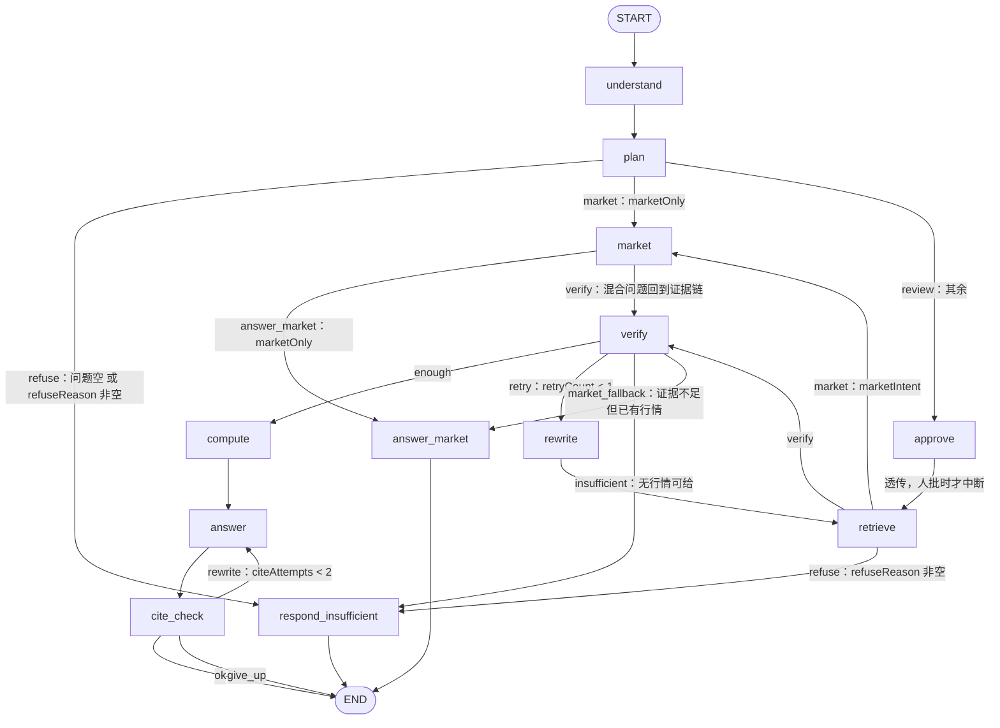

# 每轮问答的模型调用与流程图（按节点读代码版）

> **怎么用这份文档**：§1 看全局拓扑与状态总线 → §2 逐个节点对照代码（每个节点固定七段：目的 / 输入 / 核心逻辑 / 输出 / 模型调用 / 失败与降级 / 代码位置）→ §3 拿三条真实路径把节点串起来 → §4 成本账 → §8 面试讲法。
>
> 口径：一次「用户提问 → 得到答案」叫一轮（一个 turn）。本文数的是**出网的模型调用次数**，数据来自代码清点（可 grep 复现）+ 真链路实测（`target/boot-llm.log`、库表 `agent_run_step`、2026-11-04 的 8081 冒烟）。

## 0. 一句话结论

| 问题 | 答案 |
| --- | --- |
| 一轮对话请求几次 **LLM**（对话模型）？ | **1~2 次**：Query Understanding 0~1 次 + 答案生成 1 次；引用校验不过重写时答案会变 2 次（最多 3 次）。纯行情问题只有「选工具」那 1 次 |
| 还有别的模型调用吗？ | 有，但**不是 LLM**：查询向量化（每条检索车道 1 次）+ 精排 rerank（每条检索车道 1 次） |
| 一条复杂问题一共打几次模型 API？ | 实测**最多 18 次**（2 次 LLM + 8 次向量化 + 8 次精排） |
| 一轮跑几个图节点？ | 纯行情 **4 个**（understand → plan → market → answer_market）；纯年报 **8 个**；带重写/兜底最多 **11 个** |
| 会话摘要那一次算不算？ | 算，但**不是每轮**：攒够 13 条消息才触发一次，摊到每轮约 0.14 次 |

## 1. 全局：一次提问怎么走

### 1.1 入口三段（谁在驱动图）

```text
POST /api/chat/stream (SSE)
  → ChatController.stream
  → AgentStreamService.startStream        建 agent_run（RUNNING）+ 预发第一个 stage 事件（首屏立刻有反馈）
  → AgentRunService.executeStream         compiled.stream(input, config) 逐个 NodeOutput
        每出来一个节点就落一行 agent_run_step（节点名 + 耗时 + 摘要）
  → 收尾 TurnRecorder.record              落消息 / 更新会话结构化上下文 / 偶尔生成摘要
  → SSE final（answer + citations + facts + confidence + trace）
```

三条与「读代码」直接相关的约束：

1. **图只编译一次**：`AnalysisGraph.graph()`（`src/main/java/com/finagent/agent/AnalysisGraph.java:115`）双检锁缓存，`warmUp()` 在启动期编译一遍，把「少一条边 / 节点名拼错」提前到启动报错。
2. **每个节点都套了一层身份重建**：`AnalysisGraph.node(...)`（`:154-166`）进入前 `TenantContext.set(user)`、`finally` 里 `clear()`。因为 LangGraph4j 在自己的线程上跑节点，ThreadLocal 过不去，不重建就会在节点第一次查库时抛 `UnauthorizedException: 缺少认证上下文`。
3. **节点只是函数**：签名统一 `Map<String, Object> xxx(AnalysisState state)`（接口 `AnalysisNodes`，实现 `RealAnalysisNodes`），返回的是**状态补丁**，不是新状态。

### 1.2 拓扑：12 个节点 + 5 组条件边



十二个节点各干什么——先看这张表建立全貌，细节在 §2（顺序 = 执行顺序，不是代码里的声明顺序）：

| # | 节点 | 主要做什么 | 核心逻辑（面试要能说出来的点） | 写进状态 | LLM |
| --- | --- | --- | --- | --- | --- |
| 1 | `understand` | 把自然语言变成结构化查询，并在这里**一次性**判掉所有「不该答 / 不该检索」的题 | QU 四层：规则 `RuleBasedRouter` → LLM `LlmRouter` → 字段校验 + `weakEvidence` 降级 → 上下文补齐 `fillFromContext`。之后按固定顺序判 6 件事：① ACL 作用域空 → 直接 refuse（`scope_empty`）；② 跑题 `OffTopicDetector`（纯规则）；③ 人批理由（作用域里多年/多家而问题没点名）；④ 公司解析**只在作用域内匹配**，全对不上 →「公司不在当前可检索范围」（重试也不会变）；⑤ 长期记忆召回（失败只记 warning，不阻断）；⑥ 行情意图：`MARKET_ONLY = !reportLike`，且先把「股价/市值/PE」这类**行情口径指标**从 QU 指标里剔掉，否则「东方财富股价」会被当成混合问题、最后证据不足拒答 | `queryType` `metrics` `companyCodes` `companyMentions` `yearFrom/To` `refuseReason` `approvalReasons` `memoryText` `market*` | 0~1 |
| 2 | `plan` | 出人可读执行计划（SSE 里那几行「我在做什么」），决定拆不拆子问题、答案按什么形态组织 | 三支路：`refuseReason` 非空只写一行「拒答：…」；`marketOnly` 写三行固定计划并**短路**（不拆子问题）；否则 `decompose`，**只对 `COMPLEX_ANALYSIS` 生效**——按 `[和与、，,；;]` 切句、片长 `&lt; 4` 丢弃、每片补「主体 + 年份」前缀（不补的话「并结合净利润」只是关键词，会命中把词说得多但没有汇总表的附注页，把主表挤出上下文预算）；最后 `AnswerShape.detect` 定形态（归因 / 结构 / 同比…） | `subQuestions` `answerShapes` `plan` | 0 |
| 3 | `approve` | 唯一的人在环落点：运行时决定「停不停」 | `apply()` 是**透传**（返回 `Map.of()`，审批结果已由 resume 写进状态）；`interrupt()` **三个条件同时满足才停**：`approvalAllowed`（同步接口没有通道把审批交出去 → 必须空）、`approvalReasons` 非空（没说清为什么停就别弹）、`decision` 空（已经批过就接着跑）。第三个条件不能少：恢复时库会**重新进入**本节点再调一次 `interrupt()`（探针实测 2 次），只看前两个会「点了通过又停一次」永远出不来 | —（`apply` 透传不写状态；`decision` / `decisionNote` 由 resume 写） | 0 |
| 4 | `retrieve` | 多车道召回，**唯一查向量库的节点**，产出 `hits`（每块只留 160 字片段，正文后面回库取） | 五步：① `refuseReason` 非空直接返回空、**不查库**（查了也会把错主体的证据带进后面的装配）；② `RetrievalLanes.plan` 生成车道：整句 1 条 + 每个子问题 1 条 + 跨年每年 1 条 + 归因/结构再补「第三节」+ 方向词 ≤4 条，上限 `MAX_LANES = 8`；③ 每条车道走 `HybridRetriever`，第一路的 `RetrievalTrace` 记进 `AnswerStreamBridge`（`putIfAbsent`，多路不覆盖）；④ 合并同一 `chunkId` **取最高分**（先到先得会让它带着某一路的低分走到装配，名次被低估）；⑤ 年份覆盖校验：缺年补一轮，补完仍缺只记 `coverage_missing`，**不拒答**。车道内部 7 步见 §2.4 | `hits` `evidenceCount` `lanes` | 0（每车道 1 次 embedding + 1 次 rerank） |
| 5 | `verify` | 三道证据闸门，判「这些证据够不够答」，不够就去改写或拒答 | ① `tooFew`：`hits.size() &lt; max(1, minEvidence)`；② `metricMissing`：`metricHit` **回库读全文**再判——状态里只有 160 字片段，而「主要会计数据和财务指标」那张表 800 字、目标行可能在第 631 字（2026-10-31 的误拒答就是这么来的），比对走 `MetricDictionary.variants` 同义组（「归母净利润」vs「归属于上市公司股东的净利润」）；③ `attributionMissing`：**只在 `retryCount == 0`** 且形态含 `ATTRIBUTION` 且命中里没有驱动类证据时判，记 `coverage_missing:attribution`（改写后仍缺就照常生成，让答案自己写缺口，比整题拒答更专业） | `insufficient` + warning | 0 |
| 6 | `rewrite` | 规则拼接改写，只给一次机会 | 原问题 + 空格 + 指标词；归因形态再加 `原因 驱动 交易额 保有规模 手续费`；同时置 `retryCount = 1`。**不让模型重写**：拼接可回放、可断言；模型改写会让「改写后为什么命中 / 没命中」无法复现，也没法在测试里固定输入 | `rewrittenQuery` `retryCount` `plan` | 0 |
| 7 | `compute` | 事实层：证据里到底有哪些数、能算出什么 | ① `packageOf` 回库重建证据包（`ContextBuilder` 只按 `chunkId` 取正文，所以状态里不用存正文）；② `FactCollector` **只认 TABLE 块**，数字一律来自表格单元格；③ `MetricCalculator` 算派生指标（同比 / 占比 / 换算），算不出就跳过并记 `compute_skipped:*`，**绝不编一个数**；④ 组装 `facts`：`no` 从 1 起、`origin = REPORTED / COMPUTED`、`display` 只对「元」做亿/万换算（否则会出现「0.38 亿%」）；⑤ `EvidenceProfile` + `AnswerSectionPlan` → `answerPlan`——画像**必须放在这**，`plan` 阶段还没有证据，画出来必然全 false | `facts` `answerPlan` | 0 |
| 8 | `answer` | 唯一生成正文的节点（1 次流式 LLM） | ① `refuseReason` 兜底直接转拒答，**已判不可答时绝不调模型**（防将来新加边绕过条件判断）；② `packageOf` 重建证据包：父块整段 / 子块 + 兄弟 + 邻域，token 预算 `maxTokens`，超了记 `context_truncated`；③ `FactPack` = 年报事实 + 行情事实（行情走【实时行情】独立分段，免得模型拿报告期去否当日股价）；④ 1 次流式，边收边 `bridge.delta` 推前端；⑤ 返回后补年份口径、补行情脚注。内层 `AnswerService` 五层校验：事实三态合并（COMPUTED → MARKET → REPORTED，`MAX_FACTS = 8`、`MAX_COMPUTED_IN_ANSWER = 5`）、引用编号重排成 1..n、**数字回查证据**（每个数字都要能在被引块里找到或是计算派生值，全部对不上直接拒答）、版式缺失只降 confidence、缺口声明检测（说「未披露」而库里有时记 warning） | `answer` `status` | 1（cite_check 判重写时 2） |
| 9 | `cite_check` | 引用编号闸门 | 扫正文 `[E*]` 编号 → `CitationValidator.validate` 按证据包校验：越界记 `citations_dropped:n`；**一条编号都没写**记 `no_citation_marker`——「没守契约」和「编了不存在的编号」是两回事。三出口：`ok` → END；`citeAttempts &lt; 2` → 回 `answer` 重写；否则 `give_up` → END（答案带 warning 出去，只给一次重写机会，防死循环） | `citationIssues` `citeAttempts` `citationCount` | 0 |
| 10 | `market` | 行情取数：向独立的行情 MCP Server（stdio 子进程）要实时快照或近 N 日 K 线 | ① 读 `marketPlan`，`code` 空 → `marketError = 没能确定要查哪只股票`；② 规则给默认参数（`get_quote` / `get_history` + days）；③ **模型选工具**：`marketTools.pick` 直连 `ChatModel`（不经 `ChatClient` 的 ToolCallingAdvisor，所以模型只回 `toolCalls`、不会真的执行），选中则用模型的 tool/args（`pickedBy = model`），失败 / 超时 / 参数非法**静默回落规则**；④ `market.execute` → `Snapshot(data, asOf)`；⑤ 成功写数据 + `marketFacts`（`no` 从 900 起、`source = MARKET`、`evidence` 带 asOf）；⑥ 失败三分（`MarketApiException` 业务原话 / `MarketUnavailableException` 服务不可用 / 其它异常），**任何异常都不抛**，只写 `marketError`，让后面的边决定是兜底答行情还是一句话说明 | `marketData` `marketAsOf` `marketTool` `marketFacts` `marketError` | ≤1（只为选工具） |
| 11 | `answer_market` | 行情答案：模板渲染，不调模型 | `marketError` 非空 → 「暂时查不到{name}（code）的实时行情：{error}…」+ `market_unavailable`；`get_history` → 最近 N 个交易日（最新收盘 / 区间涨跌幅 / 区间最高 / 最低）；`get_quote` → 最新价 / 涨跌幅 / 总市值 / 市盈率(TTM) / 市净率 / 换手率；末尾固定附「数据时间：…（北京时间），来源：东方财富公开行情。」；从 `market_fallback` 边进来时加前缀「年报里没有找到能支撑这个问题的证据，下面只给实时行情：」+ `market_partial`。**用模板不用模型**：价格与时间戳必须逐字准确，模型会写「约」「昨天」；也保证同一只票同一分钟答案稳定 | `answer` `status` | 0 |
| 12 | `respond_insufficient` | 确定性拒答文案，并给出机器可读的拒答原因 | 按 `refuseReason` 分流：跑题 → `off_topic`（回显原话）；作用域空 → `scope_empty`；含「公司」→ `company_unresolved`（主体越界，重试也不会变）；其余 → `evidence_insufficient`；`status = REJECTED`。**不用模型写拒答**：拒答要稳定、可判定，文案错一个字用户就会以为系统坏了 | `answer` `status` | 0 |

三句话记住这张表：**12 个节点里只有 3 个会调模型**（`understand` 0~1、`answer` 1、`market` ≤1），其余 9 个全是确定性逻辑——这是「答案可复现」与「成本可控」的来源；**检索只有 `retrieve` 一个节点查库**，别的地方拿数据都靠 `packageOf` 回库；**主干是 8 个节点**（understand → plan → approve → retrieve → verify → compute → answer → cite_check），旁路是「拒答」和「行情」两条——注意 `understand` 只把 `refuseReason` 写进状态、不直接连拒答节点，真正接进边的是 `plan` 和 `retrieve` 各一条（结论写在状态里不接边就等于备注，2026-10-29 就踩过），回边只有两条且各限一次（`verify → rewrite → retrieve`、`cite_check → answer`）。

节点看上面那张表，**边**看下面这张表——五组条件边的判定原文（`AnalysisGraph.java:206-272`），**这张表就是图的全部业务分支**，读懂它就读懂了流程：

| 从哪 | 判定表达式 | 去向 | 为什么这么判 |
| --- | --- | --- | --- |
| plan | `question` 空 或 `refuseReason` 非空 | respond_insufficient | 结论写在状态里就必须接进边，否则只是备注（2026-10-29 五粮液答成东方财富的事故） |
| plan | `marketOnly()` | market | 纯行情不必检索，省 600ms 库查询，也避开「检索为空 → 判证据不足 → 拒答」的错路 |
| plan | 其余 | approve | 可答的问题一律先过人批闸门（闸门内部再决定停不停） |
| retrieve | `refuseReason` 非空 | respond_insufficient | 作用域为空只会在这一步暴露 |
| retrieve | `marketIntent()` | market | 混合问题：先有证据，再补行情 |
| market | `marketOnly()` | answer_market / verify | 纯行情走模板收尾；混合问题回证据链 |
| verify | `refuseReason` 非空 → insufficient；`!insufficient()` → enough；`retryCount<1` → retry；否则看 `marketFacts` | 四出口 | 证据不足但手里有行情时只答行情那部分，别把付费拿到的数字丢掉 |
| cite_check | `citationIssues` 空 → ok；`citeAttempts<2` → rewrite；否则 give_up | 三出口 | 只给一次重写机会，防死循环 |

### 1.3 状态总线：节点之间的唯一通信方式

`AnalysisState`（`src/main/java/com/finagent/agent/AnalysisState.java`）用 LangGraph4j 的 `Channels` 声明 49 个键。两条硬规则：

- **只放 JDK 可序列化类型**（默认 `ObjectStreamStateSerializer`，检查点要落库）——所以 `ContextPackage`、`AnswerResult` 这类对象走 `AnswerStreamBridge` 旁路，不进状态；
- **每个节点只写自己的键**，`question` 永不改写（改写走 `rewrittenQuery`）。

| 键 | 谁写 | 谁读 | 说明 |
| --- | --- | --- | --- |
| `question` / `runId` / `tenantId` / `userId` / `roles` | 入口 | 全部 | 身份 + 原始问题，只读 |
| `queryType` / `metrics` / `companyCodes` / `companyMentions` / `yearFrom` / `yearTo` | understand | plan / retrieve / compute / verify | QU 结果；`companyMentions` 是公司**字面**，拆子问题时补进片段（代码补不进去，会把向量拉偏） |
| `scope*`（kind / documentIds / companyCodes / years / docTypes） | 入口（前端选择器） | understand / retrieve | 「能看哪些文档」，由 ACL 解析成 `ResolvedScope` |
| `refuseReason` | understand / retrieve | plan / retrieve / verify / answer | 一旦非空，后续节点只做收尾，绝不调模型 |
| `approvalAllowed` / `approvalReasons` / `approvalCandidates` / `decision` / `decisionNote` | 入口 + understand + resume | approve | 人批三要素：允许停、为什么停、停时给人看什么 |
| `subQuestions` / `answerShapes` | plan | retrieve / compute / answer | 拆解结果与答案形态（归因 / 结构 / 同比…） |
| `lanes` / `hits` / `evidenceCount` | retrieve | verify / compute / answer / cite_check | `hits` 每块只留 160 字片段（正文靠 `packageOf` 回库取） |
| `insufficient` / `retryCount` / `rewrittenQuery` | verify / rewrite | verify / retrieve | 无证据 → 改写一次 → 再检索 |
| `facts` / `answerPlan` | compute | answer | 事实行（REPORTED / COMPUTED）+ 章节计划 |
| `answer` / `citationIssues` / `citeAttempts` / `citationCount` / `status` | answer / cite_check / 收尾 | 收尾 | 最终文本与校验结论 |
| `memoryText` | understand | answer | 长期记忆拼成的背景段，**永不进 [E] 编号** |
| `marketIntent` / `marketOnly` / `marketPlan` / `marketData` / `marketAsOf` / `marketTool` / `marketError` / `marketFacts` | understand / market | plan / retrieve / market / answer / answer_market | 行情支路的全部状态（阶段 23） |
| `warnings` | 几乎每个节点（`Channels.appender` 追加） | 收尾 | 机器可读的降级痕迹，前端按码翻译 |

## 2. 十二个节点逐个讲

> 每个节点都能按「目的 → 输入 → 核心逻辑 → 输出 → 调不调模型 → 失败与降级 → 代码位置」读完，代码位置是当前 HEAD 的真实行号（改代码后行号会漂，用方法名 grep 更稳）。

### 2.1 understand —— 理解问题，并一次性判掉「不该答」的题

- **目的**：把自然语言变成结构化查询（类型 / 指标 / 公司 / 年份），同时在这里判掉**所有**「这题不该答 / 不该检索」的情形：作用域为空、跑题、公司越界、问的其实是行情。后面节点只按结论执行。
- **输入**：`question`、`scope*`、`runId`（用于取会话上下文）。
- **核心逻辑**（`RealAnalysisNodes#understand:166-320`）：
  1. **QU**：`bridge.turnContext(runId)` 为空走 `router.understand(question)`；非空走带上下文版（可把上文的公司/年份补进来，并打 `inferredFromContext`）。`QueryType` 为 null → `QueryUnderstanding.failed(question, "query_type_null")`。
  2. **写 QU 结果**：`QUERY_TYPE`、`METRICS`、`COMPANY_CODES`、`COMPANY_MENTIONS`、`YEAR_FROM/TO`。
  3. **ACL 作用域**：`scopes.resolve(ScopeMapper.toScope(state))`；抛 `ScopeEmptyException` → 写 `refuseReason` + `warnings=["scope_empty"]` 并**直接返回**（图随后走 refuse）。
  4. **跑题**：`OffTopicDetector.isOffTopic(...)`（纯规则）→ 写固定前缀的 `refuseReason` + `off_topic`。
  5. **人批理由**：`AmbiguityDetector.reasons(scope.documents(), question)`（作用域里多年份/多公司而问题没点名）→ `APPROVAL_REASONS` / `APPROVAL_CANDIDATES`。
  6. **公司解析**：`CompanyResolver.resolve(codes, mentions, scope)` **只在作用域内文档里匹配**；命中则覆盖 `COMPANY_CODES`；`company.blocked()`（全都对不上）→ `refuseReason`「问题里的公司不在当前可检索范围内：…」。
  7. **长期记忆**：闸门 `memoryGate.shouldRecall(question, qu)` → `longTermRecaller.recall` → `MEMORY_TEXT`；溢出记 `instruction_overflow`，异常只记 `memory_recall_failed`（不阻断）。
  8. **行情意图**：`MarketIntentDetector.detect(question)`（纯规则：QUOTE 词 / HISTORY 词，被「年报 / 营收 / 净利润」等报告词压制）→ 命中则 `marketCompanies.resolve(question, codes, mentions)` 三级解析（问题里的 6 位码 → QU 代码 → 本租户 company 表 → MCP `search_stock` 唯一候选）；解析出公司才写 `MARKET_INTENT` / `MARKET_PLAN`（tool/code/name/days/codeSource）/ `MARKET_ONLY`。
     `MARKET_ONLY = !reportLike`，其中 `reportLike = 非行情指标非空 || yearRange != null`，行情口径指标（股价/市值/PE/PB…）用 `MARKET_METRICS` 正则剔除——不剔除的话「东方财富股价」会被 QU 抽成指标、误判成混合问题，最后证据不足拒答。
- **输出**：上述 QU 键 + `PLAN`（人看的执行计划）+ `WARNINGS` +（命中时）行情三键。
- **模型调用**：QU **0 或 1 次 LLM**（规则快路径命中就是 0）；长期记忆召回不走生成。
- **失败与降级**：QU 失败 → `SEMANTIC_EXPLANATION` + `route=degraded`，不重试；记忆失败 → 只留 warning；行情解析不出公司 → 只留 `market_company_unresolved`，继续走年报。
- **为什么都塞一个节点**：这些判断互相依赖——判「公司越界」必须先有作用域；判「纯行情」必须先有指标和年份；判「要不要人批」必须先知道作用域里有几年。拆开只会让状态来回传。
- **代码**：`RealAnalysisNodes#understand:166`；QU 本身在 `RouterService`（四层：规则 `RuleBasedRouter` → LLM `LlmRouter` → 字段校验 / `weakEvidence` 降级 → 上下文补齐 `fillFromContext`）。

### 2.2 plan —— 出执行计划，纯行情时短路

- **目的**：产出人可读的执行计划（SSE 里那几行「我在做什么」），并决定要不要拆子问题、按什么形态组织答案。
- **核心逻辑**（`:333-368`）：
  1. `refuseReason` 非空 → 只写一行「拒答：…」返回；
  2. `marketOnly()` → 写三行固定计划并返回（不拆子问题、不算章节）；
  3. 否则 `decompose(state)`（`:371`）：**只对 `COMPLEX_ANALYSIS` 生效**，按 `[和与、，,；;]` 切句，片长 < 4 丢弃，去掉「以及 / 并且」开头，每片再补「主体 + 年份」前缀（`contextPrefix:402`，片段里已有则不补），上限 `props.maxSubQuestions()`；
  4. `shapesOf(state)` → `ANSWER_SHAPES`（`AnswerShape.detect`，规则）；
  5. 混合问题补一行「先检索年报证据，再查实时行情补充当前估值」。
- **输出**：`SUB_QUESTIONS`、`ANSWER_SHAPES`、`PLAN`。
- **模型调用**：**0**。
- **为什么补主体/年份**：拆出来的「并结合净利润」脱离原句后只是关键词，会命中把词说得多、但没有汇总表的附注页（实测 rerank 0.602 vs 主表 0.523），主表被挤出上下文预算。

- **`plan` 是给人看的投影，不参与任何判定**（读代码时最容易误判的一点）——分支只由条件边 `marketOnly()` / `refuseReason` 决定（`AnalysisGraph.java:206-272`），把计划文本改成什么都改变不了走向。它真正的四个消费者：
  1. **审批卡片**：停下来时 `AgentRunService#planJson:378` 把 `plan()` 序列化进 `agent_run.plan_json`，`resume` 后 `view():433` 再取出来喂 `ApprovalCard.vue`——人批要「看它打算怎么做」才能决定批不批，这条是硬需求，没有计划审批卡就是空白；
  2. **时间线**：`final` / `approval` 两个 SSE 载荷都带 `plan`（`AgentStreamService.java:420/434`），前端 `AgentTimeline.vue:87` 用 `<ol>` 逐条渲染；
  3. **刷新 / 重启后仍在**：`view(runId)` 从检查点状态取 `plan()`，不是只活在那一次 SSE 流里；
  4. **纯行情那三行为什么必须写**：`decompose` 的产物唯一消费者是 `RetrievalLanes.plan`（生成车道），`answerShapes` 的唯一消费者是 `AnswerService` 的答案骨架——纯行情不检索、答案由 `answer_market` 模板渲染，两者都没有消费者，写了就是假账；但计划也不能空（审批卡 / 时间线 / `plan_json` 都要用），更不能套通用文案（「证据不足会改写一次再检索」在这条路径上永远不会发生，等于对用户撒谎）。所以写的是这条路径的真实承诺：查哪只票、**不检索年报**、数字与数据时间由模板渲染不经模型。

### 2.3 approve —— 唯一的人在环落点（运行时决定停不停）

- **目的**：需要人确认「准备怎么查」时把图停下来，等用户点「通过 / 修改」。
- **输入**：`approvalAllowed`、`approvalReasons`、`decision`。
- **核心逻辑**（`src/main/java/com/finagent/agent/ApprovalGate.java:34/40`）：
  1. `apply()` 是**透传**：返回 `Map.of()`，不改任何键（审批结果已由 resume 写进 `DECISION` / `DECISION_NOTE`）；
  2. `interrupt()` **三个条件同时满足才停**：`approvalAllowed`（同步接口没有通道把审批交出去 → 必须空）、`approvalReasons` 非空（没说清什么就别弹）、`decision` 为空（已经批过就接着跑）。
- **模型调用**：**0**。
- **为什么必须有第三条件**：恢复时库会**重新进入**这个节点再调一次 `interrupt()`（2026-11-03 探针实测 `interruptCalls=2 / applyCalls=1`），只看前两个条件会导致点「通过」后再停一次，永远出不来。
- **停的时候发生什么**：状态写检查点 → SSE 发 `approval` 事件 → 前端 `POST /api/agent/runs/{id}/resume` → `AgentRunService` 用 `GraphInput.resume(patch)` 从 `approve` 继续。

### 2.4 retrieve —— 多车道召回（唯一查向量库的节点）

- **目的**：把问题变成「多路召回」，产出 `hits`（每块只留 160 字片段，正文后面回库取）。
- **核心逻辑**（`:421-479`）：
  1. `refuseReason` 非空 → 返回空 `hits`，**不查库**（查了也会把错主体的证据带进后面的装配）；
  2. 重新解析作用域 + QU，`RetrievalLanes.plan(...)` 生成车道：整句永远 1 条；子问题各 1 条；跨年每年 1 条；归因/结构类再加一条「第三节」；方向词最多 4 条；上限 `MAX_LANES = 8`；
  3. 每条车道调 `HybridRetriever.retrieve(...)`，第一路的 `RetrievalTrace` 记进 `AnswerStreamBridge`（`putIfAbsent`，多路不覆盖）；
  4. 合并：同一 `chunkId` 出现在多路时**保留最高分**（先到先得会让它带着某一路的低分走到装配，名次被低估）；
  5. **年份覆盖校验**：合并后每年都要有证据，缺年份补一轮（`WARN_YEAR_RETRIED`），补完仍缺只写 `coverage_missing:year=YYYY`，**不拒答**。
- **输出**：`HITS`、`EVIDENCE_COUNT`、`LANES`、`WARNINGS`。
- **模型调用**：每条车道 **1 次 embedding + 1 次 rerank**（无 rerank key 时是 Noop，0 次）。
- **车道内部顺序**（`HybridRetriever#doRetrieve:123-284`，这段是检索链的核心）：
  1. 作用域过滤（`applyScope`）+ QU 实体过滤（`mergeFilters`，QU 推的过滤算「猜测」）；
  2. **精准事实先跑 Sparse**：`EXACT_FACT` + 指标非空 + `SparseMode.EXACT` 时先精确子串召回，命中数落在 `[3, 30)` 就**跳过 Dense**（省一次 embedding，实测 174~373 ms）—— 太多或太少都不跳，否则会静默丢证据；
  3. Dense：`EmbeddingService` 向量化 → `ORDER BY embedding <=> ?::vector LIMIT topDense`；
  4. Sparse：精确子串 / zhparser 全文；精确命中为空 → 退 `FTS_OR`（记 `sparse_exact_empty_fallback`）；
  5. 两路都空且过滤里有 QU 部分 → **去掉 QU 过滤重试**（记 `qu_filter_empty_fallback`）；放松到只剩作用域仍 0 条 → 记 `no_evidence_in_scope` 并返回空（绝不放开作用域，那等于回答了用户没问的文档）；
  6. RRF 融合（`k=60`，两路名次都保留）+ 多文档配额（`DocumentQuotaBalancer`）；
  7. 截断到 `fusionLimit`（默认 50）再送 rerank → 取 `topRerank`（默认 8）；rerank 抛异常 → 降级到 RRF 结果并记 `rerank_failed:…`（只降级不重试，防把 15s 超时放大成 30s）。

### 2.5 verify —— 三道证据闸门

- **目的**：判「这些证据够不够答」，不够就让图去改写或拒答。
- **三道判定**（`:531-547`）：
  1. `tooFew`：`hits.size() < max(1, props.minEvidence())`；
  2. `metricMissing`：目标指标没出现在任何命中块里。`metricHit` **会回库读全文**——状态里只有 160 字片段，而「主要会计数据和财务指标」那张表 800 字、目标行可能在第 156 / 631 字（2026-10-31 评测就是这么误拒答的）；比对走 `MetricDictionary.variants` 同义组（「归母净利润」vs「归属于上市公司股东的净利润」）；
  3. `attributionMissing`：**只在 `retryCount == 0`** 且形态含 `ATTRIBUTION` 且命中里没有驱动类证据（`DRIVER_SECTIONS` / `DRIVER_TERMS`）时判，记 `coverage_missing:attribution`。
- **输出**：`INSUFFICIENT`（+ 可能一条 warning）。
- **模型调用**：**0**。
- **为什么第三道只判一次**：改写后仍缺就照常生成，让答案自己写「缺口」，比整题拒答更专业。

### 2.6 rewrite —— 规则改写，只给一次机会

- **核心逻辑**（`:616-628`）：原问题 + 空格 + 指标词；归因形态再加 `原因 驱动 交易额 保有规模 手续费`；同时 `RETRY_COUNT = 1`。
- **输出**：`REWRITTEN_QUERY`、`RETRY_COUNT`、`PLAN`。
- **模型调用**：**0**（改写是拼接，不是让模型重写，保证可回放、可断言）。

### 2.7 compute —— 事实层：证据里有哪些数、能算出什么

- **目的**：把「数字」从证据里抽成结构化事实行，并算派生指标（同比、占比、换算），让答案与事实卡共用同一份数。
- **核心逻辑**（`:643-706`）：
  1. `packageOf(state, qu, scope)` 重建证据包（`ContextBuilder` 只按 chunkId 回库取正文，所以状态里不需要正文）；
  2. `FactCollector.collect(pkg.blocks(), qu)`：**只认 TABLE 块**，数字一律来自表格单元格；
  3. `MetricCalculator.compute(facts, shapes, metrics)`：算不出来的直接跳过并记 `compute_skipped:*`，**绝不编一个数**；
  4. 组装 `FACTS` 行（`no` 从 1 起，`origin=REPORTED/COMPUTED`，`display` 只有「元」才给「亿元/万元」，否则会出现「0.38 亿%」）；
  5. `EvidenceProfile.of(blocks)` + `AnswerSectionPlan.of(...)` → `ANSWER_PLAN`（章节计划）。
- **模型调用**：**0**。
- **为什么画像放这里**：章节计划要按真实证据的形态定，`plan` 阶段还没有证据（画像必然全 false）。

### 2.8 answer —— 唯一生成正文的节点（1 次流式 LLM）

- **核心逻辑**（`:723-753`）：
  1. `refuseReason` 兜底 → 直接 `respondInsufficient`（即使将来新加边绕过条件判断，也不允许在「已判不可答」时调模型）；
  2. `packageOf` 重建证据包：`ContextBuilder#build:66` 按父块整段 / 子块 + 兄弟 + 邻域组装，token 预算 `props.maxTokens`，超了记 `context_truncated`；
  3. `FactPack.from(withMarketFacts(state))`：年报事实 + 行情事实（行情走【实时行情】独立分段，避免模型拿报告期去否当日股价）；
  4. `answers.answerStreaming(...)`：**1 次 LLM 流式**，边收边把 `answer` 字段增量推给前端（`bridge.delta`）；
  5. 返回后 `withPeriodLabel`（补「2025 年」口径）、`withMarketStamp`（补行情脚注，逐项去重）→ `bridge.result(runId, result)`；
  6. 写 `ANSWER`、`WARNINGS`（含行情时追加 `market_live`）、`STATUS=DONE`。
- **模型调用**：**1 次**（`cite_check` 判重写时 2 次）。
- **内层 `AnswerService` 的五层校验**（`answerStreaming:120` → `evaluate:170-282`，流式与非流式共用同一个实现）：
  1. **事实三态合并**（`mergeFacts:293`）：COMPUTED（系统算的）→ MARKET（行情）→ REPORTED（模型照抄）；模型一条都没给才用 EXTRACTED 兜底并记 `facts_backfilled`；上限 `MAX_FACTS=8`、`MAX_COMPUTED_IN_ANSWER=5`；
  2. **引用编号**：`usedEvidence` ∪ 正文里实际写了但漏登记的编号（`withBodyMarkers`），校验丢弃越界的，再把正文编号**重排成 1..n**（`renumberCitations`），否则前端点 [E7] 会去数组第 7 项、而数组只有 4 条；
  3. **数字回查证据**（`ground:609`）：答案里每个数字必须能在被引块正文里找到（或属于计算的派生值），对不上就降 confidence，**全部**对不上直接拒答（2026-10-22：引用是真的，数字是编的）；
  4. **版式**：章节缺失只降 confidence、不拒答（写得不够好 ≠ 数字不可信）；
  5. **缺口声明**：`gapClaims` 抓到「未披露 / 无法找到」但库里其实有时 → 记 warning 并降 confidence。
  - **partial 分支**（阶段 24）：模型说 `sufficient=false` 但答了内容时，**不清空** citations/facts，只把 confidence 落 `insufficient` 并加 `partial_answer`——否则正文里的 [E8]/[F900] 会变成点不开的死角标。
- **失败与降级**：模型输出解析失败 → `WARNING_GENERATION_FAILED` + 「答案生成失败」，绝不退回「无引用的自由文本」；证据包为空 → 直接拒答，**不调模型**。

### 2.9 cite_check —— 引用编号闸门（不调模型）

- **核心逻辑**（`:1139-1158`）：`emitted(answer)` 扫正文编号 → `CitationValidator.validate(numbers, pkg.blocks())`；越界 → `citations_dropped:n`；**一条编号都没写** → `no_citation_marker`（这是「没守契约」，与「编了不存在的编号」是两回事）；写 `CITE_ATTEMPTS`、`CITATION_COUNT`。
- **出口**：issues 空 → END；`citeAttempts < 2` → 回 answer 重写；否则 `give_up` → END（答案带着 warning 出去）。
- **模型调用**：**0**（只有「回 answer」那一步才再花 1 次）。

### 2.10 market —— 行情取数（阶段 23：MCP 子进程）

- **目的**：向独立的行情 MCP Server（`financial-mcp-server4j`，stdio 子进程）取实时快照或近 N 日 K 线。
- **核心逻辑**（`:834-892`）：
  1. 读 `MARKET_PLAN`（understand 写的）；`code` 空 → `MARKET_ERROR = "没能确定要查哪只股票"`；
  2. 规则给默认参数（`get_quote` / `get_history` + days）；
  3. **模型选工具**：`marketTools.pick(question, code, market.tools())`（直连 `ChatModel`，不经 `ChatClient` 的 `ToolCallingAdvisor`，所以模型只回 `toolCalls`、不会真的执行）—— 选中则用模型的 tool/args（`pickedBy=model`），失败 / 超时 / 参数非法则静默回落规则；
  4. `market.execute(tool, args, days)` → `Snapshot(data, asOf)`；
  5. 成功：写 `MARKET_TOOL` / `MARKET_DATA` / `MARKET_AS_OF` / `MARKET_FACTS`（`no` 从 900 起、`source=MARKET`、`evidence="实时行情 " + asOf`）+ `PLAN` 一行 + `bridge.marketTrace(...)`；
  6. 失败三分：`MarketApiException`（业务原话，如「股票代码应为 6 位数字」）/ `MarketUnavailableException`（「行情服务暂时不可用」）/ 其它 `RuntimeException`（「行情服务异常」），并登记失败 trace。
- **模型调用**：**最多 1 次**（只为选工具）。
- **降级**：任何异常都不抛，只写 `MARKET_ERROR`，让后面的边决定是兜底答行情还是一句话说明。

### 2.11 answer_market —— 行情答案（模板渲染，不调模型）

- **核心逻辑**（`:944-1012`）：
  1. `MARKET_ERROR` 非空 → 「暂时查不到{name}（code）的实时行情：{error}…」+ `market_unavailable`；
  2. `get_history` → 最近 N 个交易日：最新收盘 / 区间涨跌幅 / 区间最高 / 最低；否则 → 最新价 / 涨跌幅 / 总市值（亿元）/ 市盈率(TTM) / 市净率 / 换手率；
  3. 末尾固定附「数据时间：…（北京时间），来源：东方财富公开行情。」；
  4. `state.insufficient()`（从 `market_fallback` 边过来）→ 前缀「年报里没有找到能支撑这个问题的证据，下面只给实时行情：」+ `market_partial`。
- **模型调用**：**0**。
- **为什么用模板**：价格与时间戳必须逐字准确，模型改写会引入「约」「昨天」这类错口径；也保证同一只票同一分钟答案稳定。

### 2.12 respond_insufficient —— 拒答文案（不调模型）

- **目的**：用确定性文案结束这一轮，并给出机器可读的拒答原因。
- **输入**：`refuseReason`、`warnings`。
- **核心逻辑**（`:1163-1185`）：按 `refuseReason` 分流文案与 warning：跑题 → `off_topic`（原话回显）；作用域空 → `scope_empty`；含「公司」→ `company_unresolved`（主体越界，重试也不会变）；其余 → `evidence_insufficient`；`STATUS=REJECTED`。
- **输出**：`ANSWER`（确定性文案）、`WARNINGS`（一个码）、`STATUS=REJECTED`。
- **模型调用**：**0**。
- **为什么不用模型写拒答**：拒答要稳定、可判定；文案错一个字就会让用户以为系统坏了。

## 3. 三条路径串起来（真实走法 + 实测）

### 3.1 纯行情：「东方财富股价」

```text
understand → plan → market → answer_market        （4 个节点，0 次检索，1 次 LLM 只用来选工具）
```
- understand：QU 1 次（实测约 4.3 s）+ 行情意图命中 + `MARKET_ONLY=true`；
- plan：写三行计划短路；
- market：`get_quote`，MCP 子进程热调用约 40 ms；
- answer_market：模板出答案 + 数据时间。
- 实测：**4.5 s**（QU 走规则、行情已预热）~ **10.3 s**（QU 调模型 + 首次握手 6.7 s）。

### 3.2 纯年报：「东方财富2025年净利润是多少」

```text
understand → plan → approve → retrieve → verify → compute → answer → cite_check   （8 个节点）
```
- 不触发行情（判据：有报告期指标 / 年份，且没有行情词）；
- 实测 **14.0 s**，`answer` 1 次 LLM（9~16 s），warnings 可能带 `facts_table_skipped:<chunkId>`；
- 若 verify 判不足：`rewrite → retrieve` 再来一遍（多 1~N 条车道）；
- 若 cite_check 判编号有问题：`answer` 再来一次（最多 2 次）。

### 3.3 混合：「东方财富2025年净利润和现在股价」

```text
understand → plan → approve → retrieve → market → verify → compute → answer → cite_check
                                                   ↘（证据不足但有行情）answer_market
```
- understand：既有指标又有年份 → `MARKET_ONLY=false`，但 `MARKET_INTENT=true`；
- retrieve 之后先补行情（`market`），再到 verify；
- verify 判不足且 `marketFacts` 非空 → `market_fallback` → answer_market（只答行情 + 明说年报没证据）；
- 实测 **15.7 s**，`sufficient=true`，`citations=1`，`facts=8`（其中 6 条 `source=MARKET`），答案脚注只补正文没写的行情项（正文已写的不重复）。

## 4. 每个节点调不调模型（矩阵）

| 节点 | LLM | embedding | rerank | 说明 |
| --- | --- | --- | --- | --- |
| understand | 0~1 | 0 | 0 | QU；规则命中即 0 |
| plan | 0 | 0 | 0 | 纯规则 |
| approve | 0 | 0 | 0 | 透传 / 中断 |
| retrieve | 0 | 每车道 1 | 每车道 1 | EXACT_FACT 精确命中 [3,30) 时省掉 Dense |
| verify | 0 | 0 | 0 | 规则 + 回库读全文 |
| rewrite | 0 | 0 | 0 | 拼接 |
| compute | 0 | 0 | 0 | 表格事实 + 派生计算 |
| answer | 1（重写时 2） | 0 | 0 | 流式 |
| cite_check | 0 | 0 | 0 | 编号校验 |
| market | 0~1 | 0 | 0 | 只为选工具；失败回落规则 |
| answer_market | 0 | 0 | 0 | 模板 |
| respond_insufficient | 0 | 0 | 0 | 模板 |

## 5. 一轮到底几次 LLM（按路径）

| 路径 | 触发条件 | QU | 答案 | 摘要（摊薄） | 合计 |
| --- | --- | --- | --- | --- | --- |
| A 规则命中 | 问题里字面有 6 位代码 + 年份 + 指标名（`RuleBasedRouter`） | **0** | 1 | ~0.14 | **1** |
| B 自然语言单轮 | 其余绝大多数问题 | 1 | 1 | ~0.14 | **2** |
| C 多轮追问 | 有 conversationId 且规则没命中（带上下文，仍一次调用） | 1 | 1 | ~0.14 | **2** |
| D 拒答 | 作用域空 / 公司越界 / 证据不足 | 0~1 | **0** | — | **0~1** |
| E 引用重写 | cite_check 有 issue 且只重写过 0 次 | 1 | **2** | — | **3** |
| F 复杂问题（人批） | `COMPLEX_ANALYSIS` 且过 approval 闸门 | 1（第一跳） | 1（resume 那一跳） | — | **2**（跨 2 次 HTTP） |
| G 纯行情 | 行情词命中且解析出公司、无报告期指标 | 0~1 | **0**（模板） | — | **0~1** |
| H 混合 | 行情词 + 报告期指标 | 1 | 1 | — | **2** |

要点：

- **F 的两个 1 不在同一个 HTTP 请求里**：第一跳跑到 `approve` 前中断（SSE 发 `approval`），用户点「通过」再 `POST /api/agent/runs/{id}/resume`，第二跳从 `approve` 接着跑到 `answer`。
- **E 只有 1 次机会**：`citeCheck` 把 `citeAttempts` 加 1，条件边要求 `< 2` 才回 `answer`（`AnalysisGraph.java:264-272`）。
- **摘要不挂在每轮**：阈值 `finagent.memory.summary-trigger-messages=12`，且一次只汇总最早的一半。

## 6. 非 LLM 的模型调用：按「车道」计

检索不是一个查询打一次，而是先把问题拆成多条车道（`RetrievalLanes.plan`），每条车道独立走一遍 Dense → Sparse → RRF → Rerank，所以**车道数 = 向量化次数 = 精排次数**。

| 车道 | 何时加 | topK |
| --- | --- | --- |
| 整句 | 永远（1 条） | 8 |
| 子问题 | 拆出 ≥1 条时 | 8 |
| 按年份 | 年份区间跨年，每年一条（最多 3 条） | 4 |
| 章节定向 | 形态命中「归因 / 结构」→ 只搜第三节 | 4 |
| 方向 | 结构 / 经营 / 成本 / 盈利 / 同比，最多 4 条 | 4 |
| 合计上限 | `MAX_LANES = 8` | |

两条省钱规则：**精准事实可能跳过 Dense**（`HybridRetriever.java:148-158`）；**没有候选就不精排**（`:251-253`）。

## 7. 实测（2026-11-02 全链路 + 2026-11-04 行情版）

| # | 问题 | QU 耗时 | answer 耗时 | 端到端 | 车道 | 向量化 | 精排 | LLM | 模型 API 合计 |
| --- | --- | --- | --- | --- | --- | --- | --- | --- | --- |
| Q1 | `300059 2025年营业总收入是多少` | **466 ms**（规则命中，0 次） | 9,140 ms | 11.8 s | 1 | **0** | 1 | **1** | 2 |
| Q2 | `东方财富2025年营业收入增长的原因是什么` | **3,968 ms**（1 次） | 16,429 ms | 23.0 s | 2 | 2 | 2 | **2** | 6 |
| Q3 | `结合2024和2025年报，分析营收结构变化及对盈利能力影响` | **4,046 ms**（1 次） | **57,319 ms** | 67.4 s | **8** | 8 | 8 | **2** | **18** |
| Q4 | `东方财富股价` | 4,287 ms | — | **4.5 s** | 0 | 0 | 0 | 1（选工具） | 1 |
| Q5 | `东方财富2025年净利润是多少` | — | 9,000 ms 级 | **14.0 s** | 1~2 | 1~2 | 1~2 | 1 | 3~5 |
| Q6 | `东方财富2025年净利润和现在股价` | — | — | **15.7 s** | 1~2 | 1~2 | 1~2 | 2 | 4~6 |

证据（可复现）：

```text
# 三轮问答跑完后的计数（target/boot-llm.log，共 447 行日志）
已向量化 1/1  × 10     ← 向量化次数 = Q1:0 + Q2:2 + Q3:8
检索完成      × 11     ← 车道数（每条车道结束打一条汇总）
Rerank 完成   × 11     ← 精排调用数（= 车道数，没有候选时不会打）

# Q3 第一条车道的真实日志（按发生顺序）
11:20:51.850 DenseRetriever       : Dense 召回 30 条（query=结合2024年和2025年年报，分析东方财富营业收入结构发生了什么变化，以及对盈利能力的影响）
11:20:51.977 PgSparseRetriever    : Sparse EXACT 召回 30 条（terms=[营业收入, 盈利能力, 300059]）
11:20:52.525 DashScopeRerankModel : Rerank 完成：候选 50 条，返回 8 条，用时 546 ms

# QU 耗时差就是「有没有调 LLM」的证据（agent_run_step.duration_ms）
Q1 understand=466ms      ← 规则命中，0 次 LLM
Q2 understand=3968ms     ← 一次 LLM
Q3 understand=4046ms     ← 一次 LLM
```

Q1 为什么 1 条车道却是 0 次向量化：`精准事实命中 17 条，跳过 Dense`（17 落在 [3, 30) 区间）。

## 8. 面试怎么讲

### 8.1 30 秒版（先给结构，再给数字）

> 这是一个金融年报问答系统。一轮问答由 LangGraph 编排，12 个节点、5 组条件边，分三条路径：纯年报问题走「理解 → 计划 → 人批闸门 → 多车道混合检索 → 证据校验 → 事实计算 → 一次流式生成 → 引用校验」；纯行情问题走「理解 → 计划 → MCP 取行情 → 模板出答案」，跳过检索；两者都有时先检索再补行情。一轮只调 1~2 次 LLM，其余成本花在向量化和精排上；最复杂的跨年多子问题实测 18 次模型 API、67 秒。

### 8.2 3 分钟版（按四层讲）

**第一层：编排为什么用图，而不是一串 if**

- 每个节点是纯函数 `Map<String,Object> node(AnalysisState)`，只写自己的键，状态可序列化 ⇒ 可检查点、可中断恢复、可回放评测；
- 条件边把业务分支变成一等公民：`plan` 三出口、`retrieve` 三出口、`verify` 四出口、`cite_check` 三出口。分支判定读状态、不在节点里 `if` 掉——否则「拒答」的结论只是备注，图会照常检索；
- 人批是一个节点（`approve`），停不停在运行时按状态判：`approvalAllowed && approvalReasons 非空 && decision 为空`。不用编译两张图，也不用 `interruptsBefore`。踩过的坑：恢复时库会**重新进入**节点再调一次 `interrupt()`，所以必须看 `decision`。

**第二层：证据链怎么保证不答错主体**

- 作用域先过 ACL，`ScopeEmptyException` 直接拒答（`scope_empty`）；公司解析只在作用域内文档里匹配，匹配不到就 `refuseReason`——2026-10-29 五粮液答成东方财富，就是因为这个结论没接进条件边；
- 检索多车道：整句 / 子问题 / 按年份 / 章节定向 / 方向词，上限 8 条；每车道 Dense（pgvector）+ Sparse（zhparser 精确子串 / 全文）各召回，RRF `k=60` 融合，再送 qwen3-rerank 取前 8；
- 车道内两条降级：精准事实精确命中 `[3,30)` 条就跳过 Dense（省一次 embedding）；rerank 挂了降级到 RRF 并记 warning，只降级不重试；
- verify 三道闸门：证据数、指标是否出现（回库读全文 + 同义词典，因为片段只有 160 字）、归因证据覆盖（只判一次）。

**第三层：数字怎么保证可信**

- 数字只来自表格单元格（`FactCollector` 只认 TABLE 块），派生指标（同比、占比、换算）由 `MetricCalculator` 算，算不出就跳过并留 warning，绝不编；
- 生成只有一次调用，输出一个 JSON：`{sufficient, answer, facts[], usedEvidence[], note, confidence}`；
- 生成后五层校验：事实三态合并 → 引用编号补齐并重排 1..n（否则前端点 [E7] 找不到）→ **数字回查被引正文**（全对不上直接拒答）→ 版式 → 缺口声明；
- 模型说「答不全」但写了一部分时（partial），保留引用与事实、只把 confidence 落 `insufficient`，避免正文角标点不开。

**第四层：行情支路为什么不塞进证据链**

- 行情是快照，落库会把昨天的价格当今天；也不进 `hits` / 证据包（`ContextBlock` 字段全是 chunk 形状），否则会被 verify 当成年报证据、被 ground 当成年报数字；
- 所以单独两个节点：`market` 取数（MCP stdio 子进程，热调用 40 ms，冷启动 3.7 s，所以启动后异步预热）、`answer_market` 用模板出答案，数字与时间戳逐字来自接口；
- 模型只负责「选哪个工具、传什么参数」（直连 `ChatModel`，不挂 `ToolCallingAdvisor`，所以模型只回 `tool_calls` 不执行），执行与参数校验都在代码里；选工具失败静默回落规则；
- 混合问题：证据不足但有行情 → `market_fallback` 边 → 只答行情并明说「年报里没找到证据」。

### 8.3 常见追问怎么答

| 追问 | 回答要点 |
| --- | --- |
| 为什么不让**模型自主 tool-calling** 跑完整链路？ | 工具执行挂在 `ChatClient` 的 `ToolCallingAdvisor` 上，一旦打开，同一个 ChatClient 的所有调用都会自动执行工具，而且结果是没有时间戳的文本，进不了事实层与 `ground` 白名单。工具执行与业务校验必须分开：模型选，代码执行 |
| 为什么 QU 用规则 + LLM 两层？ | 规则零成本零延迟、可断言可回放；LLM 只处理规则覆盖不到的自然语言。QU 判错会改流程走向（拒答 / 检索 / 行情），所以判不准时降级到 `SEMANTIC_EXPLANATION` 而不是猜 |
| RRF 的 k 为什么是 60？ | Cormack 2009 的经验值；k 越小头部越独占（k=0 时 rank1 与 rank30 差 30 倍，k=60 只差 1.48 倍）。它只依赖名次不依赖分数，两路分数量纲不同也能融合 |
| 为什么 `embedding` 不随内容自动更新？ | `content_tsv` 是 `GENERATED ALWAYS ... STORED`，数据库自己能算；`embedding` 要调外部 API，DB 算不出来，只能应用层写。改内容必须重建向量 |
| 1516 行时为什么不用 HNSW？ | 优化器自己选精确 kNN（Seq Scan + Sort，9.8 ms）比 HNSW（31.4 ms）快，交叉点约 1 万行。索引留着是为数据量增长准备 |
| 为什么答案只调一次模型而不是每节一次？ | 四段骨架（结论 / 数据 / 分析 / 缺口）写在系统提示里，一次 JSON 输出。多次调用会让数字口径漂移，也更贵 |
| 为什么拒答不用模型？ | 拒答必须稳定可判定，文案按 `refuseReason` 类型分流即可；模型参与只会引入不确定性 |
| 缓存 / 幂等怎么做？ | 图只编译一次；`ContextBuilder` 按 id 回库取正文，状态里只放 id；检查点落库支持中断恢复与回放 |
| 怎么评测？ | 10 题冒烟集（QU vs 无 QU 对比，top-1 相关数 ≥7）；节点耗时落 `agent_run_step`，warning 码可聚合 |
| 这套里最难的三个 bug？ | ① 公司越界结论没接进条件边（答错主体）；② 指标落在 160 字片段之外导致误拒答（改成回库读全文 + 同义词典）；③ 人批恢复时节点再停一次（`interrupt()` 必须看 `decision`） |

## 9. 五个常见误解

| 误解 | 实际 |
| --- | --- |
| 「答案分四段，应该调四次模型」 | 一次调用出一个 JSON：`{sufficient, answer, facts[], usedEvidence[], note}`，四段骨架写在系统提示里 |
| 「事实卡是模型抽的」 | `compute` 节点用规则从表格里抽数值 + 算派生指标，不调模型；模型只负责在正文里引用 `[F900]` 这类编号 |
| 「rerank 也是 LLM」 | qwen3-rerank 是 cross-encoder 打分接口，输入「问题 + 候选文本」，输出分数，不生成文字 |
| 「每轮都要写摘要」 | 攒够 13 条消息才触发，且一次只压最早的一半（`summary_until_message_id` 指针前移，不删消息） |
| 「行情也走检索」 | 行情不进 hits、不落库，单独两个节点；答案里的数字与时间戳来自模板 |

## 10. 自己怎么验

```powershell
# 1) 全项目只有 3 个类持有 ChatClient.Builder（另有 MarketToolSelector 直连 ChatModel）
Select-String -Path src\main\java\com\finagent\**\*.java -Pattern "ChatClient.Builder"

# 2) 跑一轮并数车道 / 精排（把日志级别开到 DEBUG）
mvn -o spring-boot:run "-Dspring-boot.run.arguments=--logging.level.com.finagent=DEBUG"
Select-String -Path target\boot-llm.log -SimpleMatch "检索完成"   # 车道数
Select-String -Path target\boot-llm.log -SimpleMatch "Rerank 完成" # 精排次数
Select-String -Path target\boot-llm.log -SimpleMatch "Dense 召回"  # 向量化次数

# 3) 每个节点的耗时（能反推有没有调模型）
docker exec -it finagent-postgres psql -U finagent -d finagent -c "SELECT r.question, s.node, s.duration_ms FROM agent_run r JOIN agent_run_step s ON s.run_id=r.id ORDER BY r.created_at DESC, s.seq LIMIT 20;"
```

## 11. 与其它文档的关系

- 图结构与状态键：`docs/关键契约.md` **C9**；图只编译一次：**C36**；人批：**C11 / C12**
- 检索车道与 RRF：**C19 / C31**；精排降级：**C22**；上下文预算：**C16**
- 部分答案与行情脚注：**C41**；行情支路：**C40**；流式事件：**C18**
- 行情 MCP 的报文级链路：`docs/技术资料/MCP-Client调用链路.md`
- 阶段报告：`docs/阶段23-行情MCP接入.md`、`docs/阶段24-部分答案与混合问题.md`
- 术语（LLM / embedding / cross-encoder / 车道）：`docs/术语表.md`
- 端到端调用链导读：`docs/主流程导读.md`

