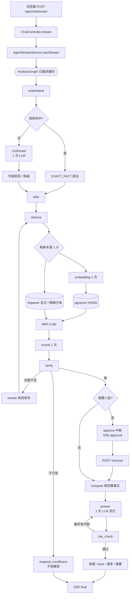

# 每轮问答请求了几次模型（含完整处理流程图）

> 口径：一次「用户提问 → 得到答案」叫一轮（一个 turn）。本文数的是**出网的模型调用次数**，
> 数据来自代码静态清点（可 grep 复现）+ 2026-11-02 的真链路实测（日志 `target/boot-llm.log` 与库表 `agent_run_step`）。

## 0. 一句话结论

| 问题 | 答案 |
| --- | --- |
| 一轮对话请求几次 **LLM**（对话大模型）？ | **1~2 次**：Query Understanding 0~1 次 + 答案生成 1 次；引用校验不过重写时答案会变 2 次（最多 3 次） |
| 还有别的模型调用吗？ | 有，但**不是 LLM**：查询向量化（每条检索车道 1 次）+ 精排 rerank（每条车道 1 次） |
| 一条复杂问题一共打几次模型 API？ | 实测**最多 18 次**（2 次 LLM + 8 次向量化 + 8 次精排） |
| 会话摘要那一次算不算？ | 算，但**不是每轮**：攒够 13 条消息才触发一次，摊到每轮约 0.14 次 |

## 1. 先分清三种「模型调用」

这三个都走阿里云百炼、都要花钱、都算「请求模型」，但只有第一个是 LLM：

| 类型 | 干什么 | 谁在调 | 每轮次数 |
| --- | --- | --- | --- |
| **LLM（对话模型）** | 理解问题（输出 JSON）、写答案（输出 JSON） | `LlmRouter` / `ChatClientAnswerGenerator` | **1~2**（最多 3） |
| **Embedding（向量化）** | 把问题变成 1024 维向量，去 pgvector 查近邻 | `DenseRetriever` → `EmbeddingService` | 每条检索车道 **1** |
| **Rerank（精排）** | 把候选块和问题拼一起打分重排（cross-encoder） | `HybridRetriever` → `DashScopeRerankModel` | 每条车道 **1**（无 key 时是 Noop，0 次） |

严格说 rerank 也是「模型」（qwen3-rerank），但它**不做生成**、不是 chat 接口，所以本文把它单列。

## 2. LLM 调用点只有 3 处（可 grep 复现）

```powershell
# 整个 main 里能拿到聊天模型的类，一共 3 个
Select-String -Path src\main\java\com\finagent\**\*.java -Pattern "ChatClient.Builder"
```

| # | 类 | 方法（行号） | 什么时候调 | 一轮内几次 |
| --- | --- | --- | --- | --- |
| 1 | `understanding/LlmRouter.java` | `route(String)` :76、`route(String, String)` :87-91 | 规则快路径没命中时（`RouterService.java`:66 / :107） | 0 或 1 |
| 2 | `answer/ChatClientAnswerGenerator.java` | `complete()` :24（同步）、`stream()` :38（流式） | `AnswerService` :82 / :134 —— 每次「生成答案」一次 | 1（重写时 2） |
| 3 | `memory/LlmSummaryGenerator.java` | `generate()` :41 | `ConversationSummarizer.maybeSummarize`（`TurnRecorder.java`:84 收尾时） | 攒够阈值才 1 次 |

**没有第 4 处**：拆子问题、事实抽取、派生指标、覆盖校验、引用校验全是规则代码，不调模型。
这也是为什么答案只有「一次调用」——四段骨架、数据表、引用编号全在一次 JSON 输出里，不是每节调一次。

## 3. 每一轮到底几次 LLM（按路径）

| 路径 | 触发条件 | QU | 答案 | 摘要（摊薄） | 合计 |
| --- | --- | --- | --- | --- | --- |
| A 规则命中 | 问题里**字面**有 6 位代码 + 年份 + 指标名（`RuleBasedRouter.java`:52） | **0** | 1 | ~0.14 | **1** |
| B 自然语言单轮 | 其余绝大多数问题 | 1 | 1 | ~0.14 | **2** |
| C 多轮追问 | 有 conversationId，且规则没命中（带对话背景，**仍是一次调用**） | 1 | 1 | ~0.14 | **2** |
| D 拒答 | 作用域为空 / 公司不在范围 / 证据不足 | 0~1 | **0**（`AnswerService` 第 73-78 行：证据包空不调模型） | — | **0~1** |
| E 引用重写 | cite_check 发现编号越界或一个编号都没写，且只重写过 0 次 | 1 | **2** | — | **3** |
| F 复杂问题（人批） | `queryType == COMPLEX_ANALYSIS` 且 `finagent.agent.hitl=true` | 1（第一跳） | 1（resume 那一跳） | — | **2**（跨 2 次 HTTP） |

要点：

- **F 的两个 1 不在同一个 HTTP 请求里**：第一跳跑到 `approve` 前中断（SSE 发 `approval` 事件），
  用户点「通过」再发 `POST /api/agent/runs/{id}/resume`，第二跳从 `compute` 接着跑到 `answer`。
- **E 只有 1 次机会**：`citeCheck` 把 `citeAttempts` 加 1，条件边要求 `citeAttempts < 2` 才回 `answer`（`AnalysisGraph.java`:243）。
- **摘要不挂在每轮**：阈值 `finagent.memory.summary-trigger-messages=12`（`MemoryProperties.java`:38），
  未汇总消息 > 12 才动手，且一次只汇总「最早的一半」（`ConversationSummarizer.java`:67）。

## 4. 非 LLM 的模型调用：按「车道」计

检索不是一个查询打一次，而是先把问题拆成**多条车道**（`RetrievalLanes.plan`），每条车道独立走一遍
Dense → Sparse → RRF → Rerank，所以**车道数 = 向量化次数 = 精排次数**。

| 车道 | 何时加 | topK |
| --- | --- | --- |
| 整句 | 永远（1 条） | 8 |
| 子问题 | `needDecompose` 且拆出 ≥1 条 | 8 |
| 按年份 | 年份区间跨年，每年一条（最多 3 条） | 4 |
| 章节定向 | 形态命中「归因 / 结构」→ 只搜第三节 | 4 |
| 方向 | 形态/问句词（结构、经营、成本、盈利、同比），最多 4 条 | 4 |
| 合计上限 | `MAX_LANES = 8` | |

两条省钱规则：

- **精准事实可能跳过 Dense**（`HybridRetriever.java`:148-158）：`EXACT_FACT` + 精确子串命中 [3, 30) 条 → 不向量化；
- **没有候选就不精排**（:251-253）：候选为空时既不报「正在精排」，也不发请求。

## 5. 完整处理流程图

### 5.1 主链路（流式，单轮）

```
浏览器
  │  POST /api/chat/stream  (SSE)
  ▼
ChatController.stream
  ▼
AgentStreamService.startStream
  │ ① 建运行记录 agent_run（status=RUNNING）
  │ ② 预发 stage: understand（首屏立刻有反馈）
  ▼
┌─────────────────────────── AnalysisGraph（进程内只编译一次） ───────────────────────────┐
│                                                                                        │
│  understand ─────────────────────────────────────────────────────────────              │
│    ├─ 有会话上下文？→ 取近期消息 / 摘要 / 结构化槽位（查库，不调模型）                    │
│    ├─ RouterService 四层防线                                                           │
│    │    ① 规则：代码+年份+指标齐全 → 直接 EXACT_FACT ............ 0 次 LLM              │
│    │    ② 否则 LlmRouter.route(...) ............................ 1 次 LLM  ★           │
│    │    ③ 对LLM的QU内容字段校验（代码必须在原文出现、年份不越界）  
│    │    ④ 失败 → 降级 SEMANTIC_EXPLANATION（不重试、不再调）      					  │
│    ├─ 作用域解析：走ACL校验用户的文档访问权限 + 长期记忆闸门（规则判断）                         │
│    └─ 公司解析失败 / 作用域空 → 写 refuseReason（后面直接拒答，不调模型）                │
│  ▼                                                                                     │
│  plan（纯规则：拆子问题、车道预演、章节计划）..................... 0 次                 │
│  ▼                                                                                     │
│  retrieve ───────────────────────────────────────────────────────────────              │
│    for 每条车道（1~8）：                                                               │
│      ├─ Dense：EmbeddingService.embedAll(query) ........ 1 次向量化 ☆                 │
│      │        └─ SQL: ORDER BY embedding <=> ?::vector LIMIT 30                       │
│      ├─ Sparse：PG 全文 / 精确子串（zhparser + pg_trgm）......... 0 次模型（纯 SQL）     │
│      ├─ RRF 融合（k=60，纯计算）                                                      │
│      └─ Rerank：qwen3-rerank ......................................... 1 次精排 ★★     │
│                                                                                        │
│  verify（规则：证据数、年份覆盖）否 → rewrite（规则改写）→ 重回 retrieve（+N 车道）       │
│  ▼                                                                                     │
│  ┌── hitl 图且 queryType=COMPLEX_ANALYSIS ──────────────────────────────┐              │
│  │  approve 前 **中断**：状态存检查点，SSE 发 approval 事件              │              │
│  │  用户点「通过，生成答案」→ POST /resume → 从 approve 继续             │              │
│  └──────────────────────────────────────────────────────────────────────┘              │
│  ▼                                                                                     │
│  compute（规则：事实卡、派生指标、换算、章节计划）............... 0 次                  │
│  ▼                                                                                     │
│  answer ────────────────────────────────────────────────────────────────              │
│    ├─ ContextBuilder：按 chunkId 回库取正文、排序、token 预算（查库）                    │
│    ├─ AnswerService.answerStreaming(question, QU, 证据包, 记忆, 事实, 章节计划)          │
│    │     └─ ChatClient.stream() ............................... 1 次 LLM  ★★           │
│    │           └─ 边生成边把 answer 字段增量推给前端（SSE delta）                       │
│    └─ 解析 JSON → 三层校验（事实冲突 / 引用编号 / 解析失败降级）                          │
│  ▼                                                                                     │
│  cite_check（规则：编号是否越界、有没有一个编号都没写）                                   │
│    ├─ 通过 → END                                                                       │
│    └─ 不通过且 citeAttempts<2 → 回 answer 重写 ................ 再 1 次 LLM ★          │
│  ▼                                                                                     │
└────────────────────────────────────────────────────────────────────────────────────────┘
  ▼
收尾（AgentStreamService / TurnRecorder）
  ├─ 写 trace（ChatTrace JSONL）+ 回填 agent_run / agent_run_step
  ├─ 落会话消息、更新结构化上下文（查库）
  ├─ 显式记忆命令（「以后…」）→ 规则识别后落库
  └─ ConversationSummarizer：未汇总消息 > 12 → 1 次 LLM 生成摘要 ....... 偶尔 1 次 ★
  ▼
  SSE final（含 answer / citations / facts / confidence / 完整 trace）
```

★ = LLM 调用　☆ = 向量化　★★ = 非 LLM 的模型调用（精排）

### 5.2 Mermaid 版（贴到支持 Mermaid 的地方看）



### 5.3 时序版（谁等谁）

```
前端           后端                    模型 API                 数据库
 │  POST stream  │                        │                      │
 │──────────────>│ 建 run ────────────────┼─────────────────────>│
 │<── stage ─────│                        │                      │
 │               │ QU ───────────────────>│ (0 或 1 次 LLM)      │
 │               │ 作用域/记忆 ───────────┼─────────────────────>│
 │<── stage ─────│ 检索 ×N 车道            │                      │
 │               │   embedding ──────────>│ (N 次)               │
 │               │   向量查询 ────────────┼─────────────────────>│
 │               │   rerank ─────────────>│ (N 次)               │
 │<── meta ──────│ 证据清单（先给用户看）   │                      │
 │               │ [人批: 中断]            │                      │
 │<── approval ──│                        │                      │
 │  POST resume  │                        │                      │
 │──────────────>│ compute（规则）         │                      │
 │               │ answer ───────────────>│ (1 次 LLM，流式)     │
 │<── delta×N ───│<───────────────────────│                      │
 │               │ 落库 ──────────────────┼─────────────────────>│
 │<── final ─────│ 摘要（偶尔 1 次 LLM）   │                      │
```

## 6. 实测（2026-11-02 11:19~11:21，本地全链路）

| # | 问题 | QU 耗时 | answer 耗时 | 端到端 | 车道 | 向量化 | 精排 | LLM | 模型 API 合计 |
| --- | --- | --- | --- | --- | --- | --- | --- | --- | --- |
| Q1 | `300059 2025年营业总收入是多少` | **466 ms**（规则命中，0 次） | 9,140 ms | 11.8 s | 1 | **0**（精准事实跳过 Dense） | 1 | **1** | 2 |
| Q2 | `东方财富2025年营业收入增长的原因是什么` | **3,968 ms**（1 次） | 16,429 ms | 23.0 s | 2 | 2 | 2 | **2** | 6 |
| Q3 | `结合2024和2025年报，分析营收结构变化及对盈利能力影响` | **4,046 ms**（1 次） | **57,319 ms** | 67.4 s | **8** | 8 | 8 | **2** | **18** |

证据（可复现）：

```text
# 三轮问答跑完后的计数（target/boot-llm.log，共 447 行日志）
已向量化 1/1  × 10     ← 向量化次数 = Q1:0 + Q2:2 + Q3:8
检索完成      × 11     ← 车道数（每条车道结束打一条汇总）
Rerank 完成   × 11     ← 精排调用数（= 车道数，没有候选时不会打）

# Q3 第一条车道的真实日志（毫秒时间戳，按发生顺序）
11:20:51.850 DenseRetriever       : Dense 召回 30 条（query=结合2024年和2025年年报，分析东方财富营业收入结构发生了什么变化，以及对盈利能力的影响）
11:20:51.977 PgSparseRetriever    : Sparse EXACT 召回 30 条（terms=[营业收入, 盈利能力, 300059]）
11:20:52.525 DashScopeRerankModel : Rerank 完成：候选 50 条，返回 8 条，用时 546 ms

# QU 耗时差就是「有没有调 LLM」的证据（agent_run_step.duration_ms）
Q1 understand=466ms      ← 规则命中，0 次 LLM
Q2 understand=3968ms     ← 一次 LLM
Q3 understand=4046ms     ← 一次 LLM
```

Q1 为什么 1 条车道却是 0 次向量化：`精准事实命中 17 条，跳过 Dense：300059 2025年营业总收入是多少`
（17 落在 [3, 30) 区间），于是这一轮省掉一次 embedding，只花了 1 次精排。

## 7. 四个常见误解

| 误解 | 实际 |
| --- | --- |
| 「答案分四段，应该调四次模型」 | 一次调用出一个 JSON：`{sufficient, answer, facts[], usedEvidence[], note}`，四段骨架写在系统提示里 |
| 「事实卡是模型抽的」 | `compute` 节点用规则从证据块里抽数值 + 算派生指标（同比、占比、换算），不调模型 |
| 「rerank 也是 LLM」 | qwen3-rerank 是 cross-encoder 打分接口，输入是「问题 + 候选文本」，输出是分数，不生成文字 |
| 「每轮都要写摘要」 | 攒够 13 条消息才触发，且一次只压最早的一半（`summary_until_message_id` 指针前移，不删消息） |

## 8. 自己怎么验

```powershell
# 1) 全项目只有 3 个类持有 ChatClient
Select-String -Path src\main\java\com\finagent\**\*.java -Pattern "ChatClient.Builder"

# 2) 跑一轮并数车道 / 精排（需要把日志级别开到 DEBUG）
mvn -o spring-boot:run "-Dspring-boot.run.arguments=--logging.level.com.finagent=DEBUG"
Select-String -Path target\boot-llm.log -SimpleMatch "检索完成"   # 车道数
Select-String -Path target\boot-llm.log -SimpleMatch "Rerank 完成" # 精排次数
Select-String -Path target\boot-llm.log -SimpleMatch "Dense 召回"  # 向量化次数

# 3) 每个节点的耗时（含 QU 与 answer），能反推有没有调模型
docker exec -it finagent-postgres psql -U finagent -d finagent -c "SELECT r.question, s.node, s.duration_ms FROM agent_run r JOIN agent_run_step s ON s.run_id=r.id ORDER BY r.created_at DESC, s.seq LIMIT 20;"
```

## 9. 与其它文档的关系

- 图结构与状态键：`docs/关键契约.md` **C9**；图只编译一次：**C36**
- 检索车道与 RRF：**C19 / C31**；精排降级：**C22**
- 人批（HITL）与中断：**C11 / C12**；流式事件：**C18**
- 术语（LLM / embedding / cross-encoder / 车道）：`docs/术语表.md`
- 端到端调用链导读：`docs/主流程导读.md`
