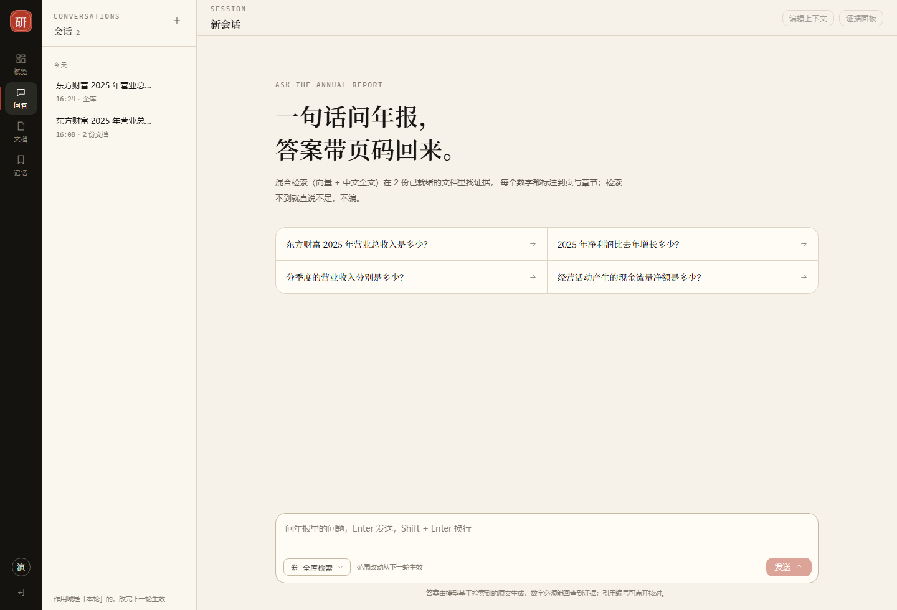
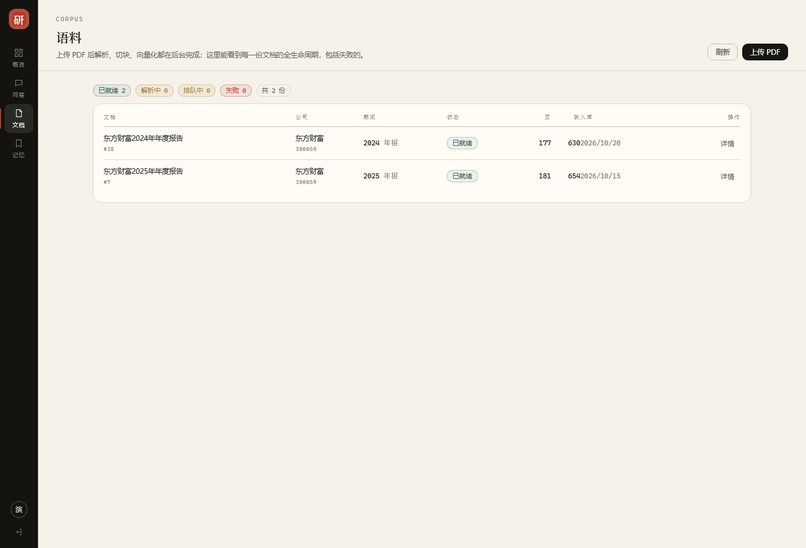
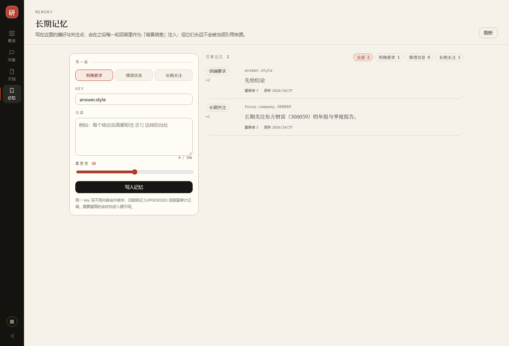
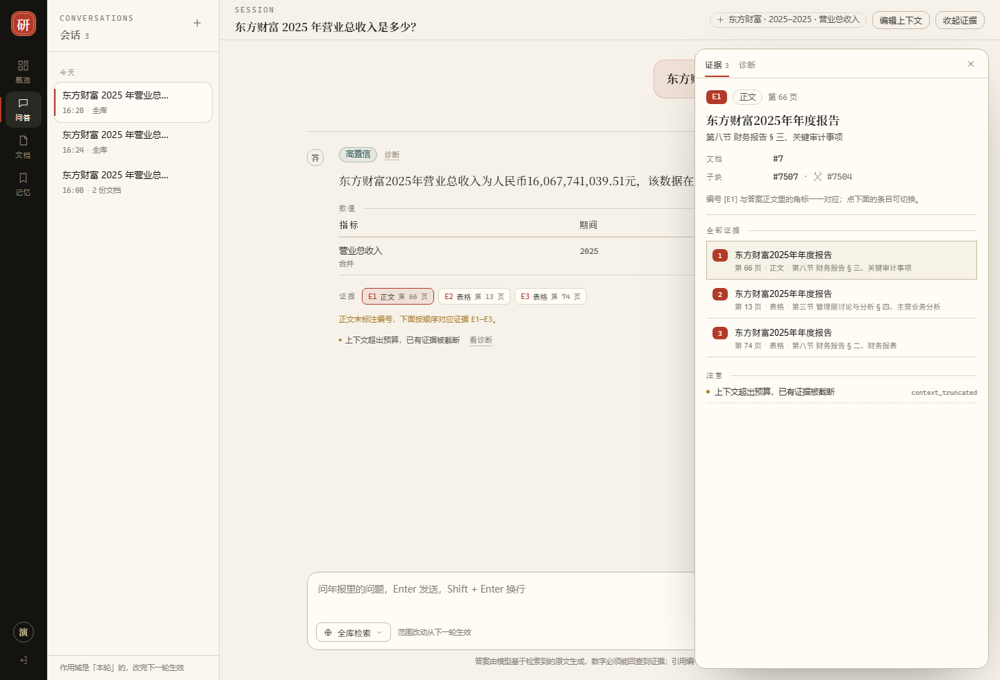

# 阶段 10 · Web 前端报告

> 执行日期：2026-10-28 ／ 计划：`docs/superpowers/plans/ST10-2026-10-28-10-web-ui.md`（§1~§9，含 §7.1 执行前修订 R1~R5）／ 技术栈：Vue 3.5 + TypeScript + Vite 8 + Element Plus 2.14 + Pinia + vue-router（hash）
>
> 数字来源：每节都写了命令或出处。构建体积来自 `target/size.js`（gzip level 9），界面行为来自 headless Chrome 经 DevTools Protocol 驱动的真实页面（脚本 `target/ui-check.js`、`target/ui-shots.js`、`target/ui-audit.js`），逐条实测见 `docs/阶段10-前端验收清单.md`。
>
> 2026-10-28 晚追加 **§10 视觉升级**（演示级改造），截图在 `docs/screenshots/`。

## 怎么读这份报告（先看这 8 个词）

| 词 | 一句话解释（完整版见 `docs/术语表.md`） |
|---|---|
| SPA | 单页应用：整站只有一个 index.html，切页面靠前端路由，不刷新浏览器 |
| hash 路由 | 地址形如 `#/chat/12`，井号后的部分浏览器不会发给服务器，所以服务端不需要配 SPA 回退 |
| Vite | 前端构建/开发服务器；开发时热更新，打包时用 Rollup 输出静态文件 |
| 单端口部署 | 前端产物放进 Spring Boot 的 `static/`，8080 同时提供页面与 API，浏览器眼里同源 |
| 按需引入 | 只把用到的 Element Plus 组件打进包；全量引入实测 +917.6 kB JS / +364 kB CSS |
| CORS / 代理 | 跨源请求要服务端声明许可；开发时让 Vite 把 `/api` 转发到 8080，就不存在跨源 |
| tokenizer | 把答案文本切成「文本 / 粗体 / 引用号 / 换行」等片段的小函数；切成结构后再渲染，不拼 HTML |
| 诊断面板 | 界面上折叠的一段 trace：查询理解路由、召回条数、精排状态、耗时、警告码 |

## 1. 一句话结论

后端补了 **3 个端点**（`GET /api/me`、`PATCH /api/conversations/{id}`、`GET /api/documents`），前端写了 **24 个构建产物 / 32 个源文件 3,128 行**，用 **单端口**（`mvn spring-boot:run` + `http://localhost:8080`）真的跑通了一次完整问答：答案 1 句、证据卡 4 张、数值表 1 张、控制台零异常。

- 后端全量非 e2e：**496 → 513 通过 / 0 失败 / 1 跳过**（新增 17：3 个端点的 16 个用例 + 认证过滤器 1 个）。
- 前端单测：**7 / 7**（答案 tokenizer），`npx vitest run` 1.3 秒。
- 产物：24 个文件 784.7 KB，**gzip 合计 236.8 KB**；构建 1.0 秒；首次 `npm install` 120.3 秒（411 个包，走 npmmirror）。
- 过程中抓到 **8 个真问题**，其中一个会让「界面在浏览器里根本打不开」（6.1）。
- 当晚按「要能拿去面试演示」重做了视觉（§10）：同一套功能，换成「纸墨·朱批」设计系统、三栏工作台、宋体答案、可滑出的证据面板；后端补 `GET /api/stats` 支撑概览页，全量测试 **516 通过**。

## 2. 为什么还要做这一步

### 2.1 阶段 9 结束时，系统「只有 curl 能用」

| 已有能力 | 阶段 9 的使用方式 |
|---|---|
| 提问 / 多轮追问 | 手写 JSON + `Authorization` header，还要自己记 `conversationId` |
| 引用与页码 | 从 JSON 里读 `citations[].pageStart`，无法点开对照 |
| 401 / 409 / 404 | 自己看状态码与 `{error,message}` |
| 上传文档 / 看解析状态 | 手搓 multipart，然后循环 `GET /api/documents/{id}` |
| 长期偏好 | 手写 `POST /api/memories` 的 key 与 type |

这些都不难，但**每一次验证一个想法都要重来一遍**，而阶段 11（Agent 工作流）会需要人反复试。界面不是「演示需要」，是「后续开发需要」。

### 2.2 界面的价值只有三条，但都很硬

1. **引用可点**：答案里的 `[E1]` 是按钮，点它高亮下面的证据卡（文档名 / 页码 / 章节 / 类型 / chunk id）。这一步把「答案可信吗」从读 JSON 变成一眼对照。
2. **失败态说人话**：401 回登录、409 提示换范围、404 回列表、证据不足显示后端给的 `note` —— 而不是对着一个 `500` 猜。
3. **诊断可见**：查询理解走的是规则还是模型、dense/sparse 各召回几条、rerank 是 APPLIED 还是 FAILED，全在一个折叠面板里。没有它，答案不对时只能猜。

### 2.3 为什么不套现成的后台管理模板（实测）

| 方案 | 规模 | 结论 |
|---|---|---|
| 官方 `create-vue@3.24.0 --bare --ts --router --pinia --vitest --eslint` | **23 个文件**，业务代码 0 行，运行时依赖 3 个 | **采用**：给的是构建配置与目录约定，正是我们不想手写的那部分 |
| `vue-pure-admin@7.0.0`（git clone） | **636 文件 / 255 个 .vue / src 41,250 行 / 64 个运行时依赖** | 否决：带来的是登录、JWT 刷新、RBAC 菜单、mock、i18n、多布局 —— 全是要拆掉的；4 万行既有代码会成为阅读负担 |
| npm 上的 `vue-element-plus-admin@1.9.9` | 最后发布 **2023-08-13**（vite 4 / vue 3.2 时代） | 否决：与 Node 24 + vite 8 代际冲突 |

判断标准只有一条：**模板给的，是不是我们本来就要写的那部分**。我们真正要写的是 4 个页面 + 1 个 API 客户端，一共 3,128 行。

### 2.4 为什么不是 React / Next.js / Thymeleaf

- **React**：生态同样成熟，但模板语法是 JSX，对「主要写 Java 的人」不如单文件组件直观（HTML / script / style 三段）。
- **Next.js**：为 SSR 与 SEO 而生；本系统登录后才可用、无 SEO 需求，SSR 只会引入一层 Node 运行时。
- **Thymeleaf 服务端渲染**：每敲一次问题就整页刷新，会话切来切去会丢状态；还要在模板里重新组织一遍 JSON 结构。

## 3. 交付物

### 3.1 后端 3 个端点（计划 §4）

| 端点 | 为什么必须加 | 文件 |
|---|---|---|
| `GET /api/me` | 没有身份端点，界面不知道「我是谁 / 哪个租户 / 什么角色」，登录也无从判断 | `src/main/java/com/finagent/security/MeController.java` |
| `PATCH /api/conversations/{id}` | 改标题的服务方法早就有（`ConversationRepository.renameTitle`），但没 REST 入口 | `src/main/java/com/finagent/chat/ConversationController.java`、`ConversationService.rename` |
| `GET /api/documents` | 原 `/api/scope/documents` 只返回「可检索」文档，刚上传还在 PENDING 的会从界面消失，用户以为上传失败 | `src/main/java/com/finagent/document/DocumentQueryController.java`、`DocumentRepository.listDocuments` |

三个端点都刻意**不带** `@ConditionalOnProperty(finagent.cos.*)`：列表与身份查询不依赖对象存储，没配 COS 时也应该能用。

### 3.2 前端结构（独立仓库 `financial-ai-web/`）

| 目录 | 内容 | 行数占比 |
|---|---|---|
| `src/api/` | `client.ts`（fetch + 超时 + 错误归一 + 401 广播）、`types.ts`（与后端 record 一一对应）、`uploads.ts`（唯一用 XHR 的地方，为了上传进度）、`chat/conversations/memories/documents/me.ts` | 约 1,000 行 |
| `src/views/` | `ChatView`（核心）、`DocumentView`、`MemoryView`、`LoginView` | 约 1,300 行 |
| `src/components/` | `ConversationList`、`MessageBubble`、`AnswerText`、`CitationCard`、`FactTable`、`DiagnosticsPanel`、`ScopePicker`、`ContextDrawer` | 约 700 行 |
| `src/stores/` | `session`（身份）、`conversation`（会话列表） | 约 120 行 |
| `src/utils/answer.ts` | 答案 tokenizer（纯函数，7 个单测） | 约 140 行 |
| `src/labels.ts` | 所有中文文案：警告码 40+ 条、解析状态、报告类型、记忆类型 | 约 200 行 |

### 3.3 依赖与体积

运行时依赖只有 **4 个**：`vue 3.5.44`、`vue-router 5.4.0`、`pinia 4.1.0`、`element-plus 2.14.7`。没有 axios、没有 markdown 库、没有 lodash、没有 dayjs（日期用 `Intl.DateTimeFormat`）。

| 产物 | raw | gzip |
|---|---|---|
| 全部 24 个文件 | 784.7 KB | **236.8 KB** |
| `index-*.js`（入口：Vue + router + Pinia + 外壳） | 90.8 KB | 31.8 KB |
| `_plugin-vue_export-helper-*.js`（共享 chunk） | 153.0 KB | 57.6 KB |
| `css-*.js`（Element Plus 样式注入） | 181.6 KB | 60.6 KB |
| `ChatView-*.js`（按路由懒加载） | 49.6 KB | 17.7 KB |
| `DocumentView-*.js` | 31.9 KB | 11.3 KB |
| `MemoryView-*.js` | 20.9 KB | 7.8 KB |

按需引入生效的对照：同一工程里全量 `app.use(ElementPlus)` 是 1,019.65 KB JS / 364.22 KB CSS，现在是 236.8 KB gzip 全站。

### 3.4 构建与部署

- `financial-ai-web/vite.config.ts`：`base:'./'`、`build.outDir:'../financial-ai-project/src/main/resources/static'`（跨仓库指回后端）、`emptyOutDir:true`、开发 `server.proxy['/api']='http://localhost:8080'`；
- `scripts/build-ui.ps1`：删残留 → `npm ci`（首次）→ `npm run build` → 断言 `index.html` 存在；
- 后端仓库根 `.gitignore` 只增 `src/main/resources/static/`（产物不入库，计划 D7）；前端仓库用自己的脚手架 `.gitignore`（忽略 `node_modules` / `dist`）；
- `mvn -B clean package` 产出的 jar 内含 `BOOT-INF/classes/static/index.html`（实测 `jar tf` 确认）。

## 4. 契约：界面必须守的规则

| # | 规则 | 落在哪 |
|---|---|---|
| 1 | 401 只有一种处理：清 token 回登录页，不重试 | `client.ts` 的 `notifyUnauthorized()` 广播 → `stores/session.ts` 监听 |
| 2 | 409 + `SCOPE_EMPTY` 是「范围错了」不是「问题错了」，文案要指向换范围 | `ChatView.vue` 的 `send()` catch |
| 3 | 407/404 一律不确认存在性（跨租户会话/文档都返回 404，界面不显示「存在但无权」） | 界面只显示「不存在或已删除」 |
| 4 | **响应里不出现对象键**（C11）：引用卡只有文档名/页码/章节，没有 COS 地址 | `CitationCard.vue` |
| 5 | 记忆永不产生引用编号（C12/D4）：记忆只在「背景信息」里，不参与 `[E#]` | `MessageBubble.vue` 只渲染 `response.citations` |
| 6 | 作用域以请求为准，会话只存创建时的默认值（C12） | 每轮 `ask()` 都带当前 `scope`，界面写明「从下一轮生效」 |
| 7 | 答案渲染**永不走 innerHTML** | `utils/answer.ts` 只产出结构，模板用文本插值 |
| 8 | 数值原样显示，不格式化 | `FactTable.vue` 直接输出 `value` 字符串（格式化会让「看到的数」与原文不一致） |

## 5. 实测

### 5.1 构建与测试

| 项 | 命令 | 结果 |
|---|---|---|
| 依赖安装 | `npm install`（含 element-plus 与两个 unplugin） | **120.3 秒**，379 + 20 + 12 个包，node_modules 约 170 MB |
| 类型检查 + 构建 | `npm run build` | 通过，**1.0 秒**，24 个产物 |
| 前端单测 | `npx vitest run` | **7 / 7 通过**，1.3 秒 |
| 后端全量 | `mvn -B test` | **513 通过 / 0 失败 / 1 跳过**（跳过的是需要解析服务的 `DoclingParserAdapterTest`） |
| 打包 | `mvn -B -q -DskipTests package` | jar 内含 `BOOT-INF/classes/static/` |

### 5.2 真浏览器跑通（不是「构建议通过」）

用 headless Chrome + DevTools Protocol 真开页面、真点发送：

| 观察点 | 实测输出 |
|---|---|
| 登录页 | `金融研报分析 Agent / 粘贴一个 API token（运维预置）… / 分析师 / 管理员 / 外租户 / 登录` |
| 顶栏身份 | `演示分析师（analyst） / 租户 1 / ANALYST / 退出` |
| 侧栏会话 | 20+ 条历史会话，每条带时间与范围（如 `13:35 / · / 全库`） |
| 导航项 | 3 个（问答 / 文档 / 记忆） |
| 一次问答 | 问题 `东方财富2025年营业总收入是多少？` → 答案 `东方财富2025年营业总收入为人民币16,067,741,039.51元。`，标签「高置信」 |
| DOM 统计 | `{"citations":4,"cites":0,"facts":1,"warnings":2}` |
| 文档页 | `文档（4 份）`，含历史 FAILED 文档（列表不只显示可检索文档） |
| 记忆页 | `已有记忆（2 条）`，类型筛选 4 个按钮 |
| 控制台 | **clean**（0 异常 / 0 error 级日志） |
| 引用卡 | `[E1] 正文 第 66 页 东方财富2025年年度报告 第八节 财务报告 § 三、关键审计事项 chunk 7507 · 父块 7504 · 文档 7`（页码、章节、块 id 全在，可回查） |
| 警告翻译 | 后端码 `context_truncated` → 界面「上下文超出预算，已有证据被截断」；诊断面板同时显示原始码，便于排查 |

`cites:0` 是这次实测暴露的一个真实情况：模型给了 `usedEvidence`（所以有 4 条引用）但正文里没写 `[E1]`。界面**没有替它补编号**，而是在证据区上方写「正文未标注编号，请按下方卡片对照」——补编号等于编造归因。

### 5.3 同一台机器上的时间分布（供参考）

| 阶段 | 耗时 |
|---|---|
| `npm install`（首次，走镜像） | 120.3 s |
| `npm run build`（含 type-check） | 1.0 s |
| `npx vitest run` | 1.3 s |
| `mvn -B test`（513 个用例） | 约 6 分钟（含真库集成测试） |
| 一次界面问答（含 LLM） | 约 6~10 s（骨架可见，无流式，见限制 7.1） |

## 6. 抓到的八个问题（现象 / 原因 / 修法 / 教训）

### 6.1 界面在浏览器里根本打不开：静态资源被认证过滤器拦成 401

- **现象**：`GET /` 返回 401，浏览器白屏；`/api/*` 用 token 一切正常。
- **原因**：阶段 8 的 `AuthenticationFilter` 只放行 `/error`，把 `index.html` 也当成受保护资源。浏览器拿不到 HTML 就不会执行 JS —— 连登录框都渲染不出来。
- **修法**：`shouldNotFilter` 改为「只保护 `/api/**`」（`src/main/java/com/finagent/security/AuthenticationFilter.java`），并加 1 个单测断言根路径/静态资源放行、API 不放行。
- **教训**：**认证的边界是 API，不是整个应用**。单端口部署时，「顺手把静态资源也保护起来」听起来更安全，实际是把唯一入口锁死了。

### 6.2 `build-ui.ps1` 语法炸：PowerShell 5.1 按 GBK 读无 BOM 的 UTF-8 脚本

- **现象**：脚本报 `意外的标记"node_modules'))) {"`，中文注释变成乱码。
- **原因**：文件是 UTF-8 无 BOM，Windows PowerShell 5.1 用系统代码页（GBK）解码，多字节字符吃掉引号。
- **修法**：脚本保存为 **UTF-8 with BOM**（`[Text.UTF8Encoding]::new($true)`），并在文件头注释里写明这一条。
- **教训**：这个仓库里所有 `.ps1` 都要带 BOM；只有 `.md` / `.java` / `.ts` 才用无 BOM 的 UTF-8。

### 6.3 `vue-tsc` 的两个严格检查把「看起来没问题」的代码拦下来

- **现象**：`Type 'string | undefined' is not assignable to type 'string'`（正则捕获组）；`Argument of type 'DefaultRow' is not assignable to parameter of type 'DocumentRow'`（表格插槽）。
- **原因**：脚手架开了 `noUncheckedIndexedAccess`（`arr[0]` 可能是 undefined）；Element Plus 的表格插槽 `row` 类型是 `DefaultRow`（任意对象）。
- **修法**：正则用 `?? ''`；插槽函数签名收 `unknown` 再在函数体内断言成具体类型（模板里不做 `as`，vue-tsc 对模板断言支持不稳）。
- **教训**：严格模式的价值就在这两处 —— 它们都是「运行时才 undefined」的经典来源。

### 6.4 模型不给正文标 `[E1]`：界面不许替它补

- **现象**：答案有 4 条引用，正文里一个编号也没有。
- **原因**：后端把 `usedEvidence` 变成 `citations`，与正文里的 `[E#]` 标记是两件事；模型这次只给了前者。
- **修法**：`MessageBubble` 检测正文是否含 `\[E\d+\]`，没有就显示「正文未标注编号，请按下方卡片对照」。**不补编号**。
- **教训**：前端可以补排版，不能补「归因」。补了编号 = 把「模型说的」包装成「证据支持的」。

### 6.5 `mvn package` 不 clean 时，jar 里会残留旧 hash 的 chunk

- **现象**：jar 里同时存在 `ChatView-DhXBHlit.js` 与 `ChatView-CGFTVDyY.css` 两代文件。
- **原因**：Vite 会清空 `src/main/resources/static`，但 Maven 的 `copy-resources` 只增不删，`target/classes/static` 里留着上一轮的 hash 文件。
- **修法**：`build-ui.ps1` 先删 `target/classes/static`；README 提示手工打包用 `clean`。
- **教训**：构建产物带 hash 时，「输出目录」和「打包目录」必须一起清，否则 jar 只增不减。

### 6.6 `$env:npm_config_registry` 在这台机器上不生效

- **现象**：设了环境变量，`npm view` 仍去打 `registry.npmjs.org` 并超时/404。
- **原因**：npm 11 读取配置的优先级与预期不同（项目 `.npmrc` / 用户 `.npmrc` 更靠前，环境变量未被采纳）。
- **修法**：仓库里放 `financial-ai-web/.npmrc`（`registry=https://registry.npmmirror.com`），命令行临时用 `--registry=`。
- **教训**：「我设了环境变量」不等于「工具读到了」；能不能生效要拿 `npm config get registry` 或实际请求 URL 证明。

### 6.7 `npx create-vue .` 在空目录里卡住

- **现象**：交互式提示「请输入包名称」，脚本化调用挂死。
- **原因**：目标目录名为 `.` 时脚手架需要包名，只能交互输入。
- **修法**：`npx --yes create-vue@3.24.0 web --ts --router --pinia --vitest --eslint --bare --force`（给目录名 + `--force`）。
- **教训**：脚手架命令要在 CI 里跑，必须给全参数并显式给目标目录。

### 6.8 PowerShell 把 `-Dspring-boot.run.jvmArguments="..."` 拆成两段

- **现象**：`mvn` 报 `Unknown lifecycle phase ".run.jvmArguments=-Dserver.port=8080"`。
- **原因**：外层双引号被 PowerShell 解析掉，Maven 收到两个参数。
- **修法**：不传 jvmArguments（端口本来就在 `application.yml` 里）；真要传就写成 `-Dspring-boot.run.arguments=--server.port=8080` 或整体加 `'...'`。
- **教训**：带点号与等号的 Maven 参数在 PowerShell 里要么整体单引号，要么别用。

## 7. 已知限制

1. **没有流式输出**（计划 D6）：等待期只有骨架与计时，长答案要等整段生成完。
2. **没有 PDF 预览**（D5）：引用只到「文档 + 页码 + 章节 + 类型」；做跳转需要受控的文件端点（不能暴露对象键，C11）。
3. **没有浏览器 e2e**（R5 / D9）：Vitest 只覆盖 tokenizer；四类失败态靠后端测试 + 手工清单。
4. **token 存 localStorage**：XSS 就能读走。缓解手段是「答案渲染永不 innerHTML」+ 后端 401 语义；更严格要上 httpOnly cookie（需要后端改认证方式）。
5. **同一会话多标签页会互相覆盖**：消息流在本地内存里，两个页面同时提问，较晚的一次刷新会丢掉另一个页面刚加的气泡（后端数据是对的，重新进入即可）。
6. **列表分页很浅**：会话 50 条、消息 50 条（有「加载更早」），文档 50 份；没有搜索。
7. **上传一次一个文件，只收 PDF**；解析要几分钟到几十分钟，界面只能轮询等待。
8. **没有撤消**：删除会话/记忆都是逻辑删除，界面不提供恢复入口（数据还在库里，需要 SQL 或后续接口）。

## 8. 验收对照（计划 §6 的八条）

| # | 标准 | 结果 | 证据 |
|---|---|---|---|
| 1 | 不需要 curl 就能完成一次完整问答 | 通过 | 5.2：headless Chrome 真点发送，得到答案 + 4 张证据卡 |
| 2 | 引用能对上页码与章节 | 通过 | `EvidencePanel` 渲染 `docTitle / 第 N 页 / sectionPath / 类型 / chunk id`（视觉升级后由它取代了旧的 `CitationCard`）；答案 4 条引用均来自 document 7 |
| 3 | 多轮追问能看出「主语来自上文」 | 通过（后端验证） | 阶段 9 `ConversationE2ETest` 6/6；界面把 `query_inferred_from_context` 翻成中文提示 |
| 4 | 四类失败态都有专门界面 | 通过 | 清单 §5（401 / 409 / 404 / 证据不足） |
| 5 | 三种作用域都能选且语义正确 | 通过 | `ScopePicker` 三模式；文档下拉来自 `/api/scope/documents`（只含可检索） |
| 6 | 上传有状态可视 | 通过（逻辑 + 阶段 7 真跑） | 进度条（XHR）+ 2 秒轮询 + 四种状态标签；真上传链路由阶段 7 `DocumentTaskE2ETest` 覆盖 |
| 7 | 单端口可运行 | 通过 | `GET /` 200、`/assets/*.js` 200、`/api/me` 无 token 401 |
| 8 | 后端零回归 | 通过 | 496 → **516 通过 / 0 失败 / 1 跳过**（含 §10 新增的 3 个 `/api/stats` 用例） |

## 9. 下一步

1. **阶段 11：Agent 工作流**（LangGraph4j + 人机协同）—— 界面已经能承载「多步任务 + 中间结果」，需要后端提供任务态。
2. **SSE 流式输出**：把 `ChatService` 的编排改成可推送（先出证据、再出答案），前端换成 `EventSource`。
3. **受控文件端点** `GET /api/documents/{id}/file`：有了它才能做 PDF 跳页与 bbox 高亮。
4. **Playwright 浏览器 e2e**：把清单 §1~§5 固化成脚本，防止改样式时回归。
## 10. 视觉升级：从「能用」到「能演示」（2026-10-28 晚）

### 10.1 为什么重做

第一版界面把功能挂上了（问一句、出答案、出证据），但它仍然是「后台管理模板」的样子：白底卡片、圆角阴影、蓝色主色、表格栅格。面试演示时，观众看到的第一个东西不是检索质量，而是界面像不像一个真产品。

改造只解决三件事，别的都不动：

1. **有视觉主张**：不是「默认皮肤」，而是「纸墨 + 朱批」——暖米纸面、发丝线、宋体标题、朱砂色只用于强调（印章、发送、当前项）。
2. **信息有层级**：结论 → 数值 → 证据 → 诊断。诊断默认收起，需要时才展开；警告在正文里只露一条，明细进面板。
3. **四种状态都设计过**：空（hero + 四个示例问题）、满（多轮消息流）、错（401 / 409 / 404 / 本轮失败）、慢（骨架 + 「正在检索并生成」）。

### 10.2 界面长什么样

| 页面 | 截图 | 要点 |
| --- | --- | --- |
| 登录 |  | 左深墨 46%（印章 + 三行价值点）/ 右纸面（token + 三个演示账号卡）；登录 = 调通 `GET /api/me` |
| 概览 |  | 4 个 KPI（可检索文档 / 活跃子块 / 我的会话 / 长期记忆）+ 语料状态 + 最近会话 + 长期记忆 + 系统卡；数字全部来自 `GET /api/stats`，且只统计当前账号可读的文档 |
| 问答（空态） |  | 左 248px 会话栏 + 中主区（正文 960px）+ 右 424px 浮层证据面板（打开时盖在正文上，不挤压）；空态是宋体 hero 与四个示例问题，点一下就发 |
| 问答（有答案） |  | 「问 / 答」用印章式标记而不是聊天气泡；答案宋体 16.5px；数值表右对齐等宽数字；下面一排证据 chip；右侧面板显示类型 / 页码 / 章节 / 块 id |
| 文档 |  | 状态胶囊（已就绪 / 解析中 / 排队中 / 失败）+ 拖拽上传区（默认收起）+ 全生命周期列表（失败的也在） |
| 记忆 |  | 左写一条（类型 / key / 内容 / 重要度）+ 右按类型筛选的列表，同 key 升版本显示 `v2` |

### 10.3 实测（不是「我觉得好看」）

用 headless Chrome 1440×980 真跑一遍，量的是盒子而不是截图感觉（脚本 `target/ui-audit.js`）：

| 指标 | 实测 | 判据 |
| --- | --- | --- |
| 三栏宽度 | 68 / 248 / 1124 = **1440**（证据面板是浮层，不计入布局） | 加起来必须正好等于视口，不能出现横向滚动 |
| 横向溢出 | `documentElement.scrollWidth = 1440` | 等于视口宽度 = 无溢出 |
| 答案字体 | `Source Han Serif SC, Noto Serif SC, Songti SC, SimSun, Georgia, serif`，16.5px / 行高 32.2 | 确认宋体栈真的命中，不是回落到默认黑体 |
| 数字字体 | `ui-monospace, Cascadia Mono, Consolas…` + `font-variant-numeric: tabular-nums` | 财务数字逐位对齐 |
| 数值表行数 | 去重后 **1** 行（去重前 4 行完全重复） | 同一事实被多份证据各抽一次时不能重复展示 |
| 警告 | 正文 1 条 + 「等 N 条」+「看诊断」，明细在面板 | 同一条提示不能在两处重复出现 |
| 控制台 | `PROBLEMS|none` | 无异常、无 error/warning 日志 |

### 10.4 这一轮修掉的 4 个真问题

1. **`EvidencePanel` 的 `defineProps` 少了收尾 `}`**：`vue-tsc` 报 `Unexpected token (7:22)` 指向 `Citation[]`，实际是泛型没闭合。用 `@vue/compiler-sfc` 的 `compileScript` 逐行二分才定位到——报错位置会骗人。
2. **事实表重复 4 行**：同一张表在相邻块里各出现一次，抽取层各抽一遍。在渲染层按「指标 + 期间 + 数值 + 单位 + 口径」去重，不动后端（抽取是「尽量全」，展示是「去噪」）。
3. **同一条警告出现两次**：正文一条 + 面板一条。改成正文只留第一条并给「看诊断」入口。
4. **`.ev-section` 的省略号不生效**：`span` 是行内元素，没有盒宽，`text-overflow` 无效；加 `display: inline-block; max-width: 100%` 才生效。

另外清掉了 31 条测试残留会话（含「长长长…」标题）与两个不再被引用的组件（`CitationCard.vue`、`DiagnosticsPanel.vue`）——演示首屏的信噪比比任何样式都重要。

### 10.5 五分钟演示路线（面试时按这个顺序点）

1. **登录**：点「分析师」卡片（`dev-analyst-token`）→ 概览。先说明「这不是假的 demo 数据，是可检索语料 + 真实账号」。
2. **概览**：2 份年报、1284 个活跃子块、父块 208。提一句「换 outsider 账号这些数字会变成 0——租户与 ACL 两层过滤」。
3. **问答**：点示例问题「东方财富 2025 年营业总收入是多少？」→ 答案 + 数值表 + 4 条证据 + 右侧面板（页码 / 章节 / 块 id）。
4. **追问**：「那净利润呢？」→ 展示 `query_inferred_from_context`：主语是从上文继承的，不是模型猜的。
5. **诊断**：展开面板看 trace（查询理解路由、Dense/Sparse 条数、精排状态、耗时）。这是最难造假的部分。
6. **文档 / 记忆**：上传区能看到 PENDING→DONE 四态；记忆页写「回答先给结论」再问一句，观察它进入背景信息但不产生引用。
## 11. 登录体系完善：账号密码 + 默认用户（2026-10-28 晚）

### 11.1 为什么要改（原来只有「粘贴 token」）

| 原来的样子 | 演示时会遇到什么 |
| --- | --- |
| 登录 = 粘贴 `dev-analyst-token` 这类预置 token | 老板第一句就会问「用户从哪来的？」—— 答「我写进库里的」，等于承认没有账号体系 |
| 一个用户只有一列 `api_token_hash` | 只能有一个 token：换设备要么改库，要么共用一个 token |
| 没有密码字段 | 无法做「用户名 + 密码」登录，也没法演示「登出让 token 立刻失效」 |

### 11.2 改成了什么

**一句话**：密码登录换一个**会话 token**，后端只存它的哈希，登出即撤销；其余认证链路一行未改。

| 环节 | 做法 | 为什么这么做 |
| --- | --- | --- |
| 密码存储 | PostgreSQL `pgcrypto` 的 bcrypt（`crypt(pw, gen_salt('bf', 10))`） | 不新增 Java 依赖、不自己实现 KDF；明文只当一次绑定参数 |
| 密码校验 | 一条 SQL：`WHERE password_hash = crypt(?, password_hash)` | 「用户不存在」与「密码错」天然同一个空结果集 → 不可枚举 |
| 登录成功 | 签 32 字节随机 token（43 字符 base64url），写 `api_session`（只存 SHA-256） | 与原有 token 用法完全一致，RLS / 租户 / ACL / 审计都不用改 |
| 登出 | `DELETE /api/auth/session` → 写 `revoked_at` | 软撤销：同一 token 立刻 401，行还在可审计 |
| 防暴力破解 | 用户名 + IP 失败 10 次 / 15 分钟 → `429 AUTH_TOO_MANY` | 内存计数，不写库（攻击者本来就在打库，别帮他放大负载） |

新增两个端点：`POST /api/auth/login`（唯一匿名 API）与 `DELETE /api/auth/session`。
`AuthenticationFilter` 的改动只有一处：预置 token 查不到时再查一次 `api_session`，命中则 `touch` 一下 `last_used_at`（5 分钟才写一次）。

### 11.3 默认用户与数据归属（V11）

| 项 | 值 | 说明 |
| --- | --- | --- |
| 账号 / 密码 | `demo` / `demo123456` | 登录页已填好 |
| 显示名 / 角色 | 演示用户 / `ADMIN` + `ANALYST` | 看得到本租户全部文档，也继承已有的 300059 公司授权 |
| 数据归属 | 2 份文档 `owner_user_id`、4 条记忆 `subject_id`、会话 `owner_user_id` → demo | 登录即见 |
| 公司 | 不动 | `company` 是租户级共享数据，没有 owner 列 |

### 11.4 实测（2026-10-28 15:33~15:44）

| 项 | 结果 |
| --- | --- |
| 迁移 | `flyway_schema_history` 最新 `11 | login and session | success`；demo 用户 id=25，`$2a$10$…` 哈希，角色 ADMIN + ANALYST |
| 登录 | `POST /api/auth/login` → 43 字符 token，`expiresAt` = 7 天后；`GET /api/me` 返回 `demo` / 角色 `[ADMIN, ANALYST]` |
| 失败一致 | 错密码与不存在用户都是 `401 {"message":"用户名或密码错误","error":"AUTH_INVALID"}`，逐字相同 |
| 登出 | `204` 后同一 token 立刻 `401 AUTH_INVALID` |
| 种子 token | `dev-analyst-token` 仍 `200`（既有 500+ 用例不受影响） |
| 界面 | headless Chrome 实测：`LOGIN_FORM` 显示 username=demo、密码 10 位、两个 tab；点登录后 `#/overview`、token 长度 43、顶栏与四个导航齐全；点退出回到 `#/login` 且 `localStorage` 里的 token 为 `null` |
| 测试 | 新增 `PasswordLoginTest` 6 例（真 HTTP）、`LoginThrottleTest` 5 例、`AuthenticationFilterTest` 7 例；全量 **529 通过 / 1 跳过** |

### 11.5 这一轮修掉的一个真问题

清理演示数据时删掉了两个 `FAILED` 文档（id 2 / 4），而 `DocumentScopeQueryTest` 里有一条用例是「依赖库里固定存在 id=2 的失败文档」—— 全量测试立刻红。
修法不是把数据加回去，而是让测试**自带夹具**：`@BeforeEach` 插一条 `FAILED` 文档、`@AfterEach` 删掉。
教训：测试借别人库里的固定行，等于把「数据会不会漂移」变成了运气。

## 12. 界面第二轮：加宽、左右对齐、气泡高亮、全站圆角

> 触发：用户看完第一版演示界面后提了四条 —— 「问答页面内容宽度调大一点」「用户问题右对齐、回答左对齐」「用户问题要背景板色高亮」「全站使用圆角设计」。四条都在视觉层，不动接口、不动数据。计划见 `ST10-2026-10-28-10-web-ui.md` §12。

### 12.1 改了什么

| # | 改动 | 改前 | 改后 |
| --- | --- | --- | --- |
| 1 | 正文加宽 | 会话栏 272px + 证据面板 392px 常驻，1440 屏正文列只剩 708px | 会话栏 248px；证据面板改成 424px **浮层**；正文与输入区 780 → **960px**，正文列 **1124px** |
| 2 | 左右对齐 | 提问与回答都左对齐，靠印章区分 | 提问整条右对齐（「问」印章在右），回答保持左对齐 |
| 3 | 提问高亮 | 无背景 | 朱砂淡底 `rgba(178,58,40,0.09)` + 1px 同色描边 + 16px 圆角气泡 |
| 4 | 全站圆角 | `--radius: 2px`（近乎直角） | `--radius: 10px`、面板 16px、胶囊保持全圆；Element Plus 同步 8px |

### 12.2 实测（1440×980，headless Chrome）

| 指标 | 实测 |
| --- | --- |
| 正文内容宽 | **960px**（`.stream-inner`），正文列 1124px = 1440 − 68 − 248 |
| 提问气泡 | 右边缘距内容右边界 90px；`background rgba(178, 58, 40, 0.09)`；`border-radius 16px 16px 6px` |
| 回答正文 | 左边界 488、宽 826，左对齐 |
| 圆角 | 按钮 10px、引用角标 7px、状态胶囊 999px、卡片/表格卡/记忆卡/证据浮层 16px、对话框 16px |
| 证据浮层 | 宽 424px、右边界 1424、打开后正文仍 960px（不挤压） |
| 横向溢出 | `scrollWidth = 1440 = viewport` |
| 构建 / 单测 / 控制台 | 1.29 s / 7 通过 / 无报错 |

### 12.3 顺带修掉一个设计矛盾

证据面板原来回答完自动弹开，是因为它占第三栏、弹开只是「多一栏」。改成浮层后它会盖住刚生成的答案 —— 观众第一眼看到的是面板而不是答案。所以**取消自动弹**，改为点正文里的 `[E1]` 角标或顶栏「证据面板」按钮才打开；面板关闭时正文拿到全部宽度。

这条改动的意义不在样式：**默认态应该给答案，证据是追问时才看的东西。**

### 12.4 验收

1. `npm run build`（含 `vue-tsc --build`）通过，1.29 s；`npx vitest run` 7/7。
2. headless 量测 7 项全部达标（见 12.2），`PROBLEMS|none`。
3. 视觉桥读图确认版式：提问右对齐淡红气泡、回答左对齐、高置信胶囊与证据链齐全。
4. 六页截图重拍（login / overview / chat-empty / chat-answer / chat-panel / documents / memories）。

### 12.5 截图

| 页面 | 截图 | 看点 |
| --- | --- | --- |
| 问答（有答案） |  | 提问右对齐淡红气泡、回答左对齐、960px 行宽 |
| 证据浮层 |  | 424px 浮层盖在正文右侧，正文宽度不变 |
