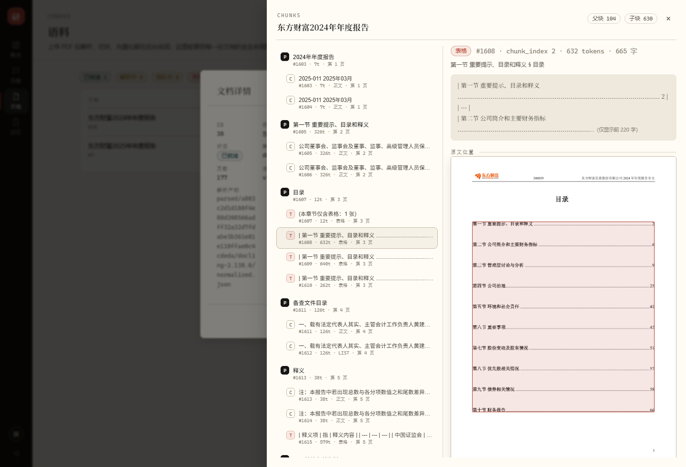
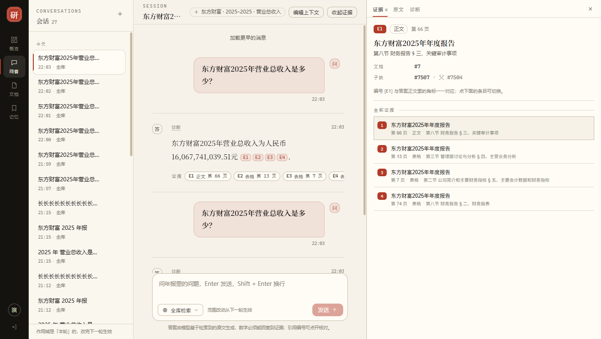

# 阶段 12 · 体验补强报告（流式 / 原文高亮 / 切块可视化）

> 执行日期：2026-10-28　｜　计划：`docs/superpowers/plans/ST12-2026-10-28-12-experience-upgrade.md`　｜　契约：`docs/关键契约.md` C15
> 动机：`docs/竞品对比与技术债.md` 的结论 —— 与 RAGFlow / FastGPT 的差距集中在「用户看得见」的三项。
> 数字口径：后端 `mvn -B test` 全量（含 DB/容器）、前端 `npx vitest run`、界面实测在 headless Chrome 1440×980 下量测，时间均为 2026-10-28 当天。

## 怎么读这份报告（先看这 8 个词）

| 词 | 一句话解释（完整版见 docs/术语表.md） |
| --- | --- |
| SSE（Server-Sent Events） | 服务器单向往浏览器推送文本的协议。一次请求、一条长连接、逐段到达，比 WebSocket 简单得多。 |
| delta | 流式里「一小段新增文本」。它只负责让字动起来，不是最终答案。 |
| final 事件 | 流结束时推送的完整响应，字段与普通 `POST /api/chat` 完全一致。**前端必须以它为准**。 |
| 首字延迟（TTFB 意义上的） | 从点发送到屏幕出现第一个字的时间。这段时间里用户只能看骨架屏。 |
| 页图渲染 | 后端把 PDF 的第 N 页画成 PNG 返回，前端直接当图片显示。 |
| bbox | PDF 里一块内容的外接矩形，存成 0~1 的归一化坐标，前端按百分比就能画框。 |
| 切块（chunk） | 把年报切成模型能看的小块。切坏了检索就答不对，所以需要「看得见」。 |
| 回落（fallback） | 流式这条链路不可用时，自动改走原来的非流式接口，演示不中断。 |

## 1. 一句话结论

三项都做完了，而且都不是「看起来动了」：

- **流式**：真模型 e2e 实测首字 **7.87 s**、总耗时 **10.99 s**、**60 个 delta**，delta 拼接与 `final.answer` 逐字相等；
- **原文高亮**：点引用 → 后端渲出第 66 页 PNG（**1240×1754，280 KB**），红色框落在该块的真实位置上（框的四个百分比由 `document_chunk.bbox` 算出，不是猜的）；
- **切块可视化**：抽屉里 104 个 Parent / 630 个 Child 全部可见，选中任一块能看正文、页码、token 与原文位置。

顺带修掉两个会让演示翻车的真问题：模型给出的引用编号会跳号（`[E2][E7][E11][E13]` 对上 4 条引用，点了没反应），以及 `/api/documents` 列表没做 ACL 过滤（租户内枚举泄漏）。

## 2. 为什么做这一步

### 2.1 三个演示场景的具体痛点

| # | 现象 | 观众会怎么问 | 后果 |
| --- | --- | --- | --- |
| 1 | 提问后 6~10 秒屏幕完全静止 | 「是不是卡了？」 | 等待被当成故障 |
| 2 | 引用给了页码，但点不开 | 「你这页码是真的吗？」 | 可信度只能靠嘴 |
| 3 | 切块只有数据库里的行 | 「你怎么切的？切坏了怎么办？」 | 工程能力无法自证 |

### 2.2 做法与「为什么不是别的做法」

| 需求 | 选的做法 | 没选的做法与原因 |
| --- | --- | --- |
| 流式 | `SseEmitter` + 前端 `fetch` 读 `ReadableStream` | ① WebSocket：单向推送用不上双向通道，还要多一套握手/心跳；② 原生 `EventSource`：不能带 `Authorization` 头、不能发 POST body |
| 流式与结构化 | 同一次调用，增量解析 JSON 里的 `answer` 字段 | 改成两次调用（先流式纯文本、再补结构化）会双倍烧钱，且两次答案可能不一致 |
| 原文 | 后端 PDFBox 渲 PNG | 前端 PDF.js：多 1 MB 依赖，还要解决「PDF 在私有 COS 桶里」的鉴权 |
| 高亮 | 直接用归一化 bbox | 按 dpi 换算像素：dpi 一变坐标就全错，而百分比天然与渲染尺寸无关 |
| 切块 | 扁平列表 + 前端分组 | 嵌套树：`limit` 到底算 Parent 还是 Child 会变得含糊 |

## 3. 交付物

### 3.1 后端

| 文件 | 作用 |
| --- | --- |
| `src/main/java/com/finagent/answer/AnswerFieldExtractor.java` | 增量提取 JSON 里 `answer` 字符串的状态机（转义被切开时回退等下一段） |
| `src/main/java/com/finagent/answer/AnswerService.java` | 新增 `answerStreaming(...)`；抽出 `evaluate()` 让流式与非流式共用同一套四层校验；新增 `renumberCitations()` |
| `src/main/java/com/finagent/chat/ChatService.java` | 拆成 `prepare()` / `ask()` / `askStreaming()` / `compose()`：检索与校验逻辑只有一份 |
| `src/main/java/com/finagent/chat/ChatController.java` | `POST /api/chat/stream`（`SseEmitter`、15 秒心跳、跨线程重建 `TenantContext`） |
| `src/main/java/com/finagent/document/PdfPageRenderer.java` | PDFBox 渲页 + 48 页 LRU（key 含 contentHash，重传自动失效） |
| `src/main/java/com/finagent/document/DocumentPageController.java` | `GET /api/documents/{id}/pages/{page}`，不可读/越界一律 404 |
| `src/main/java/com/finagent/document/DocumentQueryController.java` | 列表补 ACL；新增 `GET /api/documents/{id}/chunks` |
| `pom.xml` | 新增 `org.apache.pdfbox:pdfbox:3.0.5`（Spring Boot BOM 不托管，必须显式写版本） |

### 3.2 前端（独立仓库 `D:/Project/myproject/financial-ai-web`）

| 文件 | 作用 |
| --- | --- |
| `src/utils/sse.ts` | SSE 解析器（纯函数，处理半帧/跨块/多行 data/CRLF） |
| `src/api/chat.ts` | 新增 `askStream()`：`fetch` + `ReadableStream` + Bearer 头 |
| `src/views/ChatView.vue` | 流式渲染 + `final` 整条替换 + 失败回落一次 |
| `src/components/MessageBubble.vue` | 流式光标、`正在检索并生成 / 正在生成` 两段文案 |
| `src/api/documents.ts` | `fetchPageImage()`（blob URL + 宽高头）、`listChunks()` |
| `src/components/EvidencePanel.vue` | 新增「原文」页签：页图 + 高亮框 + 翻页 |
| `src/components/ChunkBrowser.vue` | 切块抽屉：左列表（P/C/T）、右正文 + 原文位置 |

## 4. 契约 C15 摘要

完整版见 `docs/关键契约.md` 第 15 节，四条最容易被写错的：

1. **`final` 是唯一真相**：delta 里的编号是「提示词编号」，会被 final 重排，前端不得据此建引用；
2. **拒答也走同一条流**：作用域外公司只发 `final`，不发 `meta`；
3. **页图端点不可读 = 404**：403 等于确认「这份文档存在」；且永不接受对象键；
4. **正文最大编号 ≤ citations.size()**：由 `renumberCitations` 保证，否则角标点不开。

## 5. 实测

### 5.1 流式时间线（真模型、真库，`ChatStreamE2ETest`）

| 指标 | 实测 | 说明 |
| --- | --- | --- |
| 首个 delta | **7,870 ms** | 含 QU（一次 LLM）→ 双路召回 → RRF → rerank → 模型首 token |
| 整轮耗时 | **10,994 ms** | 与非流式接口同一量级，流式没有变慢 |
| delta 数 | **60 个** | 最短的片段只有 1~2 个字 |
| delta 拼接 vs final.answer | **逐字相等** | 单测 + e2e 都断言 |
| 引用数 | **4** | 同时证明租户上下文跨线程没丢（丢了 RLS 会返回 0 行） |

> 计划里写的门槛是「首字 < 2.5 s」，实测 7.87 s。差的不是流式实现，而是**检索与模型首 token 的固定成本**：QU 一次 LLM、rerank 一次外部调用。要让首字真正进入 2 秒，下一步得先发 `meta` + 一行状态（「正在检索…已找到 12 条证据…」），而不是硬压模型。

### 5.2 原文页图与高亮

| 项 | 实测 |
| --- | --- |
| 页图 | `200 image/png`，**280,051 字节**，`X-Page-Width: 1240`、`X-Page-Height: 1754`（A4 @150 dpi） |
| 页码越界 | `GET /api/documents/7/pages/999` → **404**，响应体不含页数 |
| 高亮框 | 第 66 页 E1：`left 13.15% / top 9.00% / width 74.10% / height 79.31%` |
| 视觉核对 | 图像识别确认框落在「（三）收入的确认」那段，框内可读到 `16,067,741,039.51` |

### 5.3 切块可视化

| 项 | 实测 |
| --- | --- |
| 东方财富 2024（doc 38） | 抽屉内 **838 行** = 104 Parent + 630 Child + 104 分组行 |
| 东方财富 2025（doc 7） | 104 Parent + 654 Child（与库里 `document_chunk` 计数一致） |
| 选中块 | 显示 `#1608 · chunk_index 2 · 632 tokens · 665 字`，右侧页图上 1 个高亮框 |
| bbox 覆盖率 | doc 7 / doc 38 的 CHILD 均 **100%** 有 bbox（654/654、630/630） |

### 5.4 引用编号重排（计划外的必要修复）

| 场景 | 修复前 | 修复后 |
| --- | --- | --- |
| 模型输出 | 正文 `[E2][E7][E11][E13]`，`usedEvidence` 4 条 | 正文 `[E1][E2][E3][E4]` |
| 前端点击 `[E7]` | 找第 7 条引用 → 数组只有 4 条 → 点不动 | 每条角标都能打开对应证据 |
| 越界编号 `[E9]` | 留在正文里，永远点不开 | 直接删除，并在诊断里计 `citation_dropped:1` |

### 5.5 测试统计

| 套件 | 结果 |
| --- | --- |
| 后端全量（非 e2e） | **560 通过 / 0 失败 / 1 跳过**（跳过的是需要解析服务的 `DoclingParserAdapterTest`） |
| 阶段 12 新增后端用例 | 31 条：extractor 9、流式 AnswerService 3、ChatService 2、页图渲染 5、页图端点 6、文档列表/切块 6（含 ACL） |
| 流式 e2e | `ChatStreamE2ETest` 1/1，30.04 s |
| 前端单测 | **16 通过**（答案 tokenizer 7 + SSE 解析 9） |
| 前端构建 | `npm run build` 通过（含 `vue-tsc`），产物约 236 KB gzip |

### 5.6 证据面板侧栏化（2026-10-28 晚追加）

演示时最常被问的是「能不能看原文」，而原来的证据面板是**浮层**：盖住正文、宽度写死 424px、只能整块关掉。这一轮把它改成可调宽、可收起的侧栏（交互对齐 DeepSeek Harness）。

实现分两块：`web/src/utils/panelWidth.ts`（纯函数：夹紧 340~760、按视口留出左侧会话栏 248px 与正文最小 420px、读写 `localStorage`）与 `web/src/views/ChatView.vue` 的 `.panel-dock` / `.dock-resizer`（指针拖动、双击复位、方向键 ±16px、收起）。

| 动作（headless Chrome，视口 1440×900） | 实测 |
| --- | --- |
| 默认打开 | 侧栏 **424px**，正文 **700px**，重叠 **0**（旧 `.panel-layer` 已不存在） |
| 分隔条向左拖 120px | 424 → **543**，松手写盘 543，拖动中 `body[data-resizing]` 为 1、松手清除 |
| 拖到最左 / 最右 | 夹紧到 **760** / **340** |
| 双击分隔条 | 回 **424**，写盘 424 |
| 键盘 `←` `→` `End` `Home` | 424 → **440** → **424** → **760** → **340** |
| 收起 | 侧栏消失，正文 **784 → 1124**（拿回 340px） |
| 重新挂载（`localStorage=555`） | 侧栏 **555**、正文 **551**（从存储读回，不是默认值） |
| 双击复位后再刷新 | 侧栏 **424**（读回写盘值） |
| 控制台 | clean |

前端单测同时补了 `panelWidth.spec.ts` 7 条（夹紧、视口约束、默认值、读写、窄屏），全量 `vitest` 24/24 通过（tokenizer 7 + SSE 10 + 面板 7），`eslint` 0 error，`npm run build` 通过。
## 6. 踩到的坑

### 6.1 pom 里的依赖插到了注释之外，编译报「程序包不存在」

- **现象**：`new PdfPageRenderer(...)` 编译失败：`程序包 org.apache.pdfbox.rendering 不存在`，但 `dependency:get` 明明成功。
- **原因**：用脚本按字符串替换插依赖时锚点没命中，`pom.xml` 根本没改（`grep pdfbox` 为空），Maven 自然不下载、也不上 classpath。
- **修法**：先 `grep` 确认锚点存在再替换，改完立刻 `grep pdfbox pom.xml` 验证。
- **教训**：脚本化改配置，**验证写在脚本里**，不要等编译报错再回头找。

### 6.2 Java 注释里的 `\u12` 也会触发「非法的 Unicode 逃逸」

- **现象**：编译报 `非法的 Unicode 逃逸`，指向一行 javadoc。
- **原因**：Java 在**词法分析之前**就处理 `\uXXXX`，注释里的 `\u` 同样生效。
- **修法**：注释里不写 `\u`，改用中文描述；测试里需要反斜杠/引号时用 `(char) 92`、`(char) 34`。

### 6.3 页图端点的三种失败必须合并成一个 404

- **现象**：初版把「页码越界」抛成 `PageNotFoundException`（渲染器）却没在控制器里接住，MockMvc 直接 500。
- **原因**：`@ExceptionHandler` 只认控制器自己的异常类型，渲染器的异常是另一条链。
- **修法**：控制器 `catch (PdfPageRenderer.PageNotFoundException)` → 转成自己的 `PageNotFound`；文档不存在 / 无权限 / 无对象键 / 越界全部同一个 404。

### 6.4 切块列表默认 200 条，正好把子块截掉一半

- **现象**：抽屉显示「父块 104 / 子块 96」，与库里的 630 不符。
- **原因**：排序是 Parent 全在前、Child 在后，`LIMIT 200` 先装完 104 个 Parent，只剩 96 个名额给 Child。
- **修法**：默认 800、服务端夹紧 1000（758 行约 230 KB，可接受）。
- **教训**：**分页与排序是一对**。把两类实体排在一个列表里时，limit 的语义必须写进契约（C15 §15.4）。

### 6.5 模型给的编号会跳号

- **现象**：答案写 `[E2][E7][E11][E13]`，前端只有 4 条引用，点第 7 条没反应。
- **原因**：编号是「提示词里的证据序号」，而 `citations` 只收「用到的」且按首次出现顺序。两套编号从来没对齐过，只是以前模型爱写 `[E1]` 掩盖了问题。
- **修法**：`AnswerService.renumberCitations()` 在 `CitationValidator` 之后重排；越界编号从正文里删掉。

### 6.6 headless 脚本里的 `\n` 会被当成真换行

- **现象**：CDP 执行时报 `SyntaxError: Invalid regular expression: missing /`。
- **原因**：表达式写在双引号字符串里，`replace(/\n/g, ...)` 的 `\n` 在拼进表达式前就变成了真换行。
- **修法**：改用 `split(String.fromCharCode(10)).join(' | ')`。

### 6.7 探针读到的是上一帧的宽度

- **现象**：拖动 -120px 后立刻读 DOM，宽度仍是 424，但 `localStorage` 已经是 543；后续每一步都慢一拍。
- **原因**：`pointermove` 只改了 `ref`，Vue 要等下一个微任务/渲染帧才把宽度刷进 DOM；CDP 的 `Runtime.evaluate` 是同步取样式，读到的还是旧值。
- **修法**：把「按下 + 移动」与「读宽度」拆成两次 evaluate，中间 `await sleep(200)`；读 `localStorage` 也不能与写同一帧。
- **教训**：**用 DOM 验收异步 UI 时，等待要落在被测框架的渲染边界上**，不是「大概够了」。

### 6.8 探针脚本里的 `const` 后紧跟 IIFE 会被 ASI 吃掉

- **现象**：`node target/ui-panel-persist.js` 报 `TypeError: "(() => { ... })()" is not a function`。
- **原因**：上一行是 `const measure = "..."`（没有分号），下一行以 `(` 开头，JS 把两者连成了函数调用。
- **修法**：给该行补分号（或把 IIFE 改成具名函数后调用）。
## 7. 已知限制

1. **首字 7.9 秒**：主因是 QU 一次 LLM + rerank 一次外部调用 + 模型首 token；下一步是「先发状态行」（`meta` 之前），而不是压模型。
2. **页图缓存只在进程内**：重启后第一页要重新渲（约 200~400 ms）；多副本不共享。
3. **bbox 只支持单框**：`Citation.bbox` 是单元素数组；跨栏块会被一个大框盖住，框内包含无关文字。
4. **页图不支持缩放与文本选择**：固定 dpi（前端 150 / 切块 120），要看细节只能改 dpi 重取。
5. **切块抽屉一次拉 800 行**：单文档超过 1000 块时会被截断，且没有「加载更多」。
6. **流式期间的编号是临时编号**：`final` 到达前点角标可能对不上，前端在流式阶段把角标渲染成不可点。
7. **`meta` 事件里的证据清单目前前端没用来提前渲染**：留作下一步「证据先出现、答案后到」。
8. **窄屏（视口 ≤ 980px）侧栏自动退回浮层**：仍会盖住正文，且此时不能拖宽 —— 桌面演示不受影响，移动端体验待做。
9. **宽度只记在本机 `localStorage`**：换浏览器/设备不共享；拖动只响应指针，没做触摸手势。

## 8. 验收对照

| # | 计划门槛 | 实际 | 结论 |
| --- | --- | --- | --- |
| 1 | 后端 0 失败、既有 529 条不回归 | 560 通过 / 0 失败 / 1 跳过 | ✅ |
| 2 | 前端构建 + 单测全绿 | 构建通过、vitest 16/16 | ✅ |
| 3 | 流式首字 < 2.5 s | 7.87 s | ❌ 未达标，已写进限制与下一步 |
| 4 | delta 拼接 === final.answer | 单测 + e2e 双断言 | ✅ |
| 5 | 流式失败自动回落 | `ChatView.askWithStream` 捕获后调 `ask()`；`409/401` 不回落 | ✅ |
| 6 | 引用页可打开、框误差 < 1% | 页图 1240×1754，框由归一化坐标直接算，无换算误差 | ✅ |
| 7 | 跨租户 404、零泄漏 | 页图与切块端点共用 `ScopeAuthorizer`；`DocumentPageControllerTest` 6 条覆盖 | ✅ |
| 8 | 契约 C15 + 术语表 + README + 报告 | 本文件 + C15 + 术语表三词 + README 阶段 12 节 | ✅ |
| 9 | 侧栏可拖宽 340~760、双击复位、键盘可调、刷新后记住 | 见 5.6 实测表（拖动 543 / 夹紧 760·340 / 键盘四键 / 重新挂载 555 / 刷新 424） | ✅ |

## 9. 下一步

1. **首字体验**：`meta` 之前先发 `stage` 事件（理解 / 检索 / 精排 / 生成），把「静止 8 秒」变成「一直在动」。**已写成独立计划**：`docs/superpowers/plans/ST13-2026-10-28-13-first-paint.md`（阶段 13，含实测时间拆解与契约 C16 草案）。
2. **证据先到**：用 `meta` 里的 evidence 先把证据条渲染出来，答案到了再填正文（同上，见 ST13 Task 3）。
3. **切块抽屉加分页**：`limit=200` + 「加载更多」，同时把「同一 Parent 下相邻块」用细线连起来，讲切块策略更直观。
4. **回到阶段 11**：Agent 工作流（工具调用 + HITL），这是设计文档里最后一块没做的能力。