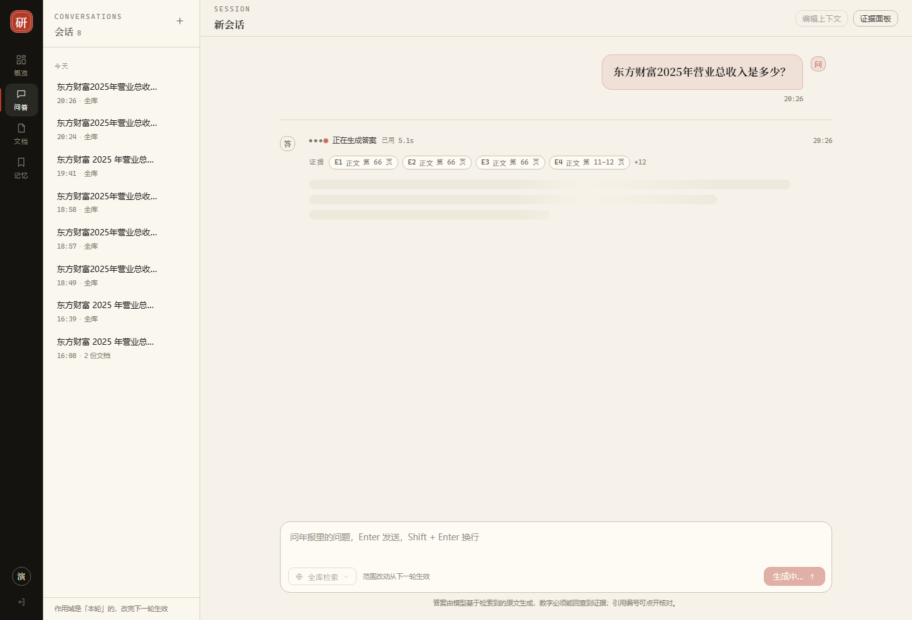
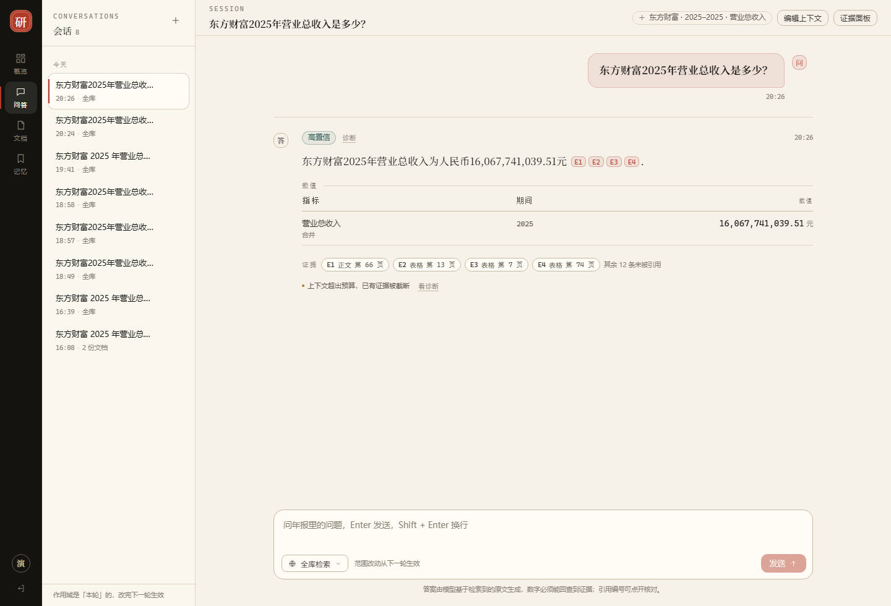

# 阶段 13 · 首屏时延报告（状态行 + 证据先行）

> 执行日期：2026-10-28　｜　计划：`docs/superpowers/plans/ST13-2026-10-28-13-first-paint.md`　｜　契约：`docs/关键契约.md` C16
> 为什么做这一步：阶段 12 结尾那句实话 —— 「首字 7.87 秒」意味着用户前面近 8 秒看不到任何变化。
> 数字口径：Java e2e = `ChatStreamE2ETest`（真模型、真库、真过滤器，热路径第二轮）；真浏览器 = headless Chrome 1440×980 + 前端探针（25 ms 采样）；trace 数字来自 `logs/chat-trace.jsonl`。全部为 2026-10-28 当天。

## 怎么读这份报告（先看这 8 个词）

| 词 | 一句话解释（完整版见 docs/术语表.md） |
| --- | --- |
| stage 事件 | 后端「正在做什么」的一行提示（理解 / 检索 / 精排 / 生成），只带计数、不带内容。 |
| 首屏时延（firstStageMs） | 点发送到屏幕出现**第一个变化**的时间。它不是总耗时，是「系统有没有反应」。 |
| 证据先行 | 证据集合在模型开口前就确定了，所以可以先显示证据、再等答案。 |
| meta | 检索与装配完成时推的事件，里面带候选证据全集。它是「预览」，不是最终引用。 |
| final | 流结束时推的完整响应。**唯一真相**：引用、置信度、警告、诊断都以它为准。 |
| 骨架屏 | 答案区的灰色占位条，避免「什么都没有」的空白期；首字到达时替换成正文。 |
| quMs | Query Understanding（把问题解析成公司/年份/指标）这一段的耗时，实测占首屏等待的一半。 |
| 假进度条 | 按计时器自己往前走的进度条。本项目**不做** —— 演示时被追问「现在到哪一步」会崩。 |

## 1. 一句话结论

同样的 12 秒总耗时，用户从「近 8 秒全白」变成「0.06 秒就看到系统在做什么」：

| 时刻 | 用户看到 | 实测（真浏览器，热路径） |
| --- | --- | --- |
| 0.06 s | 「正在理解问题 · 已用 0.0s」 | `firstStageMs = 59 ms` |
| 3.5 s | 「正在检索证据」 | 3,526 ms |
| 4.3 s | 「正在精排证据」 | 4,277 ms |
| 4.9 s | **证据条出现**（E1 表格 · 第 66 页 …），答案区仍是骨架 | 4,904 ms |
| 5.5 s | 首字出现并逐字生长 | 5,555 ms |
| 12.5 s | 状态行消失、证据条按 `citations` 重绘 | 12,459 ms |

全程**没有一个假进度**：每个阶段都是后端真实进入那一段时发的，秒数是前端本地真计时。

## 2. 为什么做这一步

### 2.1 原文里那句实话

阶段 12 的报告写「首字 **7.87 秒**」。把它拆开看（2026-10-28 18:49~19:39 的 6 条真请求）：

| 时刻 | Dense | Sparse | 融合 | 精排 | 装配 | 生成 | 总 |
| --- | --- | --- | --- | --- | --- | --- | --- |
| 18:49:27 | 697 | 61 | 1 | 486 | 94 | 7280 | 8519 |
| 18:57:23 | 536 | 31 | 3 | 479 | 35 | 7116 | 8165 |
| 18:58:14 | 463 | 16 | 0 | 432 | 761 | 6623 | 8295 |
| 19:00:31 | 698 | 37 | 2 | 524 | 33 | 7167 | 8160 |
| 19:03:09 | 932 | 27 | 3 | 484 | 140 | 7730 | 9176 |
| 19:39:39（追问） | 1175 | 182 | 26 | 1219 | 66 | 3813 | 6481 |

首字 7,870 ms 的构成：**QU 约 2,900 ms** + 召回 500~1,360 + 融合 0~26 + 精排 430~1,220 + 装配 33~761 + 模型首 token 约 3,300（推算）。
结论：**系统自己算了约 4.5 秒，模型首 token 约 3.3 秒** —— 这 4.5 秒全是「有进展但没有告诉用户」。

### 2.2 做法与「为什么不是别的做法」

| 需求 | 选的做法 | 没选的做法与原因 |
| --- | --- | --- |
| 让等待可见 | 后端发 `stage` 事件（真实进展） | ① 定时器补发/假进度条：被追问「现在到哪一步」就崩；② 只在前端做「加载中」动画：动画与真实进展无关，看不出卡在哪 |
| 让等待有内容 | `meta` 到达即渲染证据条 | 另开一个「证据预览」端点：同一份数据要发两遍，还多一次鉴权与超时 |
| 缩短等待 | **不做**（本期只改感知） | 压模型（换小模型/砍输出）：答案质量下降，与「数字必须有据」冲突；砍 QU：实测 QU 在此语料零增益但也不能删（多轮追问依赖它补槽位）。优化真实耗时留到后续单独评估 |
| 阶段粒度 | 4 个（理解/检索/精排/生成） | 更细（拆 dense/sparse）：用户不关心两路召回谁先完成，事件越多前端越容易抖 |

## 3. 交付物

### 3.1 后端

| 文件 | 作用 |
| --- | --- |
| `src/main/java/com/finagent/retrieval/RetrievalProgress.java`（新增） | `@FunctionalInterface`：`void onPhase(String phase, int count)`；常量 `NONE` 保证既有调用点零改动 |
| `src/main/java/com/finagent/retrieval/HybridRetriever.java` | 新增 4 参重载 `retrieve(req, qu, scope, progress)`；在 dense / sparse / fuse / rerank 四处埋点 |
| `src/main/java/com/finagent/chat/ChatStreamEvent.java` | 新增 `STAGE` 常量、四个 `PHASE_*` 常量、`stage(phase, label, detail)` 工厂 |
| `src/main/java/com/finagent/chat/ChatService.java` | `askStreaming` 第一行发 `understanding`；`prepare(request, sink)` 发 `retrieving`；`meta` 之后发 `generating`；新增 `quMs` 计时 |
| `src/main/java/com/finagent/chat/ChatTrace.java` | 新增第 11 个字段 `long quMs`（保留 10 参/11 参兼容构造器），`totalMs()` 含它 |

### 3.2 前端（独立仓库 `D:/Project/myproject/financial-ai-web`）

| 文件 | 作用 |
| --- | --- |
| `src/components/StageLine.vue`（新增） | 四个点 + 后端文案 + `已用 x.xs`；200 ms 本地计时，卸载时 `clearInterval` |
| `src/components/EvidenceStrip.vue`（新增） | 单行证据条，超出 4 条折叠 `+N`；生成中不可点，`final` 后可点 |
| `src/api/chat.ts` | 新增 `StreamStage` 类型与 `onStage` 回调；`handleFrame` 增加 `stage` 分支 |
| `src/types/ui.ts` | `ChatMessage` 增加 `stage` / `evidencePreview` / `timings` |
| `src/views/ChatView.vue` | 接 `onStage` / `onMeta`；发消息时预置 `understanding`；记 `firstStageMs / metaMs / firstTokenMs / totalMs`；滚动改为「只在底部 40 px 内才跟随」 |
| `src/components/MessageBubble.vue` | 删掉写死的「正在检索并生成」，改用 `StageLine` + `EvidenceStrip`（两处：生成中的预览条、`final` 后的引用条） |
| `src/utils/__tests__/sse.spec.ts` | 新增「未知事件照常解析但不影响后续帧」：守协议向前兼容 |

## 4. 契约 C16 摘要

四个阶段与发出位置：

| phase | 在哪发 | label | detail |
| --- | --- | --- | --- |
| `understanding` | `askStreaming` 第一行 | 正在理解问题 | `{}` |
| `retrieving` | 作用域解析完、检索前 | 正在检索证据 | `{documents:N}` |
| `reranking` | `HybridRetriever` 融合后、调精排前（无候选不发） | 正在精排证据 | `{candidates:N}` |
| `generating` | `meta` 之后、调模型前 | 正在生成答案 | `{evidence:N, contextTokens:N}` |

五条硬规则（完整版见 C16 §16.1）：① 只说「正在做什么」，不带答案/证据正文/页码/chunk id；② 必须真实进入该段才发，禁止定时补发与前端伪造；③ 发过 stage 就必须有终止事件；④ stage 可丢，`meta`/`final` 不能丢；⑤ 旧前端遇未知事件忽略不崩。

证据先行（C16 §16.2）：`meta.evidence` 是**候选全集**（送进模型的 16 个证据块），`final.citations` 是**模型真用到的**（本次 4 条）；证据条只展示前 4 条、其余折叠成「+12」；`final` 后必须按 `citations` 重绘，并说明「其余 N 条未被引用」。

## 5. 实测

### 5.1 首屏时间线（两个口径）

| 指标 | 阶段 12 | Java e2e 第 1 次 | Java e2e 第 2 次 | 真浏览器（headless） | 门槛 |
| --- | --- | --- | --- | --- | --- |
| `firstStageMs` | 无此事件（7,870 ms 才有第一个字） | **19 ms** | **16 ms** | **59 ms** | ≤ 300 ms |
| `metaMs`（证据可见） | 无（只有骨架） | **4,563 ms** | **4,288 ms** | **4,904 ms** | ≤ 5,000 ms |
| `firstTokenMs`（首字） | 7,870 ms | **5,275 ms** | **6,250 ms** | **5,555 ms** | ≤ 8,000 ms |
| `totalMs` | 10,994 ms | 11,377 ms | 12,862 ms | 12,459 ms | 观察值 |

两次 Java e2e（真模型抖动让 `metaMs` / `firstTokenMs` 有 ±1 秒波动；`firstStageMs` 稳定在 16~19 ms）：

```
STREAM-E2E|firstStageMs=19|metaMs=4563|firstDeltaMs=5275|totalMs=11377|stages=4|phases=[understanding, retrieving, reranking, generating]|deltas=56|citations=4
STREAM-E2E|firstStageMs=16|metaMs=4288|firstDeltaMs=6250|totalMs=12862|stages=4|phases=[understanding, retrieving, reranking, generating]|deltas=56|citations=4
```

冷启动（同一进程内的第一轮）：`STREAM-COLD|firstStageMs=1209~2261|metaMs=13374~14260|firstDeltaMs=15784~16111`。


真浏览器探针打印（25 ms 采样，只记录状态变化）：

```
STAGE-LABELS|正在理解问题 > 正在检索证据 > 正在精排证据 > 正在生成答案
STAGE-TIMING|firstStageMs=59|firstEvidenceMs=4904|firstTokenMs=5555|finalMs=12459|skeletonSamples=4
```

四个阶段的时间点与 `logs/chat-trace.jsonl` 的分项耗时严格对得上（trace `74dec795`：`quMs=3385`、`denseMs=484`、`sparseMs=21`、`fuseMs=2`、`rerankMs=552`、`contextMs=45`、`answerMs=6945`）：

- 理解结束 3,385 ms → 前端「检索」出现在 3,526 ms；
- 检索+精排 1,059 ms → 「精排」出现在 4,277 ms、证据条 4,904 ms（差值是上下文装配 45 ms + 序列化/网络）；
- 生成首 token 约 1,050 ms → 首字 5,555 ms。

### 5.2 三个路径都验过

| 路径 | 事件序列 | 谁守的 |
| --- | --- | --- |
| 正常 | stage×3 → meta → stage → delta×56 → final | `ChatServiceStageTest.fullStageOrder` + `ChatStreamE2ETest` |
| 拒答（作用域外公司） | stage(understanding) → final（**没有** generating） | `ChatServiceTest` 两个流式用例 |
| 无候选 | 不发 `reranking`，`meta` 照发 | `ChatServiceStageTest.noCandidatesMeansNoRerankStage` + `RetrievalProgressTest.noRerankPhaseWhenNoCandidates` |

### 5.3 截图



上图是 `meta` 刚到达的一刻：状态行写着「正在生成答案 · 已用 5.1s」，证据条已经有 4 个 chip（E1..E4 · 第 66 页 …）与折叠标记「+12」，而答案区还是三行骨架 —— 这就是「证据先到、答案后到」。



### 5.4 测试统计

| 范围 | 结果 |
| --- | --- |
| 后端全量非 e2e | **568 通过 / 0 失败 / 1 跳过**（跳过的是需要解析服务的 `DoclingParserAdapterTest`）；阶段 12 末 560，+8 = `ChatServiceStageTest` 4 + `RetrievalProgressTest` 4 |
| 后端流式 e2e | `ChatStreamE2ETest` 1 通过，56.22 秒（含预热轮） |
| 前端单测 | `npx vitest run` **17 通过**（新增 1 条未知事件用例） |
| 前端构建 | `npm run build` 通过（含 `vue-tsc` 类型检查），27 个产物文件 |

## 6. 踩到的坑

### 6.1 delta 拼起来不等于 final（引用编号会重排）

**现象**：e2e 断言「`delta` 拼接 === `final.answer`」失败，报 `expected ... [E1][E2][E3][E4] but was [E2][E7][E11][E13]`。
**原因**：`delta` 里是**提示词编号**（模型看到的 E1..E20），`final` 的正文被 `AnswerService.renumberCitations` 重排成连续 1..n（阶段 12 为修「角标点不开」而加）。
**修法**：测试比对「去掉 `[E\d+]` 后、压缩空白」的正文，另加一条断言 `final` 里的编号恰为 `1..citations.size()`。
**教训**：流式场景里「同一份数据」不等于「同一段文本」——凡是中间做过重写的字段，都要明确哪一侧是真相。

### 6.2 冷启动把首屏门槛冲掉了

**现象**：改完测试第一轮报 `[首屏反馈过慢]`（`firstStageMs > 500`）。
**原因**：JVM 刚起，第一次 SSE 请求要初始化 Tomcat 异步响应、`SseEmitter` 的消息转换器、Hikari 连接池 —— 实测 `firstStageMs = 1,209 ms`、`metaMs = 13,374 ms`（热路径是 19 / 4,563）。
**修法**：测试先跑一轮「预热 + 只断言 ≤ 3,000 ms」，第二轮才按 300 ms 断言；真浏览器验证也同样先跑一轮。
**教训**：任何「首屏 ≤ X ms」的门槛都必须声明是冷启动还是热路径，否则测试会在 CI 上随机红。

### 6.3 `Map<?, ?>.keySet()` 不能直接丢给 AssertJ

**现象**：`assertThat(stage.data().keySet()).containsExactlyInAnyOrder(...)` 编译失败。
**原因**：`keySet()` 的通配符捕获类型无法与 `AssertJ` 的泛型参数统一。
**修法**：先 `@SuppressWarnings("unchecked") Set<String> keys = (Set<String>) ...keySet()` 再用。同理 `detail()` 返回 `Map<?,?>` 时 `containsEntry("documents", 1)` 也会编译失败，需先转 `Map<String,Object>`。

### 6.4 检索多了一个参数，5 条既有断言静默失配

**现象**：`ChatServiceTest` 5 条红，报「实际调用次数 0」。
**原因**：`retriever.retrieve(...)` 从 3 参变 4 参，`verify(retriever).retrieve(a, b, c)` 匹配不到任何调用 —— 不是抛异常，是「没匹配」。
**修法**：6 处 `verify` 补第 4 参；`setUp` 的桩也改 4 参（`any(RetrievalProgress.class)`）。
**教训**：重载/加参时，`verify` 用的是「精确参数匹配」，它不会因为方法重载而报编译错 —— 只能靠跑测试发现。

### 6.5 探针的 t0 必须打在「点击那一刻」

**现象**：headless 脚本第一版量出的 `firstStageMs` 恒为 0（因为 `t0` 在页面加载时就算好了）。
**修法**：把「安装采样器」与「记录 `t0` + 点击发送」写在同一个 `Runtime.evaluate` 里，保证 `t0` 与 `click()` 之间没有网络往返。
**教训**：前端时延测量里，探针自身的开销必须 < 目标值的一个数量级（这里 25 ms vs 目标 300 ms）。

### 6.6 状态行在第一个 stage 到达前是空的

**现象**：第一版用户点发送后，有约 130 ms 状态行显示「正在处理」（前端兜底文案），然后才变成「正在理解问题」。
**修法**：发消息时就把阶段预置成 `understanding` —— 它永远是第一段，所以这不算「编阶段」；旧后端（根本不发 stage）会停在这一句，正是 ST13 §11 记录的兼容行为。

## 7. 已知限制

1. **只改感知，不改真实耗时**：总耗时仍是 11~12 秒，QU 的 3.4 秒一秒没省。决策 D8 明确本期用「不回归」当门槛。
2. **冷启动首屏 1.2 秒**：进程刚起时首包慢一个数量级，没有做「预热请求」。
3. **`meta` 与 `citations` 条数不一致**：现在用「其余 N 条未被引用」说明，但没有做「为什么这 N 条没被用」的解释。
4. **阶段不可回退**：`HybridRetriever` 内部若发生「精排失败回落 RRF」，前端仍显示「正在精排」直到 `meta` 到达 —— 事件里没有「降级」这个信号。
5. **没有 SSE 断线重连**：`fetch` 读流一旦断开就走回落（重新问一次），不支持从断点续传（会重复计费）。
6. **秒数依赖本机时钟**：`Date.now()` 跳变（系统改时间）会让秒数异常，没有做单调时钟兜底。
7. **`quMs` 只进 trace**：没有进 `/api/stats` 概览，也没有历史曲线。

## 8. 验收对照（ST13 §8 的 8 条）

| # | 门槛 | 结果 |
| --- | --- | --- |
| 1 | 第一个 stage ≤ 300 ms | ✅ 16~19 ms（e2e 两次）/ 59 ms（真浏览器） |
| 2 | 证据可见 ≤ 5 s（不回归） | ✅ 4,288~4,563（e2e）/ 4,904 ms（真浏览器） |
| 3 | 首字 ≤ 8 s（不回归） | ✅ 5,275~6,250（e2e）/ 5,555 ms（真浏览器） |
| 4 | 事件顺序正确（含拒答路径） | ✅ `ChatServiceStageTest` 4 条 + `ChatServiceTest` 两条流式用例 |
| 5 | stage 不含答案/证据正文 | ✅ `stagePayloadCarriesCountsOnly` 断言 data 的 key 集合且不含数字答案 |
| 6 | 旧前端遇未知事件不崩 | ✅ `sse.spec.ts` 新增用例 |
| 7 | 后端全量不回归（基线 560） | ✅ **568 通过 / 0 失败 / 1 跳过** |
| 8 | 前端单测/构建全绿 | ✅ vitest 17 通过、`npm run build`（含 `vue-tsc`）通过 |

## 9. 下一步

1. **真实耗时优化单独评估**：QU 3.4 秒是最大一块（可选：规则先行的更多覆盖、QU 结果按问题指纹缓存、把 QU 与检索并行）。任何一项都要先有「不回归 + 质量不掉」的评估，不能顺手改。
2. **阶段 11（Agent 工作流）**：`stage` 事件协议正好是 Agent 多步执行的可视化基础（每个 Node 一步），届时把 `phase` 扩展成「节点 id」即可，不需要改前端渲染逻辑。
3. **`meta` 降级信号**：精排失败回落时补一个 `stage` 的 `degraded: true`，让界面能说「精排不可用，已用融合排序」。
4. **`/api/stats` 加首屏分位数**：把 `quMs` / `firstStageMs` 聚合进概览页，演示时能直接给出 P50/P90。
